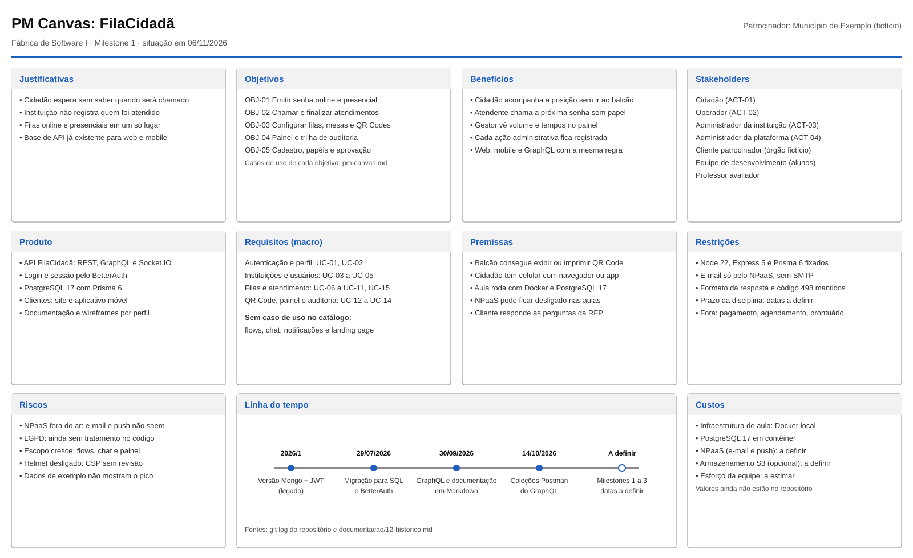

# PM Canvas do FilaCidadã

Fábrica de Software I · Milestone 1 · situação em 06/11/2026

O PM Canvas resume o projeto em uma página. A versão em grade está em [pm-canvas.svg](pm-canvas.svg). Este texto traz o que está em cada bloco, com as referências a casos de uso e a fonte de cada fato.

## Justificativas

Por que fazer:

- Quem espera numa fila física não sabe quando será chamado, e tende a ficar no balcão.
- A instituição não registra quem foi atendido, por quem e em quanto tempo.
- Filas online e presenciais são operadas separadamente. O sistema precisa atender os dois modos na mesma fila.
- A API já existe em parte (REST, GraphQL, Socket.IO) e serve de base para web e mobile.

## Objetivos

| Código | Objetivo | Casos de uso |
|---|---|---|
| OBJ-01 | Emitir senha online e presencial | UC-08, UC-09 |
| OBJ-02 | Chamar, rechamar, assumir e finalizar atendimentos | UC-10, UC-11 |
| OBJ-03 | Configurar filas, mesas, tipos de etapa e QR Codes | UC-06, UC-07, UC-12 |
| OBJ-04 | Acompanhar o atendimento e consultar painel e auditoria | UC-13, UC-14, UC-15 |
| OBJ-05 | Controlar acesso: cadastro, papéis e aprovação de instituições | UC-01 a UC-05 |

As metas numéricas (tempo de espera, volume por dia, prazo de resposta) ainda não foram definidas. Estão na lista de perguntas da [RFP](rfp.md).

## Benefícios

- O cidadão acompanha a própria posição sem ficar no balcão.
- O atendente chama a próxima senha pelo sistema, sem controle em papel.
- O administrador da instituição vê volume e tempos no painel.
- Cada ação administrativa fica registrada na auditoria.
- Web, mobile e GraphQL usam a mesma regra de negócio, porque os resolvers chamam os mesmos services.

## Produto

- API FilaCidadã: REST (`/api`), GraphQL (`POST /graphql`) e Socket.IO no mesmo servidor HTTP.
- Autenticação por sessão do BetterAuth, com papéis lidos do banco.
- Banco relacional PostgreSQL 17 com Prisma 6.
- Clientes consumidores: site e aplicativo móvel.
- Documentação em Markdown, wireframes por perfil e modelagem em UML.

## Requisitos (macro)

O detalhamento (RF e RNF, histórias e critérios) fica em [03-requisitos](../03-requisitos/README.md). Aqui, a cobertura por caso de uso:

- Autenticação e perfil: UC-01, UC-02.
- Instituições e usuários: UC-03 a UC-05.
- Filas e atendimento: UC-06 a UC-11, UC-15.
- QR Code, painel e auditoria: UC-12 a UC-14.

Sem caso de uso no catálogo fixo: flows (encaminhamento de senha entre filas, `/flows`, `/senhas/:id/flow/*`), chat (`/senhas/:id/chat`), notificações (`/notificacoes`) e landing page (`GET /landing-page`). Ver [Divergências](README.md#divergências).

## Stakeholders

| Quem | Papel no projeto |
|---|---|
| Cidadão (ACT-01, papel `USUARIO_FINAL`) | Retira, acompanha e cancela as próprias senhas |
| Operador (ACT-02, papel `OPERADOR`) | Atende, chama e finaliza senhas da própria instituição |
| Administrador da instituição (ACT-03, `ADMIN_INSTITUICAO`) | Configura filas, mesas, usuários e QR Codes da instituição; também atende |
| Administrador da plataforma (ACT-04, `ADMIN_PLATAFORMA`) | Aprova instituições e gerencia usuários de todas elas |
| Cliente patrocinador | Órgão fictício da [RFP](rfp.md) que encomenda o sistema |
| Equipe de desenvolvimento | Grupo de alunos que produz os artefatos e o código |
| Professor avaliador | Valida os artefatos pelas milestones |
| Times de web e mobile | Consomem a API e precisam de contrato estável |

## Riscos

| Risco | Resposta prevista |
|---|---|
| O NPaaS (e-mail e push) fica indisponível. Pelo código, o e-mail não sai sem ele, porque não há fallback SMTP | Notificação persistida continua disponível na API; o aviso por e-mail fica em log. Aceitar e documentar |
| LGPD: não há tratamento de dados pessoais no código nem na documentação | Incluir o tema nos requisitos não funcionais e na RFP. Pergunta em aberto |
| O escopo cresce com flows, chat e painel, que não têm caso de uso no catálogo | Fixar o que entra na milestone. Registrar o que sai no backlog |
| Helmet está comentado em `app.js` (CSP padrão bloqueava o Swagger UI). A introspecção do GraphQL está ligada | Tratar antes de uso real. Não é pendência da milestone 1, mas precisa constar nas restrições |
| Dados de exemplo (seeds) não representam um dia de pico | Criar um cenário de carga com volume próximo do real, se a milestone pedir |

## Premissas

- Cada balcão consegue exibir ou imprimir o QR Code da fila presencial.
- O cidadão tem celular com navegador ou com o aplicativo.
- A aula roda com Docker e PostgreSQL 17 (`docker-compose.yml`).
- O NPaaS pode ficar desligado nas aulas (`NPAAS_HABILITADO=false`). O sistema não quebra sem ele.
- O cliente responde as perguntas da RFP até o início da modelagem.

## Restrições

- Versões fixadas: Node 22 (`.nvmrc`), Express 5, Prisma 6, BetterAuth.
- E-mail transacional só pelo NPaaS, sem SMTP (decisão registrada em `documentacao/12-historico.md`).
- Clientes existentes continuam funcionando: o formato `{ message, data, errors }` e o código 498 para sessão inválida são mantidos.
- Prazo: a disciplina define as datas das milestones.
- Fora do escopo: pagamento, agendamento com data futura e prontuário ou cadastro de cidadão de outros órgãos.

## Linha do tempo

| Quando | O quê | Fonte |
|---|---|---|
| 2026/1 | Versão original em MongoDB com JWT duplo (legado, em `_legado-mongo/`) | `documentacao/12-historico.md` |
| 29/07/2026 | API migrada para SGBD relacional com Prisma e BetterAuth | `git log` |
| 30/09/2026 | GraphQL (Apollo Server 5) ao lado do REST; documentação convertida para Markdown | `git log` |
| 14/10/2026 | Coleções Postman das requisições GraphQL | `git log` |
| A definir | Milestones 1 a 3 | Calendário da disciplina |

## Custos

O repositório não traz valores. Os itens abaixo são o que precisa de preço ou de estimativa:

- Infraestrutura de aula: Docker na máquina do aluno, sem custo extra.
- PostgreSQL 17 em contêiner: sem custo de licença.
- NPaaS (e-mail e push): a definir, depende do contrato do serviço.
- Armazenamento S3 compatível (Garage), opcional: a definir. Sem configuração, os uploads caem no disco local.
- Esforço da equipe: a estimar na fase de planejamento, em horas por milestone.

## Veja também

- [Visão do produto](README.md)
- [RFP fictícia do cliente](rfp.md)
- [Glossário](glossario.md)
- [Processo](../02-processo/README.md)
- [Requisitos funcionais](../03-requisitos/requisitos-funcionais.md)
- [Casos de uso](../05-modelagem/casos-de-uso/casos-de-uso.svg)
