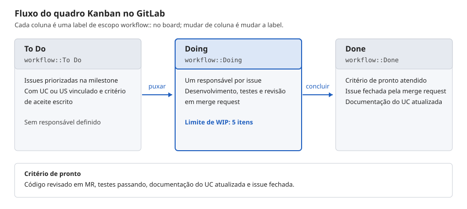

# Processo de desenvolvimento: Kanban no FilaCidadã

Contexto: unidade de processo de software · milestones 2 e 3 · quadro de issues no GitLab.

## Por que Kanban

- O trabalho chega em fluxo contínuo: ajustes de UC, correções, documentação e testes entram à medida que aparecem. Não há um volume fixo de itens por ciclo, como um sprint exigiria.
- A equipe tem 4 pessoas e uma dependência clara entre backend e frontend. O que mais atrapalha é trabalho começado e não terminado; limitar o WIP e medir o fluxo ataca isso diretamente.
- O GitLab já concentra issues, merge requests e milestones. O quadro usa labels de escopo, sem ferramenta extra.
- As métricas (lead time, cycle time, vazão) saem do próprio export do GitLab. Ver [metricas/README.md](metricas/README.md).

## Colunas

| Coluna | Label no GitLab | Entrada | Saída |
|---|---|---|---|
| To Do | `workflow::To Do` | Issue na milestone, com UC ou US vinculado e critério de aceite escrito | Responsável assumido |
| Doing | `workflow::Doing` | Responsável definido e vaga dentro do limite de WIP | Merge request aprovada e mesclada |
| Done | `workflow::Done` | Critério de pronto atendido | Issue fechada pela merge request |

Não há coluna de revisão própria. A revisão acontece dentro de Doing, na merge request. Uma coluna Review fica como melhoria futura, caso a fila de revisão passe a aparecer nas métricas.

## Políticas

1. **Uma issue, um responsável.** Quem puxa a issue é quem a conclui.
2. **Puxar, não empurrar.** Uma issue sai de To Do somente quando Doing está abaixo do limite de WIP.
3. **Terminar antes de começar.** Issue já em Doing tem prioridade sobre qualquer issue nova.
4. **Critério de pronto.** A issue só vai para Done com código revisado por outro membro em merge request, testes passando (primeiro o teste específico, depois o módulo), documentação do UC ou US atualizada e issue fechada pela merge request.
5. **Escopo registrado.** Mudar UC, US ou critério de aceite de uma issue em Doing exige comentário na issue com o motivo.
6. **Bloqueio explícito.** Issue bloqueada por outra recebe comentário com a dependência. Ela continua em Doing e ocupa o WIP, para que o bloqueio fique visível.
7. **Métrica não é avaliação individual.** Lead time e vazão servem para ajustar o processo. Não são usados para cobrar pessoas.

## WIP

- **Limite: 5 issues em Doing** para a equipe. Uma por pessoa e uma de folga para atender urgências.
- **Por que 5.** Com WIP acima do limite, o tempo de ciclo cresce sem aumento de vazão (ver a Lei de Little em [metricas/README.md](metricas/README.md)). Com WIP muito baixo, a equipe fica ociosa esperando dependência.
- **Medição.** O limite foi ultrapassado em 5 dias da janela analisada, com pico de 7 itens em 29/10. Os dias e a leitura estão em [metricas/README.md](metricas/README.md).

## Contraponto

Kanban não resolve tudo, e para esta disciplina ele tem custos que precisam ser vigiados:

- **Sem cadência.** Não há sprint, planejamento nem retrospectiva obrigatórios, como Scrum oferece. Mitigação: revisão ao fim de cada milestone, registrada em [08-qualidade/monitorias.md](../08-qualidade/monitorias.md).
- **Sem estimativa.** Kanban não exige estimar, então prever datas fica mais difícil. Mitigação: usar o lead time histórico (mediana e média) como base de previsão.
- **Prioridade implícita.** Sem sprint, a fila pode virar lista sem ordem. Mitigação: a ordem das issues em To Do é definida no planejamento da milestone.
- **Prazo de entrega.** A milestone exige escopo e data fixos, enquanto o fluxo é contínuo. Mitigação: a milestone funciona como marco de escopo; o fluxo acontece dentro dela.

## Riscos e mitigação

| Risco | Sinal no quadro | Mitigação |
|---|---|---|
| Dependência backend para frontend atrasa o frontend | Espera de issues de frontend maior que a de backend | Publicar o contrato da API (rotas e exemplos) antes de iniciar o frontend; puxar backend primeiro |
| WIP acima do limite espalha trabalho sem fechar nada | Mais de 5 issues em Doing | Não puxar com o limite cheio; priorizar o que está em Doing |
| Responsável ausente ou sobrecarregado trava uma issue | Issue sem atualização por vários dias | Comentário diário de status na issue; revisão cruzada na merge request |
| Escopo muda sem registro | UC alterado sem comentário na issue | Política 5 e revisão do UC na merge request |
| Issue fechada sem teste ou sem documentação | Done sem merge request | Critério de pronto conferido na merge request antes do fechamento |

## Veja também

- [Métricas do quadro Kanban](metricas/README.md)
- [Glossário](../01-visao/glossario.md)
- [Backlog](../03-requisitos/backlog.md)
- [Milestone 2](../09-entregas/milestone-2.md) e [Milestone 3](../09-entregas/milestone-3.md)
- [Monitorias](../08-qualidade/monitorias.md)
