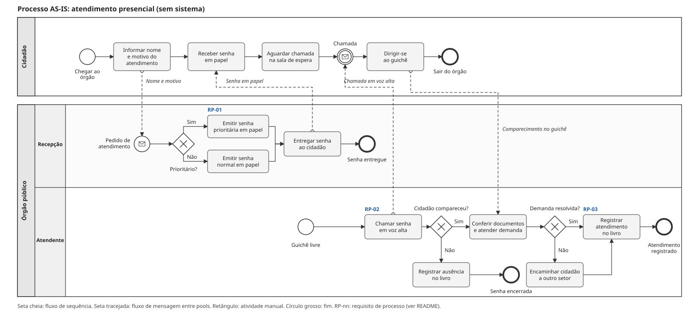

# Processo AS-IS: atendimento presencial

Milestone 1 · Unidade de processo (Fábrica de Software I)

Descreve como o atendimento presencial de um órgão público funciona hoje, antes de qualquer sistema, do ponto de vista do cidadão e das raias Recepção e Atendente. O diagrama não propõe solução.

Arquivo editável em BPMN 2.0 com coordenadas de diagrama: [processo-as-is.bpmn](processo-as-is.bpmn).

## Legenda

| Elemento | Representação | Significado |
|---|---|---|
| Pool | Retângulo com rótulo lateral | Participante: Cidadão ou Órgão público |
| Raia | Faixa dentro da pool do órgão | Papel dentro do órgão: Recepção ou Atendente |
| Evento de início | Círculo fino | Onde o fluxo começa |
| Evento de início de mensagem | Círculo fino com envelope | Início disparado por mensagem (pedido de atendimento) |
| Evento intermediário de mensagem | Círculo duplo com envelope | Espera por uma mensagem (senha chamada) |
| Evento de fim | Círculo grosso | Onde o fluxo termina |
| Atividade manual | Retângulo arredondado | Trabalho feito por pessoa, sem ferramenta de apoio |
| Gateway exclusivo | Losango com X | Decisão: apenas um caminho é seguido |
| Fluxo de sequência | Seta cheia | Ordem de execução dentro de uma pool |
| Fluxo de mensagem | Seta tracejada | Troca de mensagem entre pools (cidadão e órgão) |
| RP-nn | Rótulo azul | Requisito de processo verificável, descrito abaixo |

## Atividades: classificação

No estado atual não existe sistema. Todas as atividades são executadas por pessoas, com apoio apenas de papel e de livro de registro.

| Atividade (raia) | Classificação | Entrada | Saída |
|---|---|---|---|
| Informar nome e motivo do atendimento (Cidadão) | Manual | Cidadão no órgão | Nome e motivo informados verbalmente |
| Emitir senha prioritária ou normal em papel (Recepção) | Manual, candidata a automação | Nome, motivo e prioridade verificada a olho | Senha numerada em papel |
| Entregar senha ao cidadão (Recepção) | Manual | Senha em papel | Senha em mãos do cidadão |
| Aguardar chamada na sala de espera (Cidadão) | Manual | Senha em mãos | Cidadão aguardando, sem informação de posição |
| Chamar senha em voz alta (Atendente) | Manual, candidata a automação | Próxima senha pela ordem informal | Chamada audível na sala |
| Dirigir-se ao guichê (Cidadão) | Manual | Chamada ouvida | Cidadão no guichê |
| Conferir documentos e atender demanda (Atendente) | Manual | Cidadão no guichê e documentos | Demanda atendida ou não resolvida |
| Encaminhar cidadão a outro setor (Atendente) | Manual | Demanda não resolvida | Cidadão orientado verbalmente |
| Registrar atendimento no livro (Atendente) | Manual, candidata a automação | Resultado do atendimento | Linha no livro de registro |
| Registrar ausência no livro (Atendente) | Manual, candidata a automação | Senha sem comparecimento | Linha no livro de registro |

Resumo: 10 atividades manuais; 0 apoiadas por sistema; 4 candidatas a automação (emitir senha, chamar senha, registrar atendimento e registrar ausência), por terem entrada e saída estruturadas e se repetirem em todo atendimento.

## Requisitos de processo verificáveis

Os IDs RP-nn são requisitos do processo atual e não se confundem com RF-0xx. Cada um cita o caso de uso (UC) do catálogo a que se refere.

- **RP-01 (UC-09, emitir senha presencial).** Toda senha presencial é entregue em papel ao cidadão antes de ele aguardar a chamada. Trecho: mensagem "Senha em papel" de "Entregar senha ao cidadão" para "Receber senha em papel", seguida de "Aguardar chamada". Verificação: em todos os caminhos da recepção há uma saída pela tarefa "Entregar senha ao cidadão".
- **RP-02 (UC-10, chamar senha).** Toda chamada é seguida de verificação de presença, e a ausência é registrada. Trecho: "Chamar senha em voz alta" leva ao gateway "Cidadão compareceu?"; o ramo "Não" vai a "Registrar ausência no livro". Verificação: nenhuma saída de "Chamar senha em voz alta" ignora o gateway.
- **RP-03 (UC-11, finalizar atendimento).** Todo atendimento iniciado termina com registro no livro. Trecho: de "Conferir documentos e atender demanda" pelo gateway "Demanda resolvida?", o caminho passa por "Registrar atendimento no livro", direta ou após "Encaminhar cidadão a outro setor", até "Atendimento registrado". Verificação: todo caminho a partir de "Conferir documentos e atender demanda" chega a "Atendimento registrado".

## Dores do processo

1. **Ordem de chamada depende de papel e de olhar.** A prioridade é verificada a olho e a ordem fica no papel (gateway "Prioritário?"). Risco de senha extraviada ou de atendimento fora de ordem.
2. **Cidadão sem informação de espera.** Após "Receber senha em papel", o cidadão aguarda sem saber posição nem tempo previsto (tarefa "Aguardar chamada na sala de espera").
3. **Ausência sem regra formal.** O diagrama não define quantas chamadas são feitas antes de descartar a senha; a decisão "Cidadão compareceu?" não tem limite.
4. **Sem retorno ao cidadão.** Depois de "Dirigir-se ao guichê", o cidadão sai sem confirmação do registro (fim "Sair do órgão"); não há mensagem do órgão de volta.
5. **Indicadores manuais.** Os únicos registros são os dois livros ("Registrar atendimento no livro" e "Registrar ausência no livro"); tempo de espera e volume por período exigem contagem manual.

## Divergências

- A especificação legada (`documentacao/legado-html/Especificacao_Tecnica_API_FilaCidada.html`, seção de QR Code) diz que a criação de senha em fila PRESENCIAL ou HIBRIDO exige QR Code válido. No código, a validação só ocorre em `SenhaService.criar` (`src/services/SenhaService.js`, linha 152), a senha online. `criarPresencial`, usado pelo operador, não valida QR. Não afeta este AS-IS, que é anterior ao sistema, mas deve ser tratado pela frente de modelagem.

## Veja também

- [Processo: visão geral](../README.md)
- [Glossário](../../01-visao/glossario.md)
- [Requisitos funcionais](../../03-requisitos/requisitos-funcionais.md)
- [Modelagem de atividades](../../05-modelagem/atividades/README.md)
- [Milestone 1](../../09-entregas/milestone-1.md)
