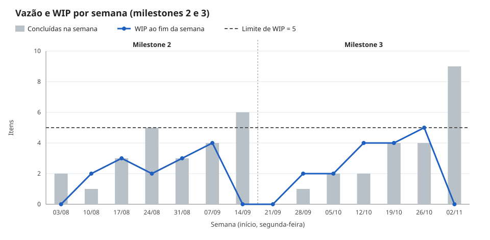

# Métricas do quadro Kanban

Contexto: unidade de processo de software · milestones 2 e 3 · dados de exemplo coerentes com UC-01 a UC-15.

## Fonte dos dados

- [export-gitlab-m2.csv](export-gitlab-m2.csv): 24 issues da milestone 2 (UC-01 a UC-08, com modelagem, backend, frontend, testes e documentação).
- [export-gitlab-m3.csv](export-gitlab-m3.csv): 22 issues da milestone 3 (UC-09 a UC-15, mais documentação e revisão de segurança).
- Colunas: `id`, `titulo`, `label` (tipo e UC, separados por `;`), `criado`, `iniciado`, `fechado`, `responsavel`.
- Os dados são fictícios. Os valores deste documento foram calculados a partir dos CSV por script, não estimados à mão.

## Definições

- **Lead time.** Dias de `criado` a `fechado`. Mede o tempo do pedido à entrega.
- **Cycle time.** Dias de `iniciado` a `fechado`. Mede o tempo de execução.
- **Espera.** Dias de `criado` a `iniciado`. Vale `lead time = espera + cycle time`.
- **Vazão (throughput).** Issues fechadas por semana.
- **WIP.** Issues iniciadas e ainda não fechadas em um instante. Aqui aparece em dois cortes: ao fim de cada semana (domingo) e pico diário.
- **Lei de Little.** `L = λ × W`: WIP médio é igual à vazão média multiplicada pelo tempo de ciclo médio.

## Resultados

| Métrica | Milestone 2 | Milestone 3 | Total |
|---|---|---|---|
| Issues fechadas | 24 | 22 | 46 |
| Lead time, média (mediana) | 13,5 dias (14) | 16,1 dias (16) | 14,8 dias (15) |
| Cycle time, média (mediana) | 5,0 dias (5) | 6,1 dias (6,5) | 5,5 dias (6) |
| Espera média antes de iniciar | 8,5 dias | 10,1 dias | 9,3 dias |
| Vazão média por semana | 3,4 | 3,1 | 3,3 |
| WIP médio diário | 2,6 | 3,3 | |
| Pico diário de WIP | 6 | 7 | 7 |

### WIP e vazão por semana

| Semana (início) | Marco | Iniciadas | Concluídas | WIP ao fim da semana |
|---|---|---|---|---|
| 03/08 | M2 | 2 | 2 | 0 |
| 10/08 | M2 | 3 | 1 | 2 |
| 17/08 | M2 | 4 | 3 | 3 |
| 24/08 | M2 | 4 | 5 | 2 |
| 31/08 | M2 | 4 | 3 | 3 |
| 07/09 | M2 | 5 | 4 | 4 |
| 14/09 | M2 | 2 | 6 | 0 |
| 21/09 | Entre marcos | 0 | 0 | 0 |
| 28/09 | M3 | 3 | 1 | 2 |
| 05/10 | M3 | 2 | 2 | 2 |
| 12/10 | M3 | 4 | 2 | 4 |
| 19/10 | M3 | 4 | 4 | 4 |
| 26/10 | M3 | 5 | 4 | 5 |
| 02/11 | M3 | 4 | 9 | 0 |

## Tempo por tipo de trabalho

Tipo é o primeiro item da coluna `label`. Valores somam as duas milestones.

| Tipo | Issues | Espera média | Cycle time médio | Lead time médio | Parcela da espera no lead time |
|---|---|---|---|---|---|
| Modelagem | 7 | 6,7 dias | 2,3 dias | 9,0 dias | 75% |
| Backend | 15 | 7,9 dias | 6,9 dias | 14,8 dias | 54% |
| Frontend | 15 | 13,2 dias | 6,0 dias | 19,2 dias | 69% |
| Teste | 7 | 7,4 dias | 5,1 dias | 12,6 dias | 59% |
| Documentação | 2 | 5,5 dias | 3,5 dias | 9,0 dias | 61% |

## Leitura dos números

**Vazão estável, com pico no fim.** A equipe fechou entre 1 e 6 issues por semana até a milestone 2 e de 1 a 4 na milestone 3, exceto na última semana, com 9 fechamentos. Esse pico indica que itens ficaram parados e foram fechados em lote perto do prazo. É um sinal secundário de gargalo na entrega.

**Gargalo: entrada do frontend.** Issues de frontend esperam 13,2 dias antes de iniciar, enquanto o tempo de execução é de 6,0 dias. Em torno de 69% do lead time do frontend é espera. No backend, a espera é de 7,9 dias e o ciclo, de 6,9. O frontend espera o contrato da API, então o gargalo está em começar o trabalho, não em executá-lo. A mitigação está na tabela de riscos de [README.md](../README.md): publicar o contrato da API antes de iniciar o frontend.

**WIP acima do limite no fim da milestone 3.** O WIP ficou acima de 5 em 5 dias: 24/08 (6), 26/10 (6), 27/10 (6), 29/10 (7) e 03/11 (6). O pico coincide com a concentração de entregas da milestone 3. A leitura é que a equipe puxou trabalho com o limite já cheio, o que a política 2 proíbe. A ação é não puxar com o limite cheio e priorizar o que já está em Doing.

**Lei de Little.** Na milestone 2, `λ = 0,52` issues por dia e `W = 4,96` dias: `λ × W = 2,59`, igual ao WIP médio medido. Na milestone 3, `λ = 0,55` e `W = 6,05`: `λ × W = 3,33`. A lei mostra a alavanca: com a vazão atual de 0,55 por dia, reduzir o cycle time para 4 dias exige reduzir o WIP médio para cerca de 2,2 itens. Reduzir o WIP é a forma de encurtar o ciclo sem exigir mais da equipe.

**Distribuição.** Ana fechou 13 issues (cycle time médio de 3,5 dias, sobretudo em modelagem e teste). Bruno fechou 13 (cycle time de 6,7 dias, com backend e documentação). Carla fechou 10 (6,1 dias) e Diego, 10 (5,9 dias). A diferença de ciclo reflete o tipo de trabalho, não o desempenho de cada pessoa.

## Veja também

- [Processo de desenvolvimento: Kanban](../README.md)
- [Fluxo do quadro Kanban](../fluxo-processo.svg)
- [Milestone 2](../../09-entregas/milestone-2.md) e [Milestone 3](../../09-entregas/milestone-3.md)
- [Backlog](../../03-requisitos/backlog.md)
- [Casos de uso](../../05-modelagem/casos-de-uso/README.md)
