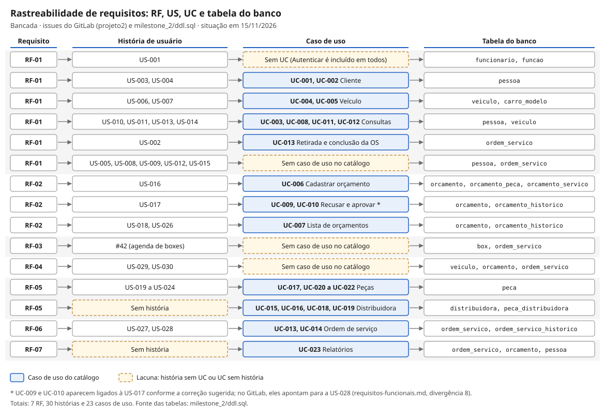

# Backlog priorizado

Milestone 1 (requisitos) · Unidade de requisitos da disciplina Engenharia de Software (Fábrica de Software I) · FilaCidadã API

Backlog do produto, ordenado por milestone e, dentro de cada milestone, por prioridade MoSCoW. Cada item aponta para a história (US), o caso de uso (UC) e os requisitos não funcionais (RNF) que afeta. O estado reflete o código do repositório na data deste documento.

## Premissas

- **Milestones.** M1 Base (identidade, perfil e instituição), M2 Núcleo de atendimento (filas, senhas, QR Codes, painel e auditoria) e M3 Qualidade, segurança e entrega. O conteúdo de cada milestone deve ser confirmado com [milestone-1.md](../09-entregas/milestone-1.md) e os seguintes.
- **Numeração.** Os RF seguem a tabela de mapeamento de [requisitos-funcionais.md](requisitos-funcionais.md) (65 RF). As histórias (US-001 a US-020) são provisórias: a ordem segue o catálogo de casos de uso, com uma ou mais por UC. A lista final está em [historias-de-usuario.md](historias-de-usuario.md), que ainda não foi publicada. Se os números mudarem, este backlog e a [rastreabilidade](rastreabilidade-requisitos.svg) mudam junto.
- **Estado do código.** "Feito" significa que a rota e o serviço existem no repositório. Não significa que a história foi testada conforme a Definição de Pronto.
- **MoSCoW.** Must: sem ele o produto não atende ao escopo. Should: importante, com alternativa temporária aceitável. Could: desejável se houver tempo. Won't: fora desta entrega. Os itens sem UC próprio ficam nessa situação até a equipe decidir (ver seção própria).

## Rastreabilidade

O diagrama liga cada grupo de RF às histórias, ao caso de uso e às classes de domínio. Os itens abaixo usam os mesmos IDs.

## M1 Base: identidade, perfil e instituição

| ID | Item | Histórias | UC | RNF | MoSCoW | Estado | Evidência |
|---|---|---|---|---|---|---|---|
| BL-001 | Cadastro por e-mail e senha | US-001 | UC-01 | RNF-010, RNF-011 | Must | Feito | `src/config/auth.js` (`/api/auth/sign-up/email`) |
| BL-002 | Login e logout com sessão | US-002 | UC-01 | RNF-010 | Must | Feito | `src/config/auth.js` (sessão de 7 dias, bearer) |
| BL-003 | Perfil, troca de senha e avatar | US-003 | UC-02 | RNF-032 | Must | Feito | `src/routes/perfilRoutes.js` (`/me`, `/me/senha`, `/me/avatar`, `/timezones`) |
| BL-004 | Solicitar cadastro de instituição | US-004 | UC-03 | RNF-018 | Must | Feito | `src/routes/instituicaoRoutes.js` (`/instituicoes/solicitar`) |
| BL-005 | Aprovar ou rejeitar instituição | US-005 | UC-04 | RNF-018 | Must | Feito | `src/routes/instituicaoRoutes.js` (`/aprovar`, `/rejeitar`) |
| BL-006 | Reconsiderar instituição rejeitada | US-006 | UC-04 | RNF-018 | Should | Feito | `src/routes/instituicaoRoutes.js` (`/reconsiderar`, ADMIN_PLATAFORMA) |

## M2 Núcleo de atendimento

| ID | Item | Histórias | UC | RNF | MoSCoW | Estado | Evidência |
|---|---|---|---|---|---|---|---|
| BL-007 | Gerenciar usuários e papéis | US-007, US-008 | UC-05 | RNF-012, RNF-018 | Must | Feito | `src/routes/usuarioRoutes.js` |
| BL-008 | Gerenciar filas | US-009, US-010 | UC-06 | RNF-007, RNF-018 | Must | Feito | `src/routes/filaRoutes.js` (`POST`, `PATCH`, `DELETE /filas`) |
| BL-009 | Configurar tipos de etapa | US-011 | UC-07 | RNF-018 | Must | Feito | `src/routes/instituicaoRoutes.js` (`/tipos-etapa`) |
| BL-010 | Emitir senha online e presencial | US-012, US-013 | UC-08, UC-09 | RNF-006, RNF-022 | Must | Feito | `src/routes/senhaRoutes.js`, `src/routes/publicoRoutes.js` (`/publico/senhas/:token/status`) |
| BL-011 | Chamar, rechamar e assumir senha | US-014, US-015 | UC-10 | RNF-009 | Must | Feito | `src/routes/senhaRoutes.js` (`/chamar`, `/rechamar`, `/assumir`) |
| BL-012 | Finalizar ou cancelar atendimento | US-016 | UC-11 | RNF-018 | Must | Feito | `src/routes/senhaRoutes.js` (`/finalizar`, `/cancelar`) |
| BL-013 | Gerenciar QR Codes | US-017 | UC-12 | RNF-018 | Must | Feito | `src/routes/qrCodeRoutes.js` (`/qrcodes`, `/regenerar`) |
| BL-014 | Dashboard e estatísticas | US-018 | UC-13 | RNF-032 | Should | Feito | `src/routes/dashboardRoutes.js` (`/dashboard/admin`, `/dashboard/instituicao`) |
| BL-015 | Consultar auditoria | US-019 | UC-14 | RNF-007, RNF-018 | Must | Feito | `src/routes/auditoriaRoutes.js` (`/auditorias`) |
| BL-016 | Acompanhar minha senha | US-020 | UC-15 | RNF-009 | Must | Feito | `src/routes/senhaRoutes.js` (`/meu-atendimento`), `src/routes/notificacaoRoutes.js`, `src/config/socket.js` |

## M3 Qualidade, segurança e entrega

| ID | Item | Histórias | UC | RNF | MoSCoW | Estado | Evidência |
|---|---|---|---|---|---|---|---|
| BL-017 | Reativar Helmet com CSP compatível com o Swagger | (transversal) | (todos) | RNF-014 | Must | Pendente | `src/app.js` (bloco comentado) |
| BL-018 | Restringir CORS às origens de `CORS_ORIGINS` | (transversal) | (todos) | RNF-015 | Must | Pendente | `src/app.js` (`origin: true`) |
| BL-019 | Limite de tentativas de login configurado e testado | US-002 | UC-01 | RNF-013 | Must | Pendente | `src/routes/authRoutes.js`; `express-rate-limit` sem uso |
| BL-020 | Pipeline com `npm test` e lint antes do merge | (transversal) | (todos) | RNF-002, RNF-003, RNF-028 | Must | Pendente | `.gitlab-ci.yml` (só SAST e segredos) |
| BL-021 | Backup e restauração testados do PostgreSQL | (transversal) | (todos) | RNF-027 | Should | Pendente | `docker-compose.yml` (volume `postgres-data`) |
| BL-022 | Rota `GET /health` com status do banco | (transversal) | (todos) | RNF-024 | Should | Pendente | `src/routes/index.js` (sem rota de saúde) |
| BL-023 | Auditar login e logout | US-002 | UC-01, UC-14 | RNF-018 | Should | Pendente | `AUDITORIA_ACOES.LOGIN` sem uso |
| BL-024 | Rotina de remoção de sessões e QR Codes vencidos | US-002, US-017 | UC-01, UC-12 | RNF-010 | Should | Pendente | `documentacao/15-deploy.md` (pendência registrada) |
| BL-025 | Exportação e retenção de dados pessoais | US-003 | UC-02 | RNF-030 | Should | Pendente | `src/utils/validators/schemas/zod/UsuarioSchema.js` (CPF); validação jurídica necessária |
| BL-026 | Medir desempenho contra metas p95 | US-009, US-012, US-015 | UC-06, UC-08, UC-15 | RNF-006, RNF-009 | Should | Pendente | Sem medição no repositório |
| BL-027 | Tempo real com Bearer no handshake do Socket.IO | US-020 | UC-15 | RNF-009, RNF-031 | Could | Pendente | `src/config/socket.js` (só cookie) |
| BL-028 | Telemetria: reativar OpenTelemetry ou remover configuração sem uso | (transversal) | (todos) | RNF-026 | Could | Pendente | `server.js` (`otel.js` comentado); `prometheus.yml` |
| BL-029 | Teste de usabilidade da emissão de senha | US-012 | UC-08 | RNF-022 | Could | Pendente | Sem teste de usabilidade no repositório |
| BL-030 | Regra de complexidade de senha | US-001 | UC-01 | RNF-011 | Could | Pendente | `src/config/auth.js` (só `minPasswordLength: 8`) |
| BL-031 | Cobertura completa das rotas no Swagger | (transversal) | (todos) | RNF-020 | Could | Pendente | `src/docs/paths/*.js` |

## Itens sem UC próprio: decisão de escopo pendente

Estes itens têm RF, mas não têm caso de uso próprio no catálogo (divergência 5 em [requisitos-funcionais.md](requisitos-funcionais.md)). Já existem no código. Até a equipe decidir, não recebem milestone.

| Item | RF | Situação no código | Decisão necessária |
|---|---|---|---|
| Flow: fluxo de atendimento por etapas | RF-029 a RF-031, RF-043, RF-044, RF-047, RF-062 | `src/routes/flowRoutes.js`; tabelas `Flow*` | Criar UC próprio ou manter sob UC-06, UC-10 e UC-11 |
| Chat entre operador e cidadão | RF-063 | `src/routes/chatRoutes.js`; tabela `ChatMensagem` | Manter sob UC-15 ou criar UC próprio |
| Notificações | RF-064 | `src/routes/notificacaoRoutes.js`; tabela `Notificacao` | Manter sob UC-15 ou criar UC próprio |
| Tempo real (Socket.IO) | RF-065 | `src/config/socket.js` | Manter sob UC-15 ou criar UC próprio |
| Landing page pública | RF-011 | `src/routes/landingPageRoutes.js`; tabela `LandingPage` | Criar UC próprio ou tirar do escopo |

## Definição de Pronto para entrar no backlog (Definition of Ready)

Um item só entra em milestone quando:

1. Tem ator (ACT-01 a ACT-04), caso de uso (UC-01 a UC-15) e história (US) com critérios de aceite verificáveis.
2. Cita os RF e RNF que afeta, com IDs existentes em [requisitos-funcionais.md](requisitos-funcionais.md) e [requisitos-nao-funcionais.md](requisitos-nao-funcionais.md).
3. Tem regra de negócio conferida em `documentacao/03-papeis-e-regras.md` e no service correspondente.
4. Lista o impacto no contrato (REST, GraphQL e Socket.IO) e os consumidores afetados.
5. Identifica mudança de schema ou migration. Migration destrutiva exige confirmação explícita antes de entrar.
6. Tem MoSCoW e tamanho estimado.

## Definição de Pronto (Definition of Done)

Um item só é concluído quando:

1. Services concentram a regra. Resolvers e controllers não acessam o Prisma diretamente.
2. Testes cobrem a mudança: unitário com dublês, integração com PostgreSQL real e rota por `supertest`. `npm test` passa.
3. Há pelo menos um caso de acesso negado por papel, quando a rota é protegida.
4. Operações de escrita registram `Auditoria` com `AUDITORIA_ACOES` e `AUDITORIA_ENTIDADES`.
5. Swagger (`src/docs/paths`), `documentacao/07-endpoints.md` e a coleção Postman estão atualizados quando o contrato muda.
6. Logs e respostas de erro não expõem dados pessoais nem `stack` em produção.
7. A métrica dos RNF afetados foi verificada e registrada na tabela do requisito.
8. `npx eslint .` sem erros, pipeline verde e revisão de outro integrante aprovada.

## Veja também

- [Requisitos não funcionais](requisitos-nao-funcionais.md)
- [Requisitos funcionais](requisitos-funcionais.md)
- [Histórias de usuário](historias-de-usuario.md)
- [Rastreabilidade de requisitos](rastreabilidade-requisitos.svg)
- [Casos de uso](../05-modelagem/casos-de-uso/README.md)
- [Milestone 1](../09-entregas/milestone-1.md)
- [Milestone 2](../09-entregas/milestone-2.md)
- [Milestone 3](../09-entregas/milestone-3.md)
- [Template de história de usuário](../templates/historia-de-usuario.md)
