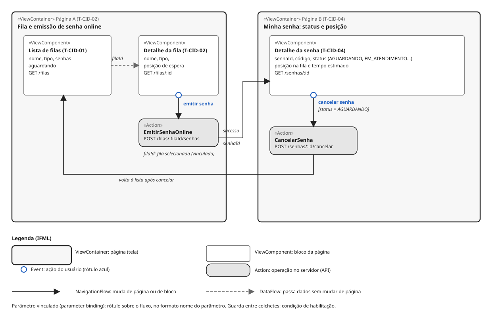

# IFML: emissão e chamado de senha

Fábrica de Software I · Protótipo do sistema (UC-08 a UC-11) · Milestones 2 e 3

Este diretório traz dois modelos IFML (Interaction Flow Modeling Language) das interações centrais do FilaCidadã. Cada modelo tem duas páginas (ViewContainers). Eles descrevem como o usuário passa de uma tela para outra, quais ações chamam a API e quais parâmetros viajam entre as telas. As telas referenciadas são as do [inventário do protótipo](../README.md), e os endpoints vêm de `src/routes`.

## Notação usada

| Elemento IFML | Representação no SVG | Uso neste protótipo |
|---|---|---|
| ViewContainer | Retângulo grande, borda forte, rótulo «ViewContainer» | Página da aplicação (uma tela do inventário, ou tela com seções) |
| ViewComponent | Retângulo branco, rótulo «ViewComponent» | Bloco de dados ou lista dentro da página, com a fonte (endpoint GET) |
| Event | Círculo azul sobre a borda de um componente, com rótulo | Ação do usuário: clique, seleção ou botão |
| Action | Retângulo arredondado cinza, rótulo «Action» | Operação no servidor, com o endpoint que executa |
| NavigationFlow | Seta contínua | Muda de página ou de bloco; pode ter condição entre colchetes |
| DataFlow | Seta tracejada | Passa dados sem mudar de página (atualização de componente) |
| Parameter binding | Rótulo sobre a seta, com o nome do parâmetro | Valor que sai de um elemento e entra em outro (`filaId`, `senhaId`) |
| Guard | Texto entre colchetes | Condição para habilitar o fluxo (`[status = AGUARDANDO]`, `[ADMIN_INSTITUICAO]`) |

Os modelos são feitos à mão em SVG, sem biblioteca, e seguem a legenda incluída em cada arquivo.

## Modelo 1: emissão de senha online

Arquivo: [ifml-emitir-senha.svg](ifml-emitir-senha.svg). Páginas: A (Fila e emissão, telas T-CID-01 e T-CID-02) e B (Minha senha, tela T-CID-04).

| Elemento | Tipo IFML | Página | Tela | Endpoint |
|---|---|---|---|---|
| Lista de filas | ViewComponent | A | T-CID-01 | GET /filas |
| Detalhe da fila | ViewComponent | A | T-CID-02 | GET /filas/:id |
| Emitir senha (clique) | Event | A | T-CID-02 | n/a |
| EmitirSenhaOnline | Action | A | T-CID-02 | POST /filas/:filaId/senhas |
| Detalhe da senha | ViewComponent | B | T-CID-04 | GET /senhas/:id |
| Cancelar senha (clique) | Event | B | T-CID-04 | n/a |
| CancelarSenha | Action | B | T-CID-04 | POST /senhas/:id/cancelar |

Fluxos:

1. O cidadão escolhe uma fila na lista. O `filaId` da fila selecionada vai por DataFlow ao detalhe da fila (`T-CID-01` para `T-CID-02`).
2. Em "emitir senha", a ação `EmitirSenhaOnline` envia o `filaId`. Com sucesso, a navegação leva à página B e passa o `senhaId` da senha criada para o detalhe (`T-CID-04`).
3. Em "cancelar senha", a ação só fica habilitada com `[status = AGUARDANDO]`. Depois de cancelar, a navegação volta à lista de filas (página A).
4. Se a ação falhar, a página permanece como está e mostra a mensagem devolvida pela API. O modelo não desenha esse ramo para não poluir o diagrama.

Variante presencial: a emissão feita pelo operador (UC-09, `T-OPE-05`) segue a mesma estrutura, com a ação `EmitirSenhaPresencial` (`POST /filas/:filaId/senhas/presencial`) no lugar de `EmitirSenhaOnline`, sem página do cidadão. Ela não foi desenhada aqui para manter o modelo em duas páginas.

## Modelo 2: chamado e atendimento de senha

Arquivo: [ifml-chamar-senha.svg](ifml-chamar-senha.svg). Páginas: A (Painel e fila, telas T-OPE-01 e T-OPE-02) e B (Atendimento da senha, telas T-OPE-03 e T-OPE-04).

| Elemento | Tipo IFML | Página | Tela | Endpoint |
|---|---|---|---|---|
| Painel do operador | ViewComponent | A | T-OPE-01 | GET /senhas/meu-atendimento |
| Fila (senhas aguardando) | ViewComponent | A | T-OPE-02 | GET /senhas |
| Chamar próxima (clique) | Event | A | T-OPE-02 | n/a |
| ChamarSenha | Action | A | T-OPE-02 | POST /senhas/:id/chamar |
| Rechamar (clique) | Event | A | T-OPE-01 | n/a |
| RechamarSenha | Action | A | T-OPE-01 | POST /senhas/:id/rechamar |
| Detalhe da senha | ViewComponent | B | T-OPE-03 | GET /senhas/:id |
| AssumirSenha | Action | B | T-OPE-03 | POST /senhas/:id/assumir `[ADMIN_INSTITUICAO]` |
| FinalizarSenha | Action | B | T-OPE-04 | POST /senhas/:id/finalizar |
| CancelarSenha | Action | B | T-OPE-04 | POST /senhas/:id/cancelar |

Fluxos:

1. O operador chama a próxima senha da fila. `ChamarSenha` tem sucesso, e a navegação leva à página B com o `senhaId`.
2. Na página A, "rechamar" aciona `RechamarSenha` sem mudar de página. A senha continua na mesma tela.
3. Na página B, "assumir" só é habilitado para o administrador da instituição (`[ADMIN_INSTITUICAO]`, conforme `authorize` em `senhaRoutes.js`). A ação atualiza o detalhe por DataFlow, sem mudar de página.
4. "Finalizar" e "cancelar" encerram o atendimento e a navegação volta à fila (página A).

Fora deste modelo: o encaminhamento e a alta no fluxo da senha (`T-OPE-06`, UC-10 e UC-11) têm endpoints próprios (`/flows/:id/senhas/:senhaId/encaminhar` e `/alta`). Não cabem nas duas páginas e ficam para um terceiro modelo, se a disciplina pedir.

## Parâmetros

| Parâmetro | Origem | Destino | Modelo |
|---|---|---|---|
| filaId | Fila selecionada (lista) | Detalhe da fila e EmitirSenhaOnline | 1 |
| senhaId | EmitirSenhaOnline (sucesso) | Detalhe da senha (página B) | 1 |
| senhaId | Clique em "chamar próxima" (linha da fila) | Detalhe da senha (página B) | 2 |

## Limites do modelo

- Os modelos mostram o caminho feliz e as ações de cancelamento. Os ramos de erro são descritos no texto.
- Não há modelagem de autenticação. Assume-se sessão válida; sessão expirada segue para `T-PUB-05` (código 498).
- Os nomes de ações (`EmitirSenhaOnline`, `ChamarSenha`) são os nomes de caso de uso da API, não de classes do domínio.

## Veja também

- [Protótipo: índice e inventário de telas](../README.md)
- [Mapa do site](../site-map.md)
- [Casos de uso](../../05-modelagem/casos-de-uso/README.md)
- [Sequência de emissão e atendimento de senha](../../05-modelagem/sequencia/README.md)
- [Estados da senha](../../05-modelagem/estados/README.md)
