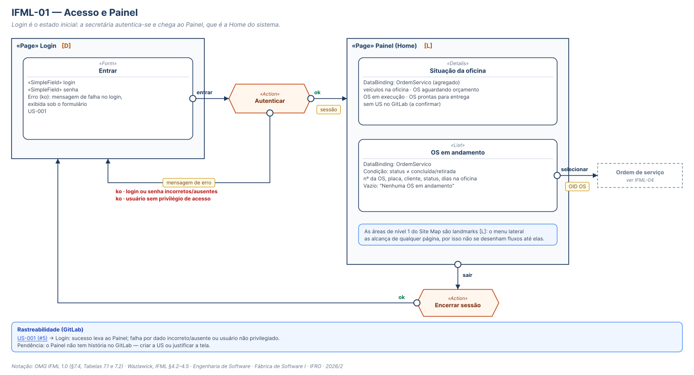
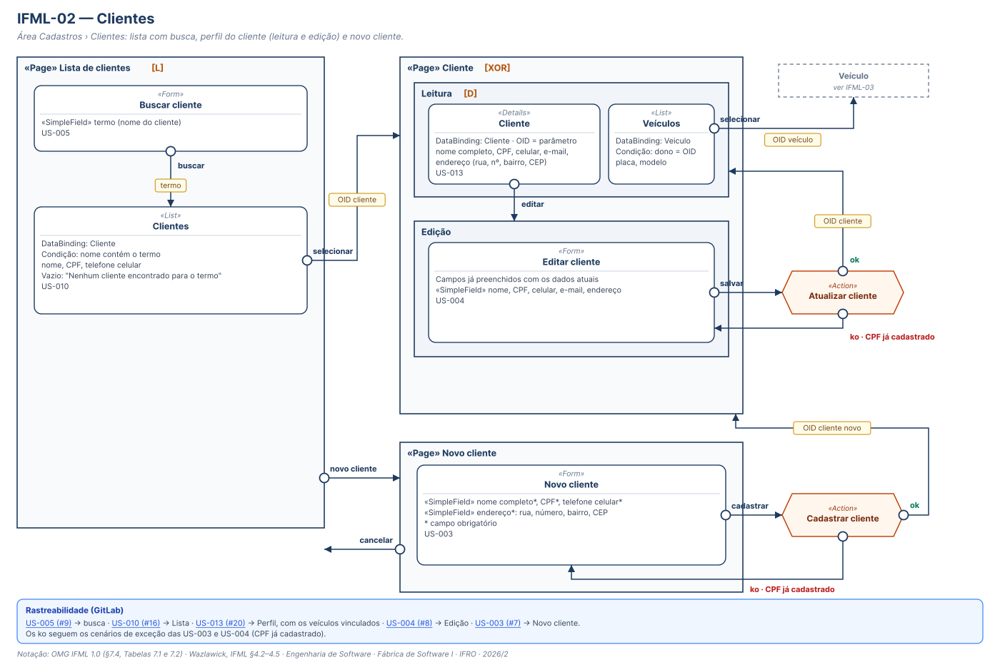
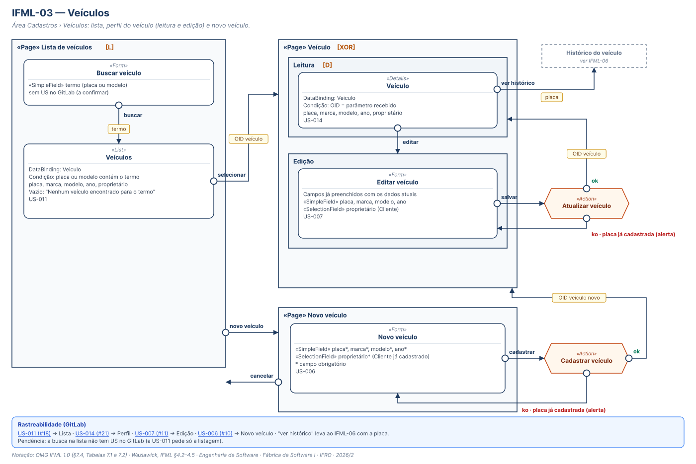
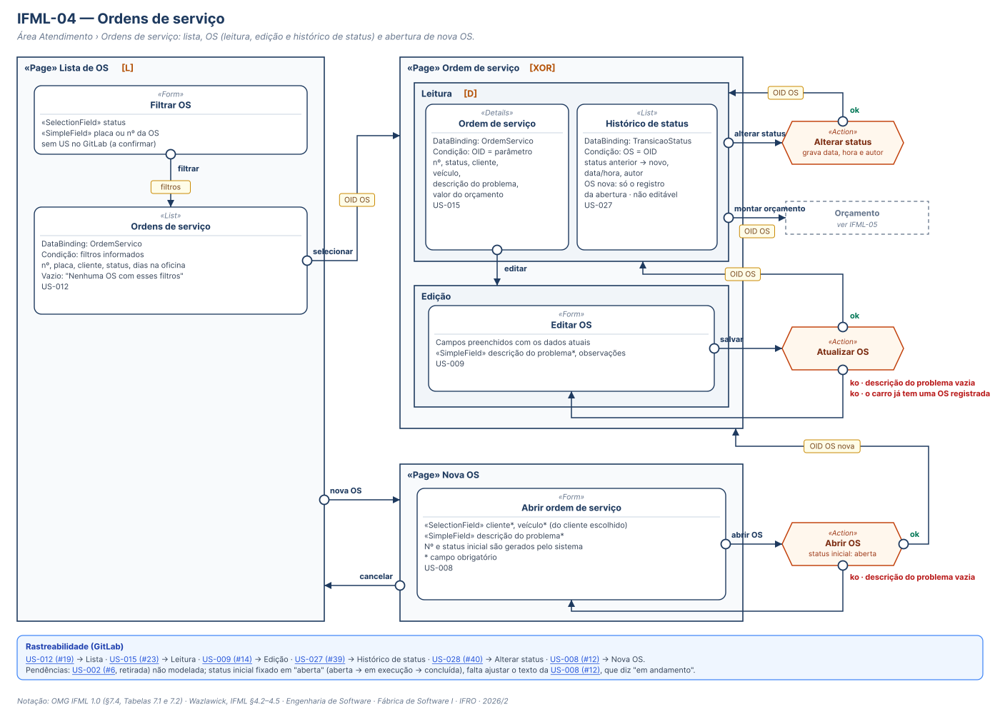
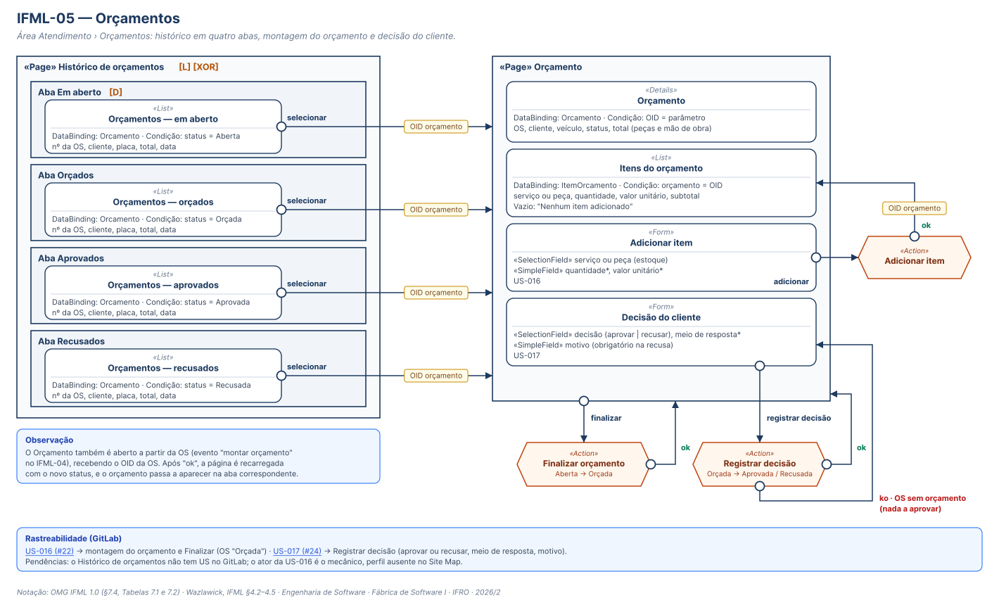
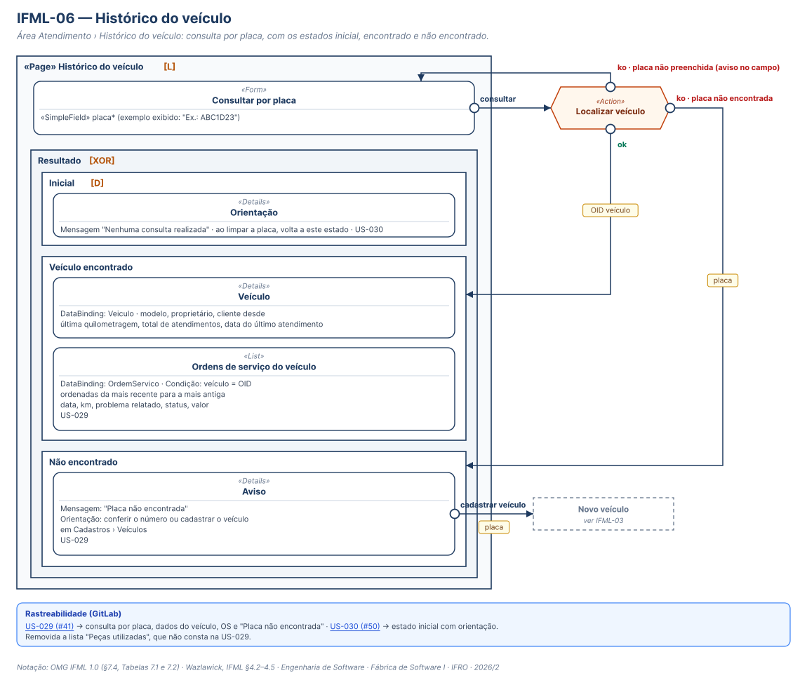
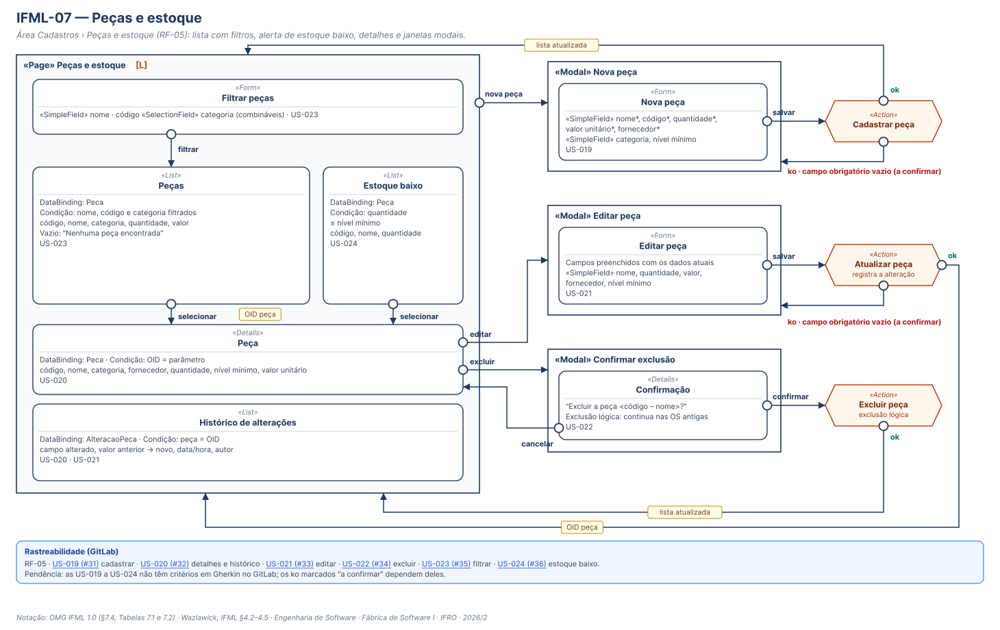
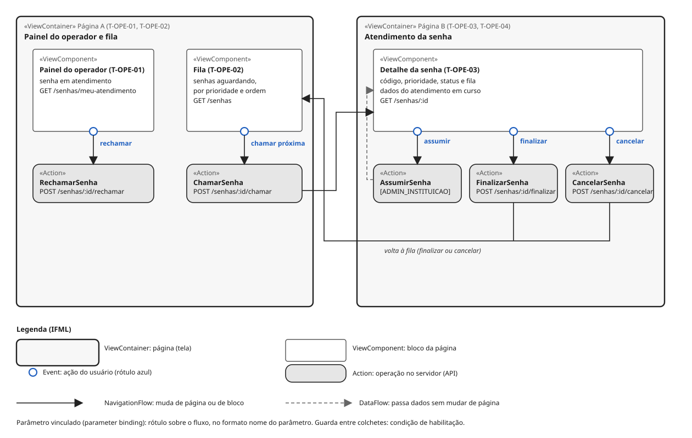

# IFML: fluxos de interação do Bancada

Fábrica de Software I · Protótipo do sistema · Milestones 2 e 3

Este diretório reúne os sete modelos IFML (Interaction Flow Modeling Language) do Bancada, o sistema de gestão de oficina mecânica da RFP 2. Cada modelo cobre uma área do menu lateral e descreve como a secretária passa de uma página para outra, quais eventos disparam ações no sistema, quais parâmetros viajam entre os elementos e o que acontece quando uma ação falha.

Os diagramas foram desenhados na página "02 · IFML" do arquivo do Figma "[Gestão de Oficina Mecânica](https://www.figma.com/design/EHj0Js5KtOJ88TRQd5fTJI/Gest%C3%A3o-de-Oficina-Mec%C3%A2nica?node-id=3-36)" e exportados em SVG. As páginas modeladas correspondem às telas dos [wireframes](../wireframes/README.md), e cada componente indica a história de usuário do GitLab que o justifica.

## Modelos

| Nº      | Modelo                                                | Área do menu                     | Histórias                                      | Wireframes                                                                                                             |
| ------- | ----------------------------------------------------- | -------------------------------- | ---------------------------------------------- | ---------------------------------------------------------------------------------------------------------------------- |
| IFML-01 | [Acesso e Painel](#ifml-01-acesso-e-painel)           | Login e Atendimento › Painel     | US-001                                         | [1 - Login](<../wireframes/Meuprojetooficina/1 - Login/>), [2 - Painel](<../wireframes/Meuprojetooficina/2 - Painel/>) |
| IFML-02 | [Clientes](#ifml-02-clientes)                         | Cadastros › Clientes             | US-003, US-004, US-005, US-010, US-013         | [5 - Clientes](<../wireframes/Meuprojetooficina/5 - Clientes/>)                                                        |
| IFML-03 | [Veículos](#ifml-03-veículos)                         | Cadastros › Veículos             | US-006, US-007, US-011, US-014                 | [6 - Veículos](<../wireframes/Meuprojetooficina/6 - Veículos/>) (6.01 a 6.06)                                          |
| IFML-04 | [Ordens de serviço](#ifml-04-ordens-de-serviço)       | Atendimento › Ordens de serviço  | US-008, US-009, US-012, US-015, US-027, US-028 | [4 - Ordens de serviço](<../wireframes/Meuprojetooficina/4 - Ordens de serviço/>)                                      |
| IFML-05 | [Orçamentos](#ifml-05-orçamentos)                     | Atendimento › Orçamento          | US-016, US-017, US-018, US-026                 | [3 - Orçamento](<../wireframes/Meuprojetooficina/3 - Orçamento/>)                                                      |
| IFML-06 | [Histórico do veículo](#ifml-06-histórico-do-veículo) | Cadastros › Veículos › Histórico | US-029, US-030                                 | [6 - Veículos](<../wireframes/Meuprojetooficina/6 - Veículos/>) (6.07 a 6.11)                                          |
| IFML-07 | [Peças e estoque](#ifml-07-peças-e-estoque)           | Cadastros › Peças e estoque      | US-019 a US-024                                | [7 - Peças e estoque](<../wireframes/Meuprojetooficina/7 - Peças e estoque/>)                                          |

O sistema tem um único perfil de acesso no escopo atual, a secretária. Por isso não há um modelo por perfil: a divisão segue as áreas do menu lateral (Atendimento, Cadastros e Gestão).

## Notação usada

A notação segue a especificação OMG IFML 1.0 (§7.4, Tabelas 7.1 e 7.2) e o material da disciplina (Wazlawick, IFML §4.2 a 4.5).

| Elemento IFML                                     | Representação no SVG                                                   | Uso neste protótipo                                                                                  |
| ------------------------------------------------- | ---------------------------------------------------------------------- | ---------------------------------------------------------------------------------------------------- |
| ViewContainer «Page»                              | Retângulo grande com borda escura e rótulo «Page»                      | Página da aplicação, correspondente a uma tela ou a um grupo de estados de tela                      |
| ViewContainer «Modal»                             | Retângulo com rótulo «Modal»                                           | Janela sobreposta à página (usada em Peças e estoque)                                                |
| Landmark `[L]`                                    | Marcação laranja ao lado do nome da página                             | Página alcançável de qualquer ponto pelo menu lateral; por isso não se desenham fluxos até ela       |
| Default `[D]`                                     | Marcação laranja em uma página ou subcontêiner                         | Página ou estado exibido primeiro (Login como estado inicial, aba ou modo padrão)                    |
| XOR `[XOR]`                                       | Marcação laranja em uma página com subcontêineres                      | Apenas um subcontêiner fica visível por vez (Leitura × Edição, abas de status, estados do resultado) |
| ViewComponent «Form», «List», «Details»           | Retângulo branco de cantos arredondados                                | Formulário, lista de registros ou detalhe de um registro                                             |
| ViewComponentPart «SimpleField», «SelectionField» | Linha dentro de um «Form»                                              | Campo de digitação ou de seleção; o asterisco indica campo obrigatório                               |
| DataBinding e Condição                            | Texto dentro do componente                                             | Entidade do domínio exibida e filtro aplicado (por exemplo, `status = Aberta`)                       |
| Event                                             | Círculo vazado sobre a borda de um componente ou página                | Ação da secretária: clique, envio de formulário ou seleção de linha                                  |
| Action                                            | Hexágono laranja com rótulo «Action»                                   | Operação executada pelo sistema                                                                      |
| ActionEvent `ok` / `ko`                           | Círculo na borda da Action, com rótulo verde (`ok`) ou vermelho (`ko`) | Resultado da operação: sucesso ou falha, com o motivo da falha                                       |
| NavigationFlow                                    | Seta contínua                                                          | Leva o foco a outra página, subcontêiner ou componente                                               |
| ParameterBinding                                  | Etiqueta amarela sobre a seta                                          | Valor transportado pelo fluxo (`OID cliente`, `placa`, `termo`)                                      |

Duas convenções próprias completam a legenda:

- **Caixa tracejada** com "ver IFML-0X": referência a uma página modelada em outro diagrama. O fluxo sai do modelo atual e continua no modelo indicado.
- **Rodapé "Rastreabilidade (GitLab)"**: lista as histórias cobertas pelo diagrama, com o número da issue, e as pendências encontradas na modelagem. Os ramos marcados "(a confirmar)" dependem de critérios de aceite que ainda não estão registrados nas issues.

## IFML-01: Acesso e Painel

Arquivo: [ifml-01-acesso-painel.svg](ifml-01-acesso-painel.svg). Páginas: Login `[D]` e Painel (Home) `[L]`.

| Elemento                                                                                               | Tipo IFML | Contêiner | História |
| ------------------------------------------------------------------------------------------------------ | --------- | --------- | -------- |
| Entrar (login, senha)                                                                                  | Form      | Login     | US-001   |
| Autenticar                                                                                             | Action    | n/a       | US-001   |
| Situação da oficina (veículos na oficina, OS aguardando orçamento, em execução e prontas para entrega) | Details   | Painel    | sem US   |
| OS em andamento (nº, placa, cliente, status, dias na oficina)                                          | List      | Painel    | sem US   |
| Encerrar sessão                                                                                        | Action    | n/a       | sem US   |

Fluxos:

1. O Login é o estado inicial do sistema. Em "entrar", a ação `Autenticar` recebe login e senha.
2. Com `ok`, a sessão é criada e a navegação leva ao Painel.
3. Com `ko`, a secretária volta ao Login com a mensagem de erro sob o formulário. Há dois motivos: login ou senha incorretos ou ausentes, e usuário sem privilégio de acesso (cenários da US-001).
4. No Painel, selecionar uma OS da lista leva à página Ordem de serviço do IFML-04, com o `OID OS`.
5. Em "sair", a ação `Encerrar sessão` devolve a secretária ao Login.

Pendência: o Painel não tem história no GitLab. É preciso criar a US ou justificar a tela.

## IFML-02: Clientes

Arquivo: [ifml-02-clientes.svg](ifml-02-clientes.svg). Páginas: Lista de clientes `[L]`, Cliente `[XOR]` (Leitura `[D]` e Edição) e Novo cliente.

| Elemento                                                  | Tipo IFML | Contêiner         | História |
| --------------------------------------------------------- | --------- | ----------------- | -------- |
| Buscar cliente (termo: nome)                              | Form      | Lista de clientes | US-005   |
| Clientes (nome, CPF, celular)                             | List      | Lista de clientes | US-010   |
| Cliente (nome, CPF, celular, e-mail, endereço)            | Details   | Cliente › Leitura | US-013   |
| Veículos do cliente (placa, modelo)                       | List      | Cliente › Leitura | US-013   |
| Editar cliente                                            | Form      | Cliente › Edição  | US-004   |
| Atualizar cliente                                         | Action    | n/a               | US-004   |
| Novo cliente (nome, CPF, celular e endereço obrigatórios) | Form      | Novo cliente      | US-003   |
| Cadastrar cliente                                         | Action    | n/a               | US-003   |

Fluxos:

1. Em "buscar", o `termo` filtra a lista de clientes na mesma página. Sem resultado, a lista mostra "Nenhum cliente encontrado para o termo".
2. Selecionar um cliente abre a página Cliente no modo Leitura, com o `OID cliente`.
3. Selecionar um veículo do cliente leva à página Veículo do IFML-03, com o `OID veículo`.
4. Em "editar", a página passa ao modo Edição, com os campos preenchidos. Em "salvar", `Atualizar cliente` volta ao modo Leitura com `ok`, ou permanece na Edição com `ko` (CPF já cadastrado).
5. Em "novo cliente", abre-se a página Novo cliente. `Cadastrar cliente` leva ao perfil do cliente criado com `ok` (`OID cliente novo`), ou mantém o formulário com `ko` (CPF já cadastrado). "Cancelar" volta à lista.

## IFML-03: Veículos

Arquivo: [ifml-03-veiculos.svg](ifml-03-veiculos.svg). Páginas: Lista de veículos `[L]`, Veículo `[XOR]` (Leitura `[D]` e Edição) e Novo veículo.

| Elemento                                                             | Tipo IFML | Contêiner         | História |
| -------------------------------------------------------------------- | --------- | ----------------- | -------- |
| Buscar veículo (termo: placa ou modelo)                              | Form      | Lista de veículos | sem US   |
| Veículos (placa, marca, modelo, ano, proprietário)                   | List      | Lista de veículos | US-011   |
| Veículo (placa, marca, modelo, ano, proprietário)                    | Details   | Veículo › Leitura | US-014   |
| Editar veículo (proprietário escolhido entre os clientes)            | Form      | Veículo › Edição  | US-007   |
| Atualizar veículo                                                    | Action    | n/a               | US-007   |
| Novo veículo (placa, marca, modelo, ano e proprietário obrigatórios) | Form      | Novo veículo      | US-006   |
| Cadastrar veículo                                                    | Action    | n/a               | US-006   |

Fluxos:

1. Em "buscar", o `termo` filtra a lista por placa ou modelo.
2. Selecionar um veículo abre a página Veículo no modo Leitura, com o `OID veículo`.
3. Em "ver histórico", a navegação leva ao IFML-06 com a `placa` do veículo.
4. Em "editar" e "salvar", `Atualizar veículo` volta à Leitura com `ok`, ou mantém a Edição com `ko` (placa já cadastrada, exibida como alerta).
5. `Cadastrar veículo` leva ao perfil do veículo criado com `ok` (`OID veículo novo`), ou mantém o formulário com `ko` (placa já cadastrada). O proprietário deve ser um cliente já cadastrado.

Pendência: a busca na lista não tem história no GitLab, pois a US-011 pede apenas a listagem.

## IFML-04: Ordens de serviço

Arquivo: [ifml-04-ordens-servico.svg](ifml-04-ordens-servico.svg). Páginas: Lista de OS `[L]`, Ordem de serviço `[XOR]` (Leitura `[D]` e Edição) e Nova OS.

| Elemento                                                                      | Tipo IFML | Contêiner                  | História |
| ----------------------------------------------------------------------------- | --------- | -------------------------- | -------- |
| Filtrar OS (status; placa ou nº da OS)                                        | Form      | Lista de OS                | sem US   |
| Ordens de serviço (nº, placa, cliente, status, dias na oficina)               | List      | Lista de OS                | US-012   |
| Ordem de serviço (nº, status, cliente, veículo, problema, valor do orçamento) | Details   | Ordem de serviço › Leitura | US-015   |
| Histórico de status (status anterior → novo, data/hora, autor; não editável)  | List      | Ordem de serviço › Leitura | US-027   |
| Alterar status (grava data, hora e autor)                                     | Action    | n/a                        | US-028   |
| Editar OS (descrição do problema, observações)                                | Form      | Ordem de serviço › Edição  | US-009   |
| Atualizar OS                                                                  | Action    | n/a                        | US-009   |
| Abrir ordem de serviço (cliente, veículo do cliente, descrição do problema)   | Form      | Nova OS                    | US-008   |
| Abrir OS                                                                      | Action    | n/a                        | US-008   |

Fluxos:

1. Em "filtrar", os filtros atualizam a lista. Sem resultado, a lista mostra "Nenhuma OS com esses filtros".
2. Selecionar uma OS abre a página Ordem de serviço no modo Leitura, com o `OID OS`. A mesma página é alcançada a partir do Painel (IFML-01).
3. Em "alterar status", a ação `Alterar status` registra a transição e recarrega a Leitura, e o histórico passa a mostrar o novo registro.
4. Em "montar orçamento", a navegação leva à página Orçamento do IFML-05, com o `OID OS`.
5. Em "editar" e "salvar", `Atualizar OS` volta à Leitura com `ok`. Com `ko`, a Edição permanece aberta: descrição do problema vazia, ou o carro já tem uma OS registrada.
6. Em "nova OS", o número e o status inicial são gerados pelo sistema. `Abrir OS` leva à OS criada com `ok` (`OID OS nova`), ou mantém o formulário com `ko` (descrição do problema vazia).

Pendências:

- O filtro da lista não tem história no GitLab.
- A US-002 (registro de retirada) ainda não foi modelada.
- O status inicial da OS aparece como "a definir" na ação `Abrir OS`. Ver a divergência [I-02](#divergências-com-o-backlog).

## IFML-05: Orçamentos

Arquivo: [ifml-05-orcamentos.svg](ifml-05-orcamentos.svg). Páginas: Histórico de orçamentos `[L] [XOR]`, com quatro abas (Em aberto `[D]`, Orçados, Aprovados e Recusados), e Orçamento.

| Elemento                                                                                     | Tipo IFML          | Contêiner               | História       |
| -------------------------------------------------------------------------------------------- | ------------------ | ----------------------- | -------------- |
| Orçamentos em aberto, orçados, aprovados e recusados (nº da OS, cliente, placa, total, data) | List (uma por aba) | Histórico de orçamentos | US-018, US-026 |
| Orçamento (OS, cliente, veículo, status, total de peças e mão de obra)                       | Details            | Orçamento               | US-016         |
| Itens do orçamento (serviço ou peça, quantidade, valor unitário, subtotal)                   | List               | Orçamento               | US-016         |
| Adicionar item (serviço ou peça do estoque, quantidade, valor unitário)                      | Form               | Orçamento               | US-016         |
| Adicionar item                                                                               | Action             | n/a                     | US-016         |
| Finalizar orçamento (Aberta → Orçada)                                                        | Action             | n/a                     | US-016         |
| Decisão do cliente (aprovar ou recusar, meio de resposta, motivo na recusa)                  | Form               | Orçamento               | US-017         |
| Registrar decisão (Orçada → Aprovada ou Recusada)                                            | Action             | n/a                     | US-017         |

Fluxos:

1. A página abre na aba Em aberto. Cada aba filtra os orçamentos por status, o que atende ao filtro da US-026. Nos wireframes, o mesmo comportamento aparece como o menu "Filtrar status".
2. Selecionar um orçamento em qualquer aba abre a página Orçamento, com o `OID orçamento`. A página também é aberta pelo evento "montar orçamento" do IFML-04, com o `OID OS`.
3. Em "adicionar", `Adicionar item` inclui o item e atualiza a lista de itens.
4. Em "finalizar", o orçamento passa de Aberta a Orçada e a página é recarregada com o novo status.
5. Em "registrar decisão", o orçamento passa a Aprovada ou Recusada. Com `ko` (OS sem orçamento, nada a aprovar), o formulário de decisão permanece aberto.
6. Depois de cada `ok`, o orçamento passa a aparecer na aba do novo status.

Pendência: o ator da US-016 é o mecânico, perfil que não existe no Site Map.

## IFML-06: Histórico do veículo

Arquivo: [ifml-06-historico-veiculo.svg](ifml-06-historico-veiculo.svg). Página: Histórico do veículo `[L]`, com o subcontêiner Resultado `[XOR]` em três estados: Inicial `[D]`, Veículo encontrado e Não encontrado.

| Elemento                                                                                                       | Tipo IFML | Contêiner                      | História |
| -------------------------------------------------------------------------------------------------------------- | --------- | ------------------------------ | -------- |
| Consultar por placa (exemplo exibido: "Ex.: ABC1D23")                                                          | Form      | Histórico do veículo           | US-029   |
| Localizar veículo                                                                                              | Action    | n/a                            | US-029   |
| Orientação ("Nenhuma consulta realizada")                                                                      | Details   | Resultado › Inicial            | US-030   |
| Veículo (modelo, proprietário, cliente desde, última quilometragem, total de atendimentos, último atendimento) | Details   | Resultado › Veículo encontrado | US-029   |
| Ordens de serviço do veículo (data, km, problema, status, valor; da mais recente para a mais antiga)           | List      | Resultado › Veículo encontrado | US-029   |
| Aviso ("Placa não encontrada")                                                                                 | Details   | Resultado › Não encontrado     | US-029   |

Fluxos:

1. A página abre no estado Inicial, com a orientação da US-030. Ao limpar a placa, a página volta a esse estado.
2. Em "consultar", `Localizar veículo` recebe a placa. Com `ok`, o resultado passa a Veículo encontrado, com o `OID veículo`.
3. Com `ko` por placa não encontrada, o resultado passa a Não encontrado. Com `ko` por placa não preenchida, o aviso aparece no próprio campo.
4. No estado Não encontrado, "cadastrar veículo" leva ao Novo veículo do IFML-03, levando a `placa` digitada.
5. A página também é aberta pelo evento "ver histórico" do IFML-03, com a placa já preenchida.

A lista "Peças utilizadas" foi removida desta versão porque não consta da US-029.

## IFML-07: Peças e estoque

Arquivo: [ifml-07-pecas-estoque.svg](ifml-07-pecas-estoque.svg). Página: Peças e estoque `[L]`. Janelas modais: Nova peça, Editar peça e Confirmar exclusão.

| Elemento                                                                             | Tipo IFML | Contêiner                | História       |
| ------------------------------------------------------------------------------------ | --------- | ------------------------ | -------------- |
| Filtrar peças (nome, código, categoria; combináveis)                                 | Form      | Peças e estoque          | US-023         |
| Peças (código, nome, categoria, quantidade, valor)                                   | List      | Peças e estoque          | US-023         |
| Estoque baixo (quantidade ≤ nível mínimo)                                            | List      | Peças e estoque          | US-024         |
| Peça (código, nome, categoria, fornecedor, quantidade, nível mínimo, valor unitário) | Details   | Peças e estoque          | US-020         |
| Histórico de alterações (campo, valor anterior → novo, data/hora, autor)             | List      | Peças e estoque          | US-020, US-021 |
| Nova peça (nome, código, quantidade, valor unitário e fornecedor obrigatórios)       | Form      | Modal Nova peça          | US-019         |
| Cadastrar peça                                                                       | Action    | n/a                      | US-019         |
| Editar peça                                                                          | Form      | Modal Editar peça        | US-021         |
| Atualizar peça (registra a alteração)                                                | Action    | n/a                      | US-021         |
| Confirmação ("Excluir a peça <código – nome>?")                                      | Details   | Modal Confirmar exclusão | US-022         |
| Excluir peça (exclusão lógica)                                                       | Action    | n/a                      | US-022         |

Fluxos:

1. Em "filtrar", os filtros atualizam a lista de peças. Sem resultado, a lista mostra "Nenhuma peça encontrada".
2. Selecionar uma peça na lista geral ou na lista de estoque baixo carrega o detalhe e o histórico de alterações da peça, com o `OID peça`, sem sair da página.
3. "Nova peça" abre o modal de cadastro. `Cadastrar peça` fecha o modal e devolve a lista atualizada com `ok`; com `ko` (campo obrigatório vazio), o modal permanece aberto.
4. "Editar" abre o modal com os dados atuais. `Atualizar peça` registra a alteração e volta ao detalhe da peça com `ok`; com `ko`, o modal permanece aberto.
5. "Excluir" abre a confirmação. Em "confirmar", `Excluir peça` faz a exclusão lógica (a peça continua nas OS antigas) e devolve a lista atualizada. "Cancelar" fecha o modal e volta ao detalhe.

Pendência: as US-019 a US-024 não têm critérios em Gherkin no GitLab. Os ramos `ko` marcados "(a confirmar)" dependem desses critérios.

## Parâmetros

| Parâmetro        | Origem                                                             | Destino                                     | Modelos    |
| ---------------- | ------------------------------------------------------------------ | ------------------------------------------- | ---------- |
| sessão           | Autenticar (`ok`)                                                  | Painel                                      | 01         |
| termo            | Formulário de busca                                                | Lista da mesma página                       | 02, 03     |
| filtros          | Formulário de filtro                                               | Lista da mesma página                       | 04, 07     |
| OID cliente      | Linha da lista de clientes ou Atualizar cliente (`ok`)             | Página Cliente                              | 02         |
| OID cliente novo | Cadastrar cliente (`ok`)                                           | Página Cliente                              | 02         |
| OID veículo      | Lista de veículos, veículos do cliente ou Localizar veículo (`ok`) | Página Veículo ou resultado do histórico    | 02, 03, 06 |
| OID veículo novo | Cadastrar veículo (`ok`)                                           | Página Veículo                              | 03         |
| placa            | "ver histórico" ou "cadastrar veículo"                             | Histórico do veículo ou Novo veículo        | 03, 06     |
| OID OS           | Lista do Painel, lista de OS ou ações da OS (`ok`)                 | Página Ordem de serviço ou página Orçamento | 01, 04, 05 |
| OID OS nova      | Abrir OS (`ok`)                                                    | Página Ordem de serviço                     | 04         |
| OID orçamento    | Linha de uma aba do histórico ou Adicionar item (`ok`)             | Página Orçamento                            | 05         |
| OID peça         | Linha das listas de peças ou Atualizar peça (`ok`)                 | Detalhe da peça                             | 07         |

## Divergências com o backlog

Os rodapés de dois diagramas foram desenhados antes da revisão das histórias na [pasta de requisitos](../../03-requisitos/historias-de-usuario.md). As tabelas deste documento já seguem o backlog atual; os rodapés no Figma devem ser corrigidos e os SVGs exportados de novo.

| ID   | Diagrama          | O que o diagrama diz                                                                                                             | Situação no backlog                                                                                                                       | Correção                                                                                                                                     |
| ---- | ----------------- | -------------------------------------------------------------------------------------------------------------------------------- | ----------------------------------------------------------------------------------------------------------------------------------------- | -------------------------------------------------------------------------------------------------------------------------------------------- |
| I-01 | IFML-04 e IFML-05 | O histórico de status da OS cita a US-018, a US-027 aparece como duplicada da US-018, e o Histórico de orçamentos aparece sem US | A US-018 trata do histórico de status do orçamento e é a tela principal de Orçamentos; a US-027 trata do histórico de status da OS (D-02) | No IFML-04, trocar US-018 por US-027 e retirar a pendência de duplicidade. No IFML-05, vincular o Histórico de orçamentos às US-018 e US-026 |
| I-02 | IFML-04           | O status inicial da OS está "a definir" (US-008 diz "em andamento"; US-016 a US-018 dizem "Aberta")                              | O ciclo decidido para a OS é aberta → em execução → concluída; Orçada, Aprovada e Recusada pertencem ao orçamento                         | Fixar "aberta" como status inicial em `Abrir OS` e ajustar o texto da US-008                                                                 |

## Limites do modelo

- As áreas Balcão, Agenda dos boxes e Relatórios ainda não têm modelo IFML. As telas da Agenda dos boxes e de Relatórios estão nos wireframes, nas pastas 8 e 9.
- Os modelos não desenham fluxos até as páginas `[L]`, porque o menu lateral as alcança de qualquer ponto. Pela mesma razão, o breadcrumb não aparece nos diagramas.
- Assume-se sessão válida em todos os modelos, exceto no IFML-01. O comportamento de sessão expirada não está modelado.
- Os nomes das ações (`Autenticar`, `Abrir OS`, `Registrar decisão`) descrevem operações do sistema. Eles não correspondem a classes do domínio nem a endpoints, porque a API ainda não foi implementada.

## Veja também

- [Protótipo: índice da pasta](../README.md)
- [Mapa do site](../site-map.md)
- [Wireframes](../wireframes/README.md) e [índice das telas](<../wireframes/Meuprojetooficina/0 - Índice.md>)
- [Histórias de usuário](../../03-requisitos/historias-de-usuario.md)
- [Matriz de rastreabilidade](../../07-rastreabilidade/matriz.md)

# IFML: emissão e chamado de senha

Fábrica de Software I · Protótipo do sistema (UC-08 a UC-11) · Milestones 2 e 3

Este diretório traz dois modelos IFML (Interaction Flow Modeling Language) das interações centrais do FilaCidadã. Cada modelo tem duas páginas (ViewContainers). Eles descrevem como o usuário passa de uma tela para outra, quais ações chamam a API e quais parâmetros viajam entre as telas. As telas referenciadas são as do [inventário do protótipo](../README.md), e os endpoints vêm de `src/routes`.

## Notação usada

| Elemento IFML     | Representação no SVG                                    | Uso neste protótipo                                                              |
| ----------------- | ------------------------------------------------------- | -------------------------------------------------------------------------------- |
| ViewContainer     | Retângulo grande, borda forte, rótulo «ViewContainer»   | Página da aplicação (uma tela do inventário, ou tela com seções)                 |
| ViewComponent     | Retângulo branco, rótulo «ViewComponent»                | Bloco de dados ou lista dentro da página, com a fonte (endpoint GET)             |
| Event             | Círculo azul sobre a borda de um componente, com rótulo | Ação do usuário: clique, seleção ou botão                                        |
| Action            | Retângulo arredondado cinza, rótulo «Action»            | Operação no servidor, com o endpoint que executa                                 |
| NavigationFlow    | Seta contínua                                           | Muda de página ou de bloco; pode ter condição entre colchetes                    |
| DataFlow          | Seta tracejada                                          | Passa dados sem mudar de página (atualização de componente)                      |
| Parameter binding | Rótulo sobre a seta, com o nome do parâmetro            | Valor que sai de um elemento e entra em outro (`filaId`, `senhaId`)              |
| Guard             | Texto entre colchetes                                   | Condição para habilitar o fluxo (`[status = AGUARDANDO]`, `[ADMIN_INSTITUICAO]`) |

Os modelos são feitos à mão em SVG, sem biblioteca, e seguem a legenda incluída em cada arquivo.

## Modelo 1: emissão de senha online

Arquivo: [ifml-emitir-senha.svg](ifml-emitir-senha.svg). Páginas: A (Fila e emissão, telas T-CID-01 e T-CID-02) e B (Minha senha, tela T-CID-04).

| Elemento                | Tipo IFML     | Página | Tela     | Endpoint                   |
| ----------------------- | ------------- | ------ | -------- | -------------------------- |
| Lista de filas          | ViewComponent | A      | T-CID-01 | GET /filas                 |
| Detalhe da fila         | ViewComponent | A      | T-CID-02 | GET /filas/:id             |
| Emitir senha (clique)   | Event         | A      | T-CID-02 | n/a                        |
| EmitirSenhaOnline       | Action        | A      | T-CID-02 | POST /filas/:filaId/senhas |
| Detalhe da senha        | ViewComponent | B      | T-CID-04 | GET /senhas/:id            |
| Cancelar senha (clique) | Event         | B      | T-CID-04 | n/a                        |
| CancelarSenha           | Action        | B      | T-CID-04 | POST /senhas/:id/cancelar  |

Fluxos:

1. O cidadão escolhe uma fila na lista. O `filaId` da fila selecionada vai por DataFlow ao detalhe da fila (`T-CID-01` para `T-CID-02`).
2. Em "emitir senha", a ação `EmitirSenhaOnline` envia o `filaId`. Com sucesso, a navegação leva à página B e passa o `senhaId` da senha criada para o detalhe (`T-CID-04`).
3. Em "cancelar senha", a ação só fica habilitada com `[status = AGUARDANDO]`. Depois de cancelar, a navegação volta à lista de filas (página A).
4. Se a ação falhar, a página permanece como está e mostra a mensagem devolvida pela API. O modelo não desenha esse ramo para não poluir o diagrama.

Variante presencial: a emissão feita pelo operador (UC-09, `T-OPE-05`) segue a mesma estrutura, com a ação `EmitirSenhaPresencial` (`POST /filas/:filaId/senhas/presencial`) no lugar de `EmitirSenhaOnline`, sem página do cidadão. Ela não foi desenhada aqui para manter o modelo em duas páginas.

## Modelo 2: chamado e atendimento de senha

Arquivo: [ifml-chamar-senha.svg](ifml-chamar-senha.svg). Páginas: A (Painel e fila, telas T-OPE-01 e T-OPE-02) e B (Atendimento da senha, telas T-OPE-03 e T-OPE-04).

| Elemento                 | Tipo IFML     | Página | Tela     | Endpoint                                       |
| ------------------------ | ------------- | ------ | -------- | ---------------------------------------------- |
| Painel do operador       | ViewComponent | A      | T-OPE-01 | GET /senhas/meu-atendimento                    |
| Fila (senhas aguardando) | ViewComponent | A      | T-OPE-02 | GET /senhas                                    |
| Chamar próxima (clique)  | Event         | A      | T-OPE-02 | n/a                                            |
| ChamarSenha              | Action        | A      | T-OPE-02 | POST /senhas/:id/chamar                        |
| Rechamar (clique)        | Event         | A      | T-OPE-01 | n/a                                            |
| RechamarSenha            | Action        | A      | T-OPE-01 | POST /senhas/:id/rechamar                      |
| Detalhe da senha         | ViewComponent | B      | T-OPE-03 | GET /senhas/:id                                |
| AssumirSenha             | Action        | B      | T-OPE-03 | POST /senhas/:id/assumir `[ADMIN_INSTITUICAO]` |
| FinalizarSenha           | Action        | B      | T-OPE-04 | POST /senhas/:id/finalizar                     |
| CancelarSenha            | Action        | B      | T-OPE-04 | POST /senhas/:id/cancelar                      |

Fluxos:

1. O operador chama a próxima senha da fila. `ChamarSenha` tem sucesso, e a navegação leva à página B com o `senhaId`.
2. Na página A, "rechamar" aciona `RechamarSenha` sem mudar de página. A senha continua na mesma tela.
3. Na página B, "assumir" só é habilitado para o administrador da instituição (`[ADMIN_INSTITUICAO]`, conforme `authorize` em `senhaRoutes.js`). A ação atualiza o detalhe por DataFlow, sem mudar de página.
4. "Finalizar" e "cancelar" encerram o atendimento e a navegação volta à fila (página A).

Fora deste modelo: o encaminhamento e a alta no fluxo da senha (`T-OPE-06`, UC-10 e UC-11) têm endpoints próprios (`/flows/:id/senhas/:senhaId/encaminhar` e `/alta`). Não cabem nas duas páginas e ficam para um terceiro modelo, se a disciplina pedir.

## Parâmetros

| Parâmetro | Origem                                     | Destino                             | Modelo |
| --------- | ------------------------------------------ | ----------------------------------- | ------ |
| filaId    | Fila selecionada (lista)                   | Detalhe da fila e EmitirSenhaOnline | 1      |
| senhaId   | EmitirSenhaOnline (sucesso)                | Detalhe da senha (página B)         | 1      |
| senhaId   | Clique em "chamar próxima" (linha da fila) | Detalhe da senha (página B)         | 2      |

## Limites do modelo

- Os modelos mostram o caminho feliz e as ações de cancelamento. Os ramos de erro são descritos no texto.
- Não há modelagem de autenticação. Assume-se sessão válida; sessão expirada segue para `T-PUB-05` (código 498).
- Os nomes de ações (`EmitirSenhaOnline`, `ChamarSenha`) são os nomes de caso de uso da API, não de classes do domínio.

## Veja também

- [Protótipo: índice e inventário de telas](../README.md)
- [Mapa do site](../site-map.md)
- [Casos de uso](../../05-modelagem/casos-de-uso/README.md)
- [Sequência de emissão e atendimento de senha](../../05-modelagem/sequencia/README.md)
- [Estados da senha](../../05-modelagem/estados/README.md)
