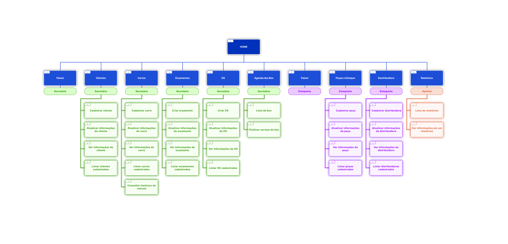

# Site Map

Fábrica de Software I · Protótipo do sistema · Milestones 2 e 3

O site map organiza as telas do Bancada, o sistema de gestão de oficina mecânica da RFP 2, em três níveis: a Home, as áreas de cada perfil de acesso e as telas de cada área. Ele indica quem acessa cada área e qual história de usuário justifica cada tela. O diagrama foi desenhado na página "01 · Site Map" do arquivo do Figma "[Gestão de Oficina Mecânica](https://www.figma.com/design/EHj0Js5KtOJ88TRQd5fTJI/Gest%C3%A3o-de-Oficina-Mec%C3%A2nica?node-id=1108-3313)" e exportado em [site-map.svg](site-map.svg).

## Níveis da hierarquia

| Nível | Elemento | Exemplo |
|---|---|---|
| 1 | Home: ponto de entrada após o login | HOME |
| 2 | Área: item do menu lateral, com o perfil que a acessa | Clientes (Secretária) |
| 3 | Tela: página da área, nomeada pela ação que a secretária, o estoquista ou o gerente realiza | Cadastrar cliente |

O Login não aparece como nó: ele é o estado inicial da Home para quem ainda não está autenticado (ver [IFML-01](ifml/README.md#ifml-01-acesso-e-painel)). As ações de confirmação e de exclusão são estados ou janelas dentro das telas do nível 3, e não nós próprios.

## Perfis de acesso

| Perfil | Cor no diagrama | Áreas | Situação das telas |
|---|---|---|---|
| Secretária | Verde | Painel, Clientes, Carros, Orçamentos, OS e Agenda dos Box | Todas as áreas têm wireframes |
| Estoquista | Roxo | Painel, Peças e Estoque e Distribuidora | Peças e Estoque e Distribuidora têm wireframes; o Painel do estoquista não tem |
| Gerente | Laranja | Relatórios | Uma tela desenhada (lista de relatórios) |

No Milestone 1, a secretária era o único perfil com login (ver [atores](../03-requisitos/README.md#atores)), e o estoquista e o gerente apareciam como perfis futuros. O site map atual distribui as áreas entre os três perfis. As telas e os modelos IFML concentram-se na secretária, porque é ela quem mais usa o sistema no dia a dia da oficina.

## Hierarquia

- HOME
  - **Secretária**
    - Painel
    - Clientes: Cadastrar cliente · Atualizar informações do cliente · Ver informações do cliente · Listar clientes cadastrados
    - Carros: Cadastrar carro · Atualizar informações do carro · Ver informações do carro · Listar carros cadastrados · Consultar histórico do veículo
    - Orçamentos: Criar orçamento · Atualizar informações do orçamento · Ver informações do orçamento · Listar orçamentos cadastrados
    - OS: Criar OS · Atualizar informações da OS · Ver informações da OS · Listar OS cadastradas
    - Agenda dos Box: Lista de box · Finalizar serviço do box
  - **Estoquista**
    - Painel
    - Peças e Estoque: Cadastrar peça · Atualizar informações da peça · Ver informações da peça · Listar peças cadastradas
    - Distribuidora: Cadastrar distribuidora · Atualizar informações da distribuidora · Ver informações da distribuidora · Listar distribuidoras cadastradas
  - **Gerente**
    - Relatórios: Lista de relatórios · Ver informações de um relatório

Total: 10 áreas (6 da secretária, 3 do estoquista e 1 do gerente) e 29 telas de nível 3. Os dois Painéis não têm filhos: a área é a própria tela.

## Tela, história e wireframe

Cada linha liga um nó do site map aos wireframes que o desenham, às histórias de [historias-de-usuario.md](../03-requisitos/historias-de-usuario.md) que o justificam e ao modelo IFML que descreve a navegação. Os números dos wireframes seguem o [índice das telas](<wireframes/Meuprojetooficina/0 - Índice.md>). Quando uma célula indica lacuna, a pendência correspondente está no [README do protótipo](README.md#pendências).

### Secretária

| Área | Tela (nível 3) | Wireframes | US | IFML |
|---|---|---|---|---|
| (Home) | Login, estado inicial | 1.01 | US-001 | IFML-01 |
| Painel | Painel (tela da própria área) | 2.01 | Sem US própria; o bloco "Prontos para retirada" atende parcialmente a US-002 | IFML-01 |
| Clientes | Listar clientes cadastrados | 5.01, 5.05 | US-010, US-005 (busca) | IFML-02 |
| Clientes | Cadastrar cliente | 5.02, 5.03, 5.04 | US-003 | IFML-02 |
| Clientes | Ver informações do cliente | 5.06 | US-013 | IFML-02 |
| Clientes | Atualizar informações do cliente | 5.07, 5.08, 5.09 | US-004 | IFML-02 |
| Carros | Listar carros cadastrados | 6.01, 6.04 | US-011 | IFML-03 |
| Carros | Cadastrar carro | 6.02, 6.03 | US-006 | IFML-03 |
| Carros | Ver informações do carro | 6.05 | US-014 | IFML-03 |
| Carros | Atualizar informações do carro | 6.06 | US-007 | IFML-03 |
| Carros | Consultar histórico do veículo | 6.07 a 6.11 | US-029, US-030 | IFML-06 |
| Orçamentos | Listar orçamentos cadastrados | 3.01, 3.02, 3.06, 3.13 a 3.22 | US-018, US-026 | IFML-05 |
| Orçamentos | Criar orçamento | 3.03, 3.04, 3.05 | US-016 | IFML-05 |
| Orçamentos | Ver informações do orçamento | 3.07, 3.12 | US-016 | IFML-05 |
| Orçamentos | Atualizar informações do orçamento | 3.08, 3.09, 3.10, 3.11 | US-016, US-017 | IFML-05 |
| OS | Listar OS cadastradas | 4.01 a 4.04, 4.07, 4.08 | US-012 | IFML-04 |
| OS | Criar OS | Sem formulário próprio: a OS é aberta pela ação "Iniciar execução" do orçamento aprovado (3.12) | US-008 | IFML-04 |
| OS | Ver informações da OS | 4.05, 4.09 | US-015, US-027 | IFML-04 |
| OS | Atualizar informações da OS | 4.05, 4.06 (finalizar a OS) | US-009, US-028 | IFML-04 |
| Agenda dos Box | Lista de box | 8.01, 8.03 | #42 | Sem modelo |
| Agenda dos Box | Finalizar serviço do box | 8.02, 8.03 | #42 | Sem modelo |
| Agenda dos Box | Designar box e mecânico (fora do site map, ver SM-02) | 8.04, 8.05 | #42 | Sem modelo |

### Estoquista

| Área | Tela (nível 3) | Wireframes | US | IFML |
|---|---|---|---|---|
| Painel | Painel do estoquista (tela da própria área) | Sem wireframe | Sem US (lacuna) | Sem modelo |
| Peças e Estoque | Listar peças cadastradas | 7.01, 7.02, 7.03, 7.12 a 7.17 | US-023 | IFML-07 |
| Peças e Estoque | Cadastrar peça | 7.04, 7.05, 7.18 | US-019 | IFML-07 |
| Peças e Estoque | Ver informações da peça | 7.06, 7.19; exclusão em 7.09 e 7.10 | US-020, US-022 | IFML-07 |
| Peças e Estoque | Atualizar informações da peça | 7.07, 7.08, 7.20 | US-021 | IFML-07 |
| Peças e Estoque | Alertas de estoque (fora do site map, ver SM-03) | 7.11 | US-024 | IFML-07 |
| Distribuidora | Listar distribuidoras cadastradas | 7.21 | Sem US (lacuna) | Sem modelo |
| Distribuidora | Cadastrar distribuidora | 7.22, 7.23, 7.24 | Sem US (lacuna) | Sem modelo |
| Distribuidora | Ver informações da distribuidora | 7.25 | Sem US (lacuna) | Sem modelo |
| Distribuidora | Atualizar informações da distribuidora | 7.26 | Sem US (lacuna) | Sem modelo |

Os wireframes 7.27 a 7.31 são a versão anterior das telas de peças. Eles ficam na pasta como registro do redesenho e não fazem parte do site map.

### Gerente

| Área | Tela (nível 3) | Wireframes | US | IFML |
|---|---|---|---|---|
| Relatórios | Lista de relatórios | 9.01 | Sem US; o RF-07 e o UC-023 cobrem o relatório da OS | Sem modelo |
| Relatórios | Ver informações de um relatório | Sem wireframe | Sem US (lacuna) | Sem modelo |

## Divergências entre o site map e os wireframes

| ID | Divergência | Tratamento proposto |
|---|---|---|
| SM-01 | O Painel do estoquista e a tela "Ver informações de um relatório" estão no site map, mas não têm wireframe. | Desenhar as duas telas ou marcá-las no diagrama como telas previstas. |
| SM-02 | A tela "Designar box e mecânico" (8.04 e 8.05) existe nos wireframes, mas não aparece na área Agenda dos Box. | Incluir o nó "Designar box e mecânico" na área Agenda dos Box. |
| SM-03 | A tela de alertas de estoque (7.11, US-024) não tem nó próprio. | Incluir o nó "Ver alertas de estoque" em Peças e Estoque, ou ligar o alerta ao Painel do estoquista. |
| SM-04 | A área Distribuidora e as telas de peças por marca e modelo (7.12 a 7.20) não têm história de usuário. Pelo material da disciplina, tela sem história é escopo sem justificativa. | Registrar as histórias no GitLab e substituir "US-xxx" nos nomes dos quadros do Figma. |
| SM-05 | Nos wireframes, a área de relatórios (9.01) mostra o menu completo da secretária, embora o site map a reserve ao gerente. Da mesma forma, as telas novas de peças mostram o menu da secretária para o usuário do almoxarifado. | Desenhar o menu lateral de cada perfil apenas com as áreas que o site map lhe atribui. |
| SM-06 | No diagrama, a Agenda dos Box e a Distribuidora estão no singular, e o último nó do gerente diz "Ver informações em um relatórios". | Corrigir os rótulos no Figma: "Agenda dos boxes", "Distribuidoras" e "Ver informações de um relatório". |

## Veja também

- [Protótipo: índice da pasta](README.md)
- [IFML: fluxos de interação](ifml/README.md)
- [Wireframes](wireframes/README.md) e [índice das telas](<wireframes/Meuprojetooficina/0 - Índice.md>)
- [Histórias de usuário](../03-requisitos/historias-de-usuario.md)
- [Matriz de rastreabilidade](../07-rastreabilidade/matriz.md)
