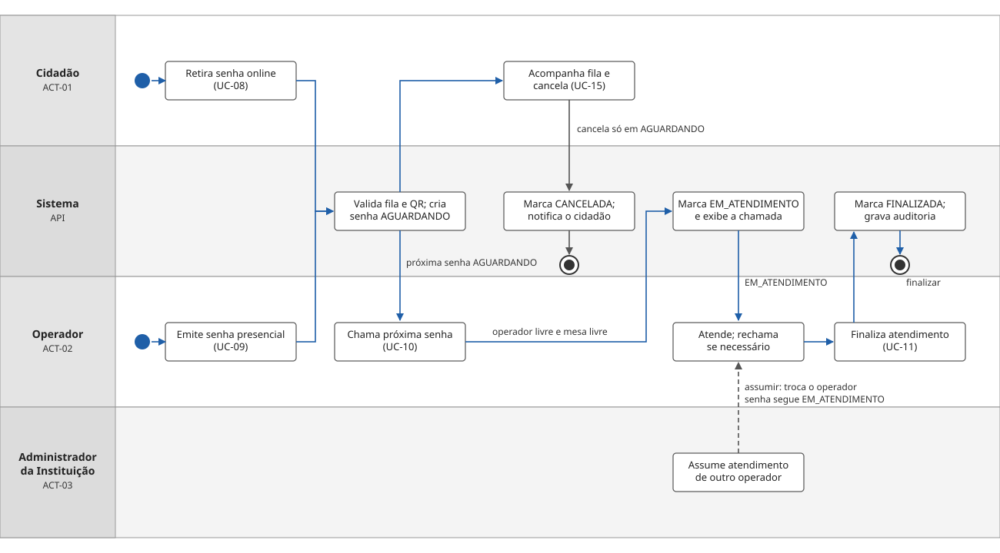
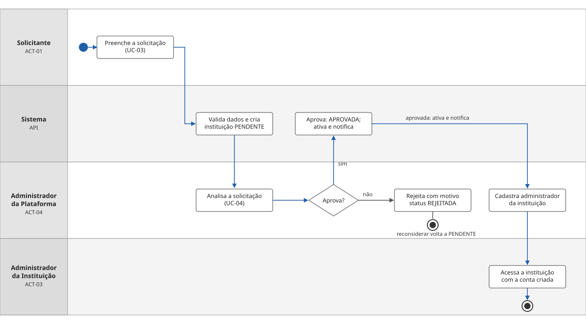

# Diagramas de atividades

Milestone 2 · Modelagem comportamental (Fábrica de Software I)

Os diagramas de atividades mostram o fluxo de trabalho entre atores e sistema, em raias. Cada raia é um ator: Cidadão (ACT-01), Operador (ACT-02), Administrador da Instituição (ACT-03), Administrador da Plataforma (ACT-04), e a raia Sistema, que representa a API. As transições de estado que cada ação dispara estão em [Máquinas de estados](../estados/README.md).

## Atendimento de uma senha

Pontos de controle do fluxo:

- Emissão: o cidadão retira a senha online (UC-08), com a fila ativa e sem outra senha sua ativa nela. O operador ou o administrador emite a senha presencial (UC-09). Em fila presencial, a emissão online exige QR Code válido.
- Chamada (UC-10): só o operador ou o administrador da instituição chama, e só com operador livre e mesa livre. Se o cidadão já estiver em atendimento em outra fila da instituição, a senha vai para o fim da fila e o sistema tenta a próxima. A senha devolvida pode não ser a pedida.
- Atendimento: rechamar reenvia a chamada ao painel e não muda o estado. Só o operador responsável pode rechamar.
- Assunção (UC-10): só o administrador da instituição assume o atendimento de outro operador. A senha continua EM_ATENDIMENTO.
- Cancelamento (UC-15): só em AGUARDANDO. Pode ser feito pelo dono, por administrador ou operador da mesma instituição, ou pelo administrador da plataforma.
- Finalização (UC-11): só em EM_ATENDIMENTO. A alta de flow também chega a FINALIZADA por esse caminho.

O encaminhamento de flow e a alta de flow não aparecem no diagrama: são fluxos de múltiplos steps e estão na máquina de estados da senha e do acompanhamento de flow.

## Solicitação e avaliação de instituição

Pontos de controle do fluxo:

- Solicitação (UC-03): qualquer usuário autenticado pode solicitar. A instituição nasce PENDENTE e inativa, e a rota não exige papel.
- Avaliação (UC-04): só o administrador da plataforma aprova, rejeita ou reconsidera. Rejeitar exige o motivo e deixa a instituição REJEITADA. Reconsiderar volta a PENDENTE e limpa o motivo.
- Aprovação: a instituição fica APROVADA e ativa, e o solicitante recebe e-mail. A aprovação não concede papel ADMIN_INSTITUICAO.
- Administrador da instituição: criado depois, em `POST /instituicoes/:instituicaoId/usuarios`, por ADMIN_PLATAFORMA ou ADMIN_INSTITUICAO. No diagrama, a criação aparece na raia do administrador da plataforma.

## Divergências

Diferenças entre o fluxo do código e a descrição acima. Detalhes e as demais divergências de estado estão em [Máquinas de estados, seção Divergências](../estados/README.md#divergências).

1. Em `chamar`, o sistema pode chamar outra senha além da pedida, quando a primeira é movida para o fim da fila. O cliente deve ler a senha devolvida na resposta, não assumir que é a pedida.
2. A solicitação de instituição não tem raia de ator específica no catálogo. A raia Solicitante representa qualquer usuário autenticado, não só o Cidadão.
3. `finalizar` não confere o operador responsável. Qualquer operador da instituição pode finalizar a senha de outro, diferentemente de `rechamar`.

## Veja também

- [Máquinas de estados](../estados/README.md): transições, guardas e quem pode disparar cada uma.
- [Casos de uso](../casos-de-uso/README.md): UC-03, UC-04, UC-08 a UC-11 e UC-15.
- [Diagramas de sequência](../sequencia/README.md): troca de mensagens entre cliente, API e banco.
- [Modelagem](../README.md): visão geral da unidade.
