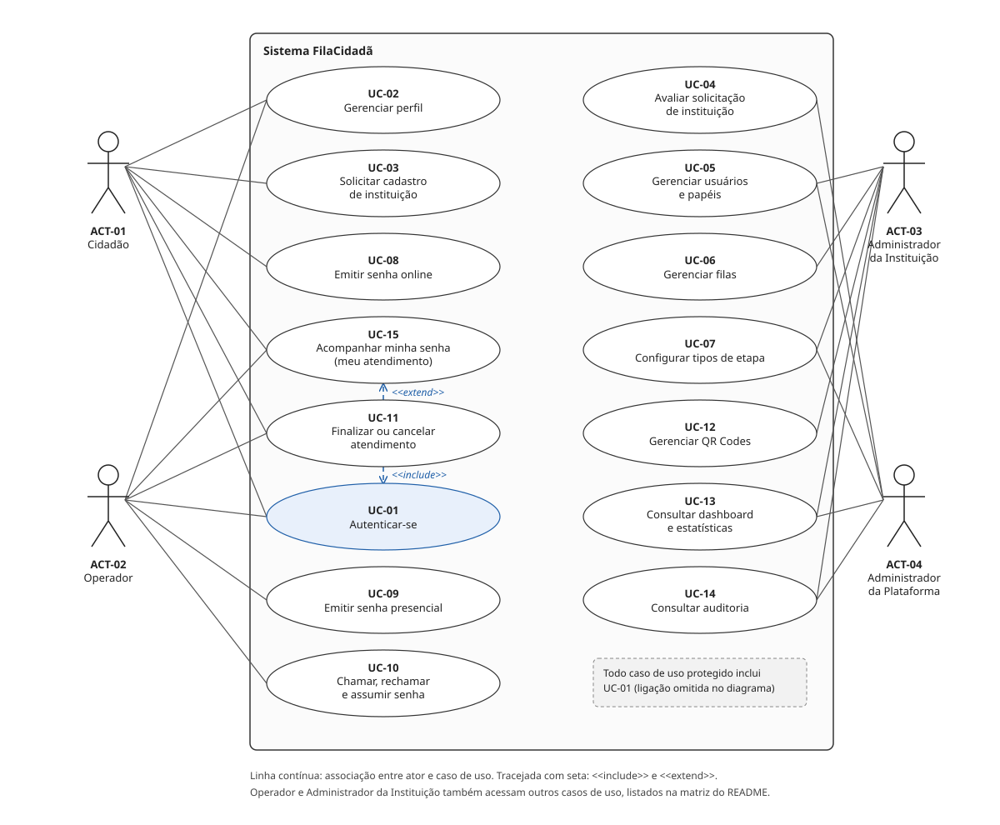

# Casos de uso

> Fábrica de Software I · Modelagem UML · Casos de uso do FilaCidadã (API de filas de atendimento)

Este documento descreve **o que** os atores fazem com o sistema, sem falar de tabelas, rotas ou classes. A fronteira é o próprio FilaCidadã; tudo fora dela (e-mail, notificação push, armazenamento de arquivos) é infraestrutura. Cada caso de uso (UC) tem um identificador fixo, usado em todos os artefatos do projeto: requisitos, histórias, diagramas de sequência e matriz de rastreabilidade.

## Diagrama

O diagrama mostra uma visão geral. Ele não repete todas as associações: o Operador e o Administrador da Instituição também executam casos de uso que não cabem no desenho. A matriz abaixo é a referência completa.

## Atores

Os atores correspondem aos papéis do enum `ROLES` em `src/constants/roles.js`. Um usuário pode acumular papéis, então um mesmo usuário pode aparecer como mais de um ator.

| ID | Ator | Papel no código | Vínculo | Resumo do que faz |
|---|---|---|---|---|
| ACT-01 | Cidadão | `USUARIO_FINAL` | nenhum | Retira senha, acompanha e cancela as próprias senhas, solicita cadastro de instituição |
| ACT-02 | Operador | `OPERADOR` | `instituicaoId` obrigatório | Emite senha presencial, chama, rechama e finaliza atendimentos, cria e edita filas e QR Codes |
| ACT-03 | Administrador da Instituição | `ADMIN_INSTITUICAO` | `instituicaoId` obrigatório | Tudo da própria instituição: filas, tipos de etapa, usuários, QR Codes, dashboard, auditoria; atende senhas e pode assumir atendimento de outro operador |
| ACT-04 | Administrador da Plataforma | `ADMIN_PLATAFORMA` | nenhum | Avalia solicitações de instituição, gerencia usuários de qualquer instituição, vê dashboard global e auditoria. Não chama nem finaliza senhas |

Regra de isolamento: ACT-02 e ACT-03 só alcançam recursos da própria instituição (`ensureInstituicao`). ACT-04 tem visão global.

## Fronteira do sistema

Dentro da fronteira: autenticação, cadastro de instituições e usuários, filas, senhas e seu ciclo de vida, QR Codes, auditoria e painéis. Fora dela: o provedor de e-mail e de notificações push (NPaaS), o armazenamento de arquivos (avatares e contratos) e o navegador ou aplicativo de quem consome a API.

## Relações entre casos de uso

**Include (inclusão).** Um caso de uso inclui outro quando o comportamento incluído é obrigatório e se repete em vários casos de uso.

- **UC-11 inclui UC-01.** Finalizar atendimento exige operador autenticado e ativo. Autenticar-se é comportamento comum a todos os casos de uso protegidos (UC-02 a UC-15). Por isso ele é tratado como inclusão e não repetido em cada fluxo. No diagrama, a inclusão aparece em um caso só, e a nota dentro da fronteira registra a regra geral.

**Extend (extensão).** Um caso de uso estende outro quando o comportamento é opcional e depende de uma condição que só existe em um ponto específico do caso base.

- **UC-11 estende UC-15.** Enquanto o cidadão acompanha a própria senha (UC-15), ela pode estar `AGUARDANDO`. Nesse ponto de extensão, o cidadão pode cancelar a senha. O cancelamento é o fluxo de cancelamento descrito em UC-11. A finalização de atendimento, que é o fluxo principal de UC-11, não é extensão de nada: é o que o operador faz no caso de uso dele.

## Matriz ator x caso de uso

X = executa o caso de uso. L = somente leitura (consulta). Em branco = sem acesso pela API.

| UC | Caso de uso | ACT-01 | ACT-02 | ACT-03 | ACT-04 |
|---|---|:-:|:-:|:-:|:-:|
| UC-01 | Autenticar-se (cadastro, login, logout) | X | X | X | X |
| UC-02 | Gerenciar perfil | X | X | X | X |
| UC-03 | Solicitar cadastro de instituição | X | | | |
| UC-04 | Avaliar solicitação de instituição | | | | X |
| UC-05 | Gerenciar usuários e papéis | | | X | X |
| UC-06 | Gerenciar filas | L | X | X | L |
| UC-07 | Configurar tipos de etapa | | L | X | X |
| UC-08 | Emitir senha online | X | | | |
| UC-09 | Emitir senha presencial | | X | X | |
| UC-10 | Chamar, rechamar e assumir senha | | X | X | |
| UC-11 | Finalizar ou cancelar atendimento | X | X | X | X |
| UC-12 | Gerenciar QR Codes | | X | X | L |
| UC-13 | Consultar dashboard e estatísticas | L | L | X | X |
| UC-14 | Consultar auditoria | | | X | X |
| UC-15 | Acompanhar minha senha (meu atendimento) | X | X | X | |

Na matriz, UC-11 aparece para ACT-01 e ACT-04 apenas no cancelamento: ACT-01 cancela a própria senha, ACT-04 cancela qualquer senha `AGUARDANDO`. ACT-02 e ACT-03 finalizam e cancelam.

## Especificação dos casos de uso

Convenções: os passos do fluxo principal são numerados. Cada extensão recebe o número do passo em que se bifurca, seguido de letra (2a, 3a, 3b). Respostas de erro usam os códigos HTTP do projeto. Os nomes de classes e serviços citados nas regras são os de `src/services/`.

### UC-01 Autenticar-se

| Campo | Detalhe |
|---|---|
| Ator principal | ACT-01 a ACT-04 |
| Pré-condições | Cadastro e login: nenhuma. Logout: sessão ativa. |
| Pós-condições | Sessão criada (com cabeçalho Bearer disponível) ou encerrada. Conta nova criada, sem papel administrativo. |
| US / RF | a definir (ver nota no fim do documento) |

**Fluxo principal: cadastro**
1. O ator informa nome, e-mail e senha.
2. O sistema envia a solicitação de cadastro ao BetterAuth (`POST /api/auth/sign-up/email`).
3. O sistema valida o e-mail, cria a conta e a sessão.
4. O sistema devolve a sessão ao ator.

**Fluxo principal: login**
1. O ator informa e-mail e senha (`POST /api/auth/sign-in/email`).
2. O sistema confere as credenciais.
3. O sistema cria a sessão e devolve o token no cabeçalho, por causa do plugin Bearer.
4. Nas requisições seguintes, o sistema lê a sessão e carrega os papéis do usuário.

**Fluxo principal: logout**
1. O ator solicita o encerramento (`POST /api/auth/sign-out`).
2. O sistema encerra a sessão.

**Extensões**
**Extensões do cadastro**
- **2a.** E-mail já cadastrado: o cadastro é recusado e o ator é orientado a fazer login.
- **2b.** Dados inválidos: o cadastro é recusado com a mensagem de validação.

**Extensões do login**
- **2a.** Credenciais inválidas: o login é recusado, sem informar qual campo está errado.
- **3a.** Usuário com `ativo = false`: a autenticação funciona, mas toda rota protegida responde 403.

**Regras de negócio**
- Usuário inativo autentica, mas recebe 403 em toda rota protegida (`AuthMiddleware.carregarContextoDoUsuario`).
- Os papéis são lidos a cada requisição a partir de `usuario_papeis`, com cache de 30 segundos. Ao alterar papéis, o cache é invalidado (`invalidarCachePapeis`).
- Cadastro pela rota pública nasce sem papel administrativo. Papéis administrativos são atribuídos por UC-05. Ver a divergência D5 sobre o papel de cidadão.

### UC-02 Gerenciar perfil

| Campo | Detalhe |
|---|---|
| Ator principal | ACT-01 a ACT-04 |
| Pré-condições | Usuário autenticado e ativo (UC-01) |
| Pós-condições | Dados do próprio perfil atualizados, senha alterada ou avatar trocado |
| US / RF | a definir |

**Fluxo principal**
1. O ator consulta o próprio perfil (`GET /me`).
2. Para alterar nome ou e-mail, envia os novos dados (`PATCH /me`).
3. Para trocar a senha, informa a senha atual e a nova (`PATCH /me/senha`).
4. Para trocar a foto, envia o arquivo (`POST /me/avatar`), ou remove a atual (`DELETE /me/avatar`).

**Extensões**
- **2a.** E-mail já em uso por outra conta: recusado (409, "Email já está em uso").
- **3a.** Senha atual incorreta: recusada (400, "Senha atual incorreta").
- **4a.** Tipo de arquivo fora de JPEG, PNG, WebP ou GIF: recusado (400).
- **4b.** Arquivo maior que 50 MB: recusado (400).

**Regras de negócio**
- O ator só altera o próprio perfil. Não existe rota para alterar o perfil de outro usuário por esta via.
- A senha não fica na tabela de usuários: é gravada na conta do BetterAuth (`UsuarioService.alterarSenha`).
- Fuso horário do usuário é listado por `GET /timezones`.

### UC-03 Solicitar cadastro de instituição

| Campo | Detalhe |
|---|---|
| Ator principal | ACT-01 (qualquer usuário autenticado pode fazê-lo) |
| Pré-condições | Usuário autenticado (UC-01) |
| Pós-condições | Instituição criada com status `PENDENTE`, vinculada ao solicitante. Administradores da plataforma notificados. |
| US / RF | a definir |

**Fluxo principal**
1. O ator preenche nome, CNPJ, e-mail, telefone, nome do responsável, endereço e, opcionalmente, descrição (até 500 caracteres).
2. O sistema valida os campos (`POST /instituicoes/solicitar`).
3. O sistema cria a instituição com status `PENDENTE` e registra o solicitante.
4. O sistema notifica os administradores da plataforma (`SOLICITACAO_INSTITUICAO`).
5. O sistema confirma o recebimento, mostrando o status `PENDENTE`.

**Extensões**
- **2a.** Campos inválidos: recusado com a lista de erros de validação (400).
- **3a.** Nome já existente: recusado (409), pela unicidade do nome no banco.

**Regras de negócio**
- Toda solicitação nasce `PENDENTE`. Nenhuma instituição pode operar antes de aprovação (UC-04).
- Administrador da plataforma pode criar instituição já `APROVADA` diretamente (`POST /instituicoes`). Esse caminho não passa por UC-04 e é uma exceção ao fluxo de solicitação.

### UC-04 Avaliar solicitação de instituição

| Campo | Detalhe |
|---|---|
| Ator principal | ACT-04 |
| Pré-condições | Existe solicitação de instituição em `PENDENTE` ou `REJEITADA` |
| Pós-condições | Instituição `APROVADA` (ativa), `REJEITADA` (com motivo) ou de volta a `PENDENTE` (reconsiderada). Solicitante notificado. |
| US / RF | a definir |

**Fluxo principal: aprovar**
1. O administrador lista as solicitações e abre uma (`GET /instituicoes`, `GET /instituicoes/:id`).
2. Escolhe aprovar e, opcionalmente, registra uma observação (`PATCH /instituicoes/:id/aprovar`).
3. O sistema marca a instituição como `APROVADA` e `ativo`, grava quem aprovou e quando, registra auditoria (`APROVAR_INSTITUICAO`) e notifica o solicitante.

**Fluxo alternativo A1: rejeitar**
- A1.1 O administrador informa o motivo, com pelo menos 5 caracteres (`PATCH /instituicoes/:id/rejeitar`).
- A1.2 O sistema marca `REJEITADA`, grava o motivo, registra auditoria (`REJEITAR_INSTITUICAO`) e notifica o solicitante.

**Fluxo alternativo A2: reconsiderar**
- A2.1 Para uma instituição `REJEITADA`, o administrador reabre a análise (`PATCH /instituicoes/:id/reconsiderar`).
- A2.2 O sistema volta o status para `PENDENTE` e registra auditoria (`RECONSIDERAR_INSTITUICAO`).

**Extensões**
- **2a.** Motivo ausente ou com menos de 5 caracteres: recusado (400).
- **2b.** Instituição fora do status exigido pela ação (por exemplo, rejeitar uma instituição já aprovada): recusado (400). Ver divergência D2.
- **1a.** Ator que não é administrador da plataforma: recusado (403).

**Regras de negócio**
- Só ACT-04 aprova, rejeita e reconsidera.
- Aprovar aceita instituição `PENDENTE` ou `REJEITADA` (`InstituicaoService.aprovar`). Ver divergência D1.
- Rejeitar só vale para `PENDENTE`. Reconsiderar só vale para `REJEITADA`.
- Contrato em PDF de até 10 MB pode ser anexado a uma instituição por ACT-04 (`POST /instituicoes/:id/contrato`).

### UC-05 Gerenciar usuários e papéis

| Campo | Detalhe |
|---|---|
| Ator principal | ACT-04 (todas as instituições) e ACT-03 (somente a própria) |
| Pré-condições | Ator autenticado com papel administrativo (UC-01) |
| Pós-condições | Usuário criado, alterado ou removido. Papéis atualizados e cache de papéis invalidado. |
| US / RF | a definir |

**Fluxo principal: criar**
1. O administrador informa nome, e-mail, papéis e instituição do novo usuário (`POST /instituicoes/:instituicaoId/usuarios`).
2. O sistema cria a conta com senha temporária e grava os papéis.
3. O sistema envia e-mail para definição de senha, pelo fluxo de redefinição do BetterAuth.

**Fluxo principal: consultar e alterar**
1. O administrador lista usuários (`GET /usuarios` ou `GET /instituicoes/:instituicaoId/usuarios`) e abre um deles (`GET /usuarios/:id`).
2. Altera dados e papéis (`PATCH /usuarios/:id`). Papéis enviados substituem os anteriores.

**Fluxo principal: remover**
1. O administrador remove o usuário (`DELETE /usuarios/:id`). O registro é apagado e o cache de papéis é invalidado.

**Extensões**
- **2a.** E-mail já em uso: recusado (409).
- **2b.** Papel administrativo (`ADMIN_INSTITUICAO` ou `OPERADOR`) sem instituição: recusado (400).
- **2c.** Instituição inexistente ou inativa: recusado (400).
- **1a.** ACT-03 tenta acessar usuário de outra instituição: recusado (403).
- **3a.** ACT-03 tenta remover usuário de outra instituição: recusado (403, "Sem permissão para remover este usuário").

**Regras de negócio**
- ACT-03 só enxerga e altera usuários da própria instituição. ACT-04 enxerga todos.
- Os papéis são validados contra o enum de quatro valores.
- Um usuário pode acumular papéis.
- Toda alteração gera auditoria (`CRIAR_USUARIO`, `ATUALIZAR_USUARIO`, `DELETAR_USUARIO`).
- Ver divergência D4: ACT-03 pode, pela implementação atual, atribuir o papel `ADMIN_PLATAFORMA`.

### UC-06 Gerenciar filas

| Campo | Detalhe |
|---|---|
| Ator principal | ACT-02 e ACT-03 (criar e editar), ACT-03 (excluir) |
| Pré-condições | Ator autenticado e vinculado à instituição da fila (UC-01) |
| Pós-condições | Fila criada, alterada ou removida. Auditoria registrada. |
| US / RF | a definir |

**Fluxo principal**
1. O operador ou o administrador lista as filas da instituição (`GET /filas`).
2. Cria uma fila informando nome, tipo de atendimento (`ONLINE`, `PRESENCIAL` ou `HIBRIDO`), mesas, prioridades habilitadas, modo de QR Code (`ROTATIVO` ou `FIXO`) e tempos (`POST /filas`).
3. Altera a fila quando necessário (`PATCH /filas/:id`).
4. Consulta quantas senhas aguardam na fila (`GET /filas/:id/senhas/contagem`).
5. ACT-03 remove a fila (`DELETE /filas/:id`). A remoção gera auditoria e avisa a instituição em tempo real (`fila:removida`).

**Extensões**
- **2a.** Instituição inexistente ou inativa: recusado (400).
- **2b.** Tentativa de criar fila em outra instituição: recusado (403).
- **3a.** Fila inexistente: recusado (404).
- **5a.** Operador tenta excluir: recusado (403). Só ACT-03 exclui.

**Regras de negócio**
- Fila `ativa` aceita senhas. Fila inativa recusa emissão (400, "Fila inválida ou inativa").
- As mesas são gravadas depois de a fila existir, na tabela de mesas (`FilaService.criar`).
- O modo de QR Code e os tempos de exibição, expiração e tolerância são usados por UC-12.
- Cada operação grava auditoria (`CRIAR_FILA`, `ATUALIZAR_FILA`, `DELETAR_FILA`).

### UC-07 Configurar tipos de etapa

| Campo | Detalhe |
|---|---|
| Ator principal | ACT-03 (e ACT-04, que também pode alterar) |
| Pré-condições | Ator autenticado com papel de administração (UC-01) |
| Pós-condições | Lista de tipos de etapa da instituição substituída por completo |
| US / RF | a definir |

**Fluxo principal**
1. O administrador consulta a lista atual (`GET /instituicoes/:instituicaoId/tipos-etapa`).
2. Envia a lista completa desejada (`PUT /instituicoes/:instituicaoId/tipos-etapa`).
3. O sistema substitui a lista inteira pela enviada.

**Extensões**
- **2a.** Instituição de outra organização: recusado (403).
- **1a.** Operador consulta a lista (somente leitura, L na matriz). Não pode alterar.

**Regras de negócio**
- O `PUT` substitui a lista inteira. Não há alteração parcial.
- Cada tipo tem código único dentro da instituição (`@@unique([instituicaoId, codigo])`).

### UC-08 Emitir senha online

| Campo | Detalhe |
|---|---|
| Ator principal | ACT-01 (papel `USUARIO_FINAL`) |
| Pré-condições | Cidadão autenticado (UC-01). Fila `ativa`. |
| Pós-condições | Senha criada com status `AGUARDANDO`, posição e número definidos. Operadores notificados. |
| US / RF | a definir |

**Fluxo principal**
1. O cidadão escolhe uma fila na lista de filas (`GET /filas`).
2. Se a fila for `PRESENCIAL` ou `HIBRIDO`, o cidadão lê o QR Code exibido no local. A leitura do código é pública e devolve nome, tipo e instituição da fila antes do login (`GET /qrcodes/buscar/:codigo`).
3. O cidadão solicita a senha (`POST /filas/:filaId/senhas`), enviando o código do QR Code quando a fila exigir.
4. O sistema valida a fila, a ausência de senha ativa do cidadão na fila, o QR Code e a prioridade.
5. O sistema cria a senha com status `AGUARDANDO`, calcula posição e número e registra auditoria (`CRIAR_SENHA`).
6. O sistema notifica os operadores da fila (`SENHA_NOVA_NA_FILA`) e devolve a senha ao cidadão.
7. O cidadão passa a acompanhar a senha (UC-15).

**Extensões**
- **2a.** Fila inativa: recusado (400, "Fila inválida ou inativa").
- **3a.** Cidadão já tem senha `AGUARDANDO` ou `EM_ATENDIMENTO` na mesma fila: recusado (409, "Usuário já possui senha ativa nesta fila").
- **4a.** Fila `PRESENCIAL` ou `HIBRIDO` sem QR Code válido: recusado (409, "QR Code inválido ou expirado").
- **4b.** Prioridade pedida (`LEGAL` ou `FIDELIDADE`) sem habilitação na fila: a senha é criada como `NORMAL`, sem erro.
- **1a.** Operador ou administrador tenta emitir pela rota online: recusado (403). Eles usam UC-09.

**Regras de negócio**
- Ordem fixa de validação em `SenhaService.criar`: autenticação e ativação, fila, duplicidade, QR Code, prioridade, número, persistência.
- Posição e número são calculados em transação, para que duas senhas simultâneas não recebam o mesmo número.
- Validade do QR Code rotativo: a senha só é aceita dentro de `validoAte` ou da tolerância (`toleranciaAte`).
- Não há reordenação retroativa: a prioridade define a posição inicial.

### UC-09 Emitir senha presencial

| Campo | Detalhe |
|---|---|
| Ator principal | ACT-02 e ACT-03 |
| Pré-condições | Ator autenticado e vinculado à instituição da fila. Fila `ativa`. |
| Pós-condições | Senha criada com status `AGUARDANDO`, sem vínculo com conta de cidadão. |
| US / RF | a definir |

**Fluxo principal**
1. O atendente, no balcão, escolhe a fila e informa o nome do cidadão.
2. Opcionalmente, informa a prioridade do atendimento.
3. O sistema cria a senha com `nomeCidadao` e sem `usuarioId` (`POST /filas/:filaId/senhas/presencial`).
4. O sistema registra auditoria (`CRIAR_SENHA`) e notifica os operadores da fila.
5. O sistema devolve o número da senha ao atendente.

**Extensões**
- **2a.** Fila de outra instituição: recusado (403, "Acesso negado: fila pertence a outra instituição").
- **2b.** Fila inativa: recusado (400).
- **1a.** Cidadão tenta usar a rota presencial: recusado (403).

**Regras de negócio**
- Não exige QR Code. A senha presencial segue a mesma ordem de prioridades e a mesma posição da senha online.
- Como não há conta vinculada, o cidadão presencial não acompanha a senha pela API. Quem acompanha é o atendente, pela fila.

### UC-10 Chamar, rechamar e assumir senha

| Campo | Detalhe |
|---|---|
| Ator principal | ACT-02 e ACT-03 (chamar e rechamar). ACT-03 (assumir). |
| Pré-condições | Ator autenticado e vinculado à instituição. Para chamar, existe senha `AGUARDANDO` na fila. |
| Pós-condições | Chamar: senha `EM_ATENDIMENTO` com operador e mesa. Rechamar: estado inalterado. Assumir: operador responsável trocado. |
| US / RF | a definir |

**Fluxo principal: chamar**
1. O operador escolhe a fila e vê a próxima senha, pela ordem de prioridade e posição.
2. Informa a mesa (opcional) e chama a senha (`POST /senhas/:id/chamar`).
3. O sistema valida as regras de atendimento (ver extensões).
4. O sistema grava o operador, a mesa e o nome da mesa, muda o status para `EM_ATENDIMENTO`, registra auditoria (`CHAMAR_SENHA`) e notifica o cidadão (`SENHA_CHAMADA`) e o próximo da fila (`SENHA_PROXIMA`).

**Fluxo alternativo: rechamar**
- 5. O operador responsável chama o cidadão de novo (`POST /senhas/:id/rechamar`). O status não muda. Registra auditoria (`RECHAMAR_SENHA`).

**Fluxo alternativo: assumir**
- 6. O administrador da instituição assume um atendimento em curso de outro operador (`POST /senhas/:id/assumir`). O operador responsável passa a ser o administrador. Registra auditoria (`ASSUMIR_ATENDIMENTO`) e notifica o operador anterior (`SENHA_TRANSFERIDA`).

**Extensões**
- **2a.** Senha não está `AGUARDANDO`: recusado (409, "Apenas senhas com status AGUARDANDO podem ser chamadas").
- **3a.** O operador já atende outra senha: recusado (409, indicando a senha e a fila em atendimento).
- **3b.** Mesa informada já ocupada por outro atendimento: recusado (409, "Estação … já está em uso").
- **3c.** Senha de outra instituição: recusado (403).
- **5a.** Quem rechama não é o operador responsável: recusado (403, "Apenas o operador responsável pode rechamar a senha").
- **5b.** Senha não está `EM_ATENDIMENTO`: recusado (409).
- **6a.** Administrador tenta assumir a própria senha: recusado (409, "Você já é o operador deste atendimento").
- **6b.** Administrador já atende outra senha: recusado (409).
- **6c.** Operador tenta assumir: recusado (403). Só o administrador assume.

**Regras de negócio**
- Um operador atende uma senha por vez.
- Uma mesa atende uma senha por vez.
- A próxima senha é a de menor peso de prioridade e, em seguida, a de menor posição.
- Rechamar não altera o estado nem o operador responsável.

### UC-11 Finalizar ou cancelar atendimento

| Campo | Detalhe |
|---|---|
| Ator principal | ACT-02 e ACT-03 (finalizar). ACT-01, ACT-02, ACT-03 e ACT-04 (cancelar, conforme regra abaixo). |
| Pré-condições | Finalizar: senha `EM_ATENDIMENTO` atendida pelo ator. Cancelar: senha `AGUARDANDO`. |
| Pós-condições | Senha `FINALIZADA` (terminal) ou `CANCELADA` (terminal). Auditoria registrada. |
| US / RF | a definir |

**Fluxo principal: finalizar**
1. O operador responsável conclui o atendimento (`POST /senhas/:id/finalizar`).
2. O sistema muda o status para `FINALIZADA`, registra auditoria (`FINALIZAR_SENHA`) e emite evento em tempo real.
3. O operador fica livre para chamar outra senha (UC-10).

**Fluxo alternativo A: cancelar** (estende UC-15, no ponto em que a senha está `AGUARDANDO`)
- A1. O ator solicita o cancelamento (`POST /senhas/:id/cancelar`).
- A2. O sistema confere se a senha está `AGUARDANDO`.
- A3. O sistema confere a permissão: o dono da senha, operador ou administrador da mesma instituição, ou administrador da plataforma.
- A4. O sistema muda o status para `CANCELADA`, registra auditoria (`CANCELAR_SENHA`) e notifica o cidadão.

**Extensões**
- **1a.** Finalizar senha que não está `EM_ATENDIMENTO`: recusado (409, "Apenas senhas EM_ATENDIMENTO podem ser finalizadas").
- **A1a.** Senha de outra instituição, para operador ou administrador: recusado (403).
- **A2a.** Senha que não está `AGUARDANDO`: recusado (409, "Senha não pode ser cancelada").
- **A3a.** Ator sem permissão, como outro cidadão: recusado (403, "Sem permissão para cancelar esta senha").

**Regras de negócio**
- `CANCELADA` e `FINALIZADA` são terminais.
- Cancelar só é possível em `AGUARDANDO`. Finalizar só é possível em `EM_ATENDIMENTO`.
- Cancelamento por operador é permitido pelo código (`SenhaService.cancelar`), embora a documentação de regras não o liste. Ver divergência D3.

### UC-12 Gerenciar QR Codes

| Campo | Detalhe |
|---|---|
| Ator principal | ACT-02 e ACT-03 (criar, regenerar, desativar). ACT-04 consulta. |
| Pré-condições | Ator autenticado e vinculado à instituição da fila. Fila `ativa`. |
| Pós-condições | QR Code criado, regenerado ou desativado. Auditoria registrada. |
| US / RF | a definir |

**Fluxo principal**
1. O operador ou o administrador lista os QR Codes (`GET /qrcodes`) e consulta um deles (`GET /qrcodes/:id`).
2. Cria o QR Code de uma fila (`POST /qrcodes`), ou regenera o da fila (`POST /qrcodes/regenerar`), que desativa o anterior e cria outro.
3. Quando necessário, desativa um QR Code (`PATCH /qrcodes/:id/desativar`).
4. O sistema registra auditoria (`GERAR_QRCODE`) e emite o evento `qrcode:regenerado` quando há regeneração.

**Extensões**
- **2a.** Fila inativa: recusado (400).
- **2b.** Fila de outra instituição: recusado (403).
- **3a.** QR Code inexistente: recusado (404).

**Regras de negócio**
- QR Code **rotativo**: o código de exibição vale 5 minutos por padrão, a expiração é 2 vezes o tempo de exibição e a tolerância é 1 vez, todos configuráveis na fila.
- QR Code **fixo** reaproveita o código ativo da fila, se existir. Sua validade é de 10 anos.
- A comparação do código não diferencia maiúsculas de minúsculas.
- Não há rotina de limpeza: um QR Code expirado continua na tabela, marcado como inativo ou com data vencida.

### UC-13 Consultar dashboard e estatísticas

| Campo | Detalhe |
|---|---|
| Ator principal | ACT-04 (painel global) e ACT-03 (painel da instituição). ACT-02 consulta o painel da instituição. ACT-01 consulta as próprias estatísticas. |
| Pré-condições | Ator autenticado (UC-01) |
| Pós-condições | Indicadores exibidos. Nenhum dado alterado. |
| US / RF | a definir |

**Fluxo principal**
1. O ator abre o painel adequado ao seu papel: `GET /dashboard/admin` (ACT-04) ou `GET /dashboard/instituicao` (ACT-02, ACT-03, ACT-04).
2. Para indicadores agregados de senhas, consulta `GET /senhas/stats`.
3. Para relatório com período, consulta `GET /senhas/stats/relatorio` com a data inicial e a final.
4. O sistema aplica o escopo do papel e devolve os indicadores.

**Extensões**
- **1a.** Ator sem o papel exigido pelo painel: recusado (403).

**Regras de negócio**
- ACT-04 vê todos os dados. Ao informar `instituicaoId`, consulta uma instituição específica.
- ACT-02 e ACT-03 veem apenas a própria instituição.
- ACT-01 vê apenas as próprias senhas.
- Sem data informada, o fuso padrão de cálculo é `America/Manaus`.

### UC-14 Consultar auditoria

| Campo | Detalhe |
|---|---|
| Ator principal | ACT-04 (todas as instituições) e ACT-03 (somente a própria) |
| Pré-condições | Ator autenticado com papel administrativo (UC-01) |
| Pós-condições | Nenhuma. Consulta apenas. |
| US / RF | a definir |

**Fluxo principal**
1. O administrador abre a lista de auditoria (`GET /auditorias`).
2. Aplica filtros e paginação (padrão de 20 registros por página).
3. O sistema aplica o escopo do papel e devolve os registros: ação, entidade, identificador da entidade, usuário, instituição e data.

**Extensões**
- **1a.** Operador ou cidadão tenta consultar: recusado (403).
- **3a.** Nenhum registro encontrado: lista vazia, sem erro.

**Regras de negócio**
- ACT-03 vê apenas registros da própria instituição (`AuditoriaService.listar`).
- A auditoria é gravada pelos casos de uso de escrita. As ações possíveis estão no enum `AUDITORIA_ACOES` (`src/constants/auditoria.js`).
- Registros não são alterados nem apagados pela API.

### UC-15 Acompanhar minha senha (meu atendimento)

| Campo | Detalhe |
|---|---|
| Ator principal | ACT-01 (acompanha a própria senha). ACT-02 e ACT-03 (acompanham o próprio atendimento). |
| Pré-condições | Ator autenticado (UC-01). Para ACT-01, existe senha emitida (UC-08 ou UC-09). |
| Pós-condições | Nenhuma. Consulta e troca de mensagens. |
| US / RF | a definir |

**Fluxo principal: cidadão**
1. O cidadão lista as próprias senhas (`GET /senhas`). O sistema devolve somente as dele.
2. Abre uma senha (`GET /senhas/:id`) e acompanha posição, status e fila.
3. Sem login, acompanha pelo link público (`GET /publico/senhas/:token/status`), que mostra número, status, posição, fila e etapa atual.
4. Recebe notificações de chamada e de senha próxima (UC-10).
5. Com a senha `EM_ATENDIMENTO`, troca mensagens com o operador pelo chat (`GET` e `POST /senhas/:id/chat`).

**Fluxo principal: operador ou administrador**
1. O operador consulta o próprio atendimento ativo, em qualquer fila (`GET /senhas/meu-atendimento`).

**Pontos de extensão**
- **3a (ponto: senha `AGUARDANDO`).** O cidadão pode cancelar a senha. Fluxo em UC-11.
- **2a.** Senha de outro usuário: recusado (403, "Acesso negado: senha pertence a outro usuário").
- **5a.** Chat fora de `EM_ATENDIMENTO`: recusado (409).
- **5b.** Mensagem de quem não é o cidadão dono ou o operador responsável: recusado (403). Administradores da instituição leem o chat, mas não enviam.

**Regras de negócio**
- O link público não exige login. Ele expõe apenas o necessário para acompanhar a fila.
- Mensagens do chat guardam o nome do autor no momento do envio. Renomear o usuário não altera o histórico.
- Notificações não são apagadas. Marcar como lida apenas atualiza o estado.
- O nome deste caso de uso no catálogo aceita duas leituras: "minha senha" (cidadão) e "meu atendimento" (operador). Este documento trata as duas no mesmo caso de uso, conforme o catálogo fixo.

## Divergências

Diferenças encontradas entre o código e a documentação `documentacao/03-papeis-e-regras.md`, ou entre o código e o próprio catálogo. Segue o código. Nada foi corrigido aqui: os itens são para decisão do grupo.

- **D1. Aprovação de instituição.** O código aceita aprovar instituição `PENDENTE` ou `REJEITADA` (`InstituicaoService.aprovar`). A documentação diz "só em PENDENTE". Este documento segue o código.
- **D2. Código de erro em transição inválida de instituição.** O código responde 400 para aprovar, rejeitar e reconsiderar fora do status permitido. A documentação diz que transição inválida responde 409.
- **D3. Cancelamento de senha por operador.** O código permite que `OPERADOR` cancele senha da instituição (`SenhaService.cancelar`, uso de `PAPEIS_ADMIN_INSTITUICAO`). A documentação lista só dono, administrador da instituição e administrador da plataforma.
- **D4. Risco de permissão.** A validação de papel aceita qualquer valor do enum em criação e alteração de usuário. Não há checagem de que `ADMIN_INSTITUICAO` não atribua `ADMIN_PLATAFORMA` (`UsuarioService.criar` e `atualizar`). Além disso, a alteração de papel não repete a exigência de `instituicaoId` para papéis administrativos. Isso contraria o isolamento descrito na documentação. Não é corrigido aqui: é assunto de segurança e exige decisão do grupo.
- **D5. Papel de cidadão no cadastro.** O cidadão precisa do papel `USUARIO_FINAL` para emitir senha (UC-08). Nenhum trecho de `src/` atribui esse papel automaticamente no cadastro por `sign-up`. A documentação diz apenas que o cadastro "nasce sem papel administrativo". Confirmar se o papel vem de seed, de cadastro manual ou de outra rotina.
- **D6. Flows fora do catálogo.** As rotas de flow (ingressar, encaminhar, dar alta, criar e editar flows) não têm caso de uso próprio no catálogo fixo. Opções: incluir como UC-16, ou tratar como parte de UC-06 (configuração) e UC-10 (operação). Decisão do grupo, sem alterar o catálogo agora.
- **D7. Notificações.** O envio e a leitura de notificações (`/notificacoes`) também não têm caso de uso próprio. Estão implícitos nos UC que disparam notificação (UC-03, UC-04, UC-08, UC-09, UC-10).
- **D8. Estado de sessão.** A documentação diz que sair de um papel "vale no request seguinte" e, na mesma linha, que há cache de 30 segundos. As duas coisas não coincidem: a mudança pode levar até 30 segundos para valer.
- **D9. US e RF pendentes.** Os IDs de US e RF de cada caso de uso dependem de `docs/03-requisitos/historias-de-usuario.md` e `requisitos-funcionais.md`, que ainda não existem neste ramo. Os campos "US / RF" estão como "a definir" até a publicação dessas listas.

## Veja também

- [Visão geral da modelagem](../README.md)
- [Diagrama de casos de uso](casos-de-uso.svg)
- [Requisitos funcionais](../../03-requisitos/requisitos-funcionais.md)
- [Histórias de usuário](../../03-requisitos/historias-de-usuario.md)
- [Papéis e regras de negócio (documentação atual)](../../../documentacao/03-papeis-e-regras.md)
- [Glossário](../../01-visao/glossario.md)
