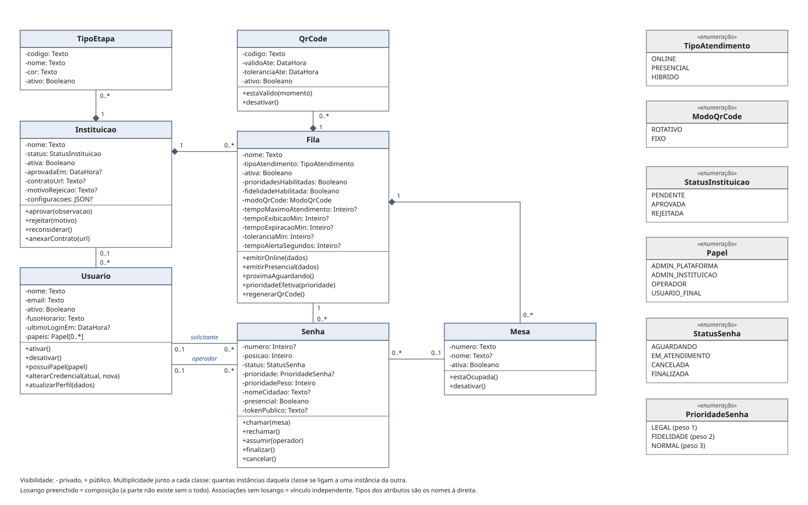

# Diagrama de classes de domínio

Milestone 2 · Modelagem do domínio (Fábrica de Software I)

O diagrama modela o domínio da Gestão de Oficina Mecânica de Carros: as classes que o negócio reconhece, seus atributos, operações e associações. Não é diagrama de tabelas, controllers ou DAO. O mapeamento para o banco está em [dicionário de dados](../../06-banco-de-dados/dicionario-de-dados.md).

## Arquivos

- [classes.svg](classes.svg): núcleo do domínio (Cliente, Funcionario, Veiculo, Orcamento, OrdemServico, etc.) e enumerações.

## Lista oficial de classes

| Classe | Responsabilidade | Telas (perfil) | Tabela |
|---|---|---|---|
| Pessoa | Pessoa com ou sem acesso ao sistema. Pode estar vinculada a um Cliente ou Funcionário. | Secretária login, cadastros, listagens, atualizações, visualiações. Estoquista: login, cadastros, listagens, atualizações, visualiações, Gerente: visualizações | `pessoa` (papéis em `funcionario`) |
| Endereço | Informação de localização do cliente | Secretária (cadastro, listagem, atualização e visualização) | papéis em `pessoa` |
| Cliente | Pessoa que traz o veículo para fazer o orçamento. |  ||
| Veiculo | Veículo do cliente. Se víncula ao Orçamento | Secretária (cadastro, listagem, atualização e visualização) | `veiculo` |
| Orcamento | Orçamento feito para o Veículo. Passa pelo ciclo EM ABERTA, ORÇADA, APROVADA e RECUSADO | Secretária (cadastro, listagem, atualização e visualização) | `orcamento ` |
| OrdemServico | Valor e detalhes do serviço a ser executado no veículo. Possa pelo ciclo APROVADO, EM EXECUÇÃO e CONCLUÍDO | Secretária (cadastro, listagem, atualização e visualização) | `ordem_servico` |
| Box | Local onde será executada a Ordem de Serviço. Passa pelo ciclo LIVRE e EM EXECUÇÃO | Secretária: (seleção) | `box` |
| Servico | Tipo de servico a ser realizado no veículo. | Secretária (seleção) | `servico ` |
| Funcao | Função desemplenhada pelo funcionário e é, também, o __NÍVEL DE ACESSO__ ao sistema. | DBA | `funcao` |
| Peca | Peças presentes no estoque e que podem compor o Orçamento do veículo. | Estoquista (cadastro, listagem, atualização e visualização), Secretária (seleção) | `peca` |
| CarroMarca | Marca do veículo do cliente, mas é vínculado ao Modelo. | Secretária (seleção) | `carro_marca` |
| CarroModelo | Modelo do carro do cliente. | Secretária (seleção) | `carro_modelo` |
| ItemOrcamentoPeca | Classe associativa que vincula Peça ao Orçamento. | Secretária (orçamento) | `orcamento_peca` |
| Distribuidora | Reponsável pela venda da peça à oficina. | Estoquista (cadastro, listagem, atualização e visualização) | `distribuidora ` |
| PecaDistribuidora | Classe associativa que vincula Peça a Distribuidora | Estoquista (seleção) | `peca_distribuidora` |
| Compatibilidade | Classe associativa entre Peça e Modelo do carro | Estoquista (visualização), Secretária (seleção) | `peca_modelo` |
| HistoricoStatusOS | Guarda as informações do histórico de status da Ordem de Serviço | Gerente (relatório ) | `ordem_servico_historico` |

## Associações e multiplicidades

Leitura: o número junto a uma classe indica quantas instâncias dela se ligam a uma instância da outra. Losango preenchido indica composição.

| Associação | Multiplicidade (A e B) | Tipo | Observação |
|---|---|---|---|
| Cliente e Pessoa | -- | Herança | |
| Cliente e Veiculo | 1 e * | Agregação | Cliente deve ser cadastrado antes do veículo |
| ItemOrcamentoPeca e Orcamento | * e 1 | Composição | |
| ItemOrcamentoServico e Orcamento | * e 1 | Composição | |
| Funcionario e HistoricoStatusOS | 1 e * | Associação | |
| Funcionario e Orcamento | 1 e * | Associação | |
| Funcionario e Funcao | * e 1 | Associação | As funções devem estar previamente cadastradas no sistema |
| Funcionario e Pessoa | -- | Herança | Informações pessoais, ficam em Pessoa |
| OrdemServico e Box | * e 0..1 | Associação | |
| OrdemServico e Funcionario | * e 0..1 | Associação | |
| CarroMarca e CarroModelo | 1 e * | Associação | Marca deve existir antes do modelo |
| CarroModelo e Veiculo | 1 e * | Associação | Modelo deve existir antes do veículo |
| CarroModelo e Compatibilidade | 1 e * | Associação | |
| Peca e Compatibilidade | 1 e * | Associação | |
| Peca e ItemOrcamentoPeca | 1 e * | Associação | |
| Peca e PecaDistribuidora | 1 e * | Associação | |
| Distribuidora e PecaDistribuidora | 1 e * | Associação | |
| Endereco e Distribuidora | 1 e 0..1 | Composição | |
| Endereco e Pessoa | 1 e 0..1 | Composição | |
| Servico e ItemOrcamentoServico| 1 e * | Associação | |
| HistoricoStatusOS e OrdemServico | * e 1 | Composição | |
| Veiculo e Orcamento | 1 e * | Associação | |
| Orcamento e OrdemServico | 1 e 0..1 | Associação | OS só pode ser aberta para orçamento `APROVADO` |

## Enumerações

| Enumeração | Literais | Usada em |
|---|---|---|
| Papel | Secretária, Estoquista, Gerente | Funcionario.funcao |
| status(OS) | Aprovado, Em Execução e Concluído | OrdemServico.status |
| statusAnterior | Aprovado, Em Execução e Concluído | HistoricoStatusOS.statusAnterior |
| statusNovo | Aprovado, Em Execução e Concluído | HistoricoStatusOS.statusNovo |
| status(Box) | Livre e Em Execução | Box.status |
| status(Orcamento) | Em Aberta, Orçada, Aprovada e Recusado | Orcamento.status |

## Decisões de modelagem

- **Papel como enumeração, não classe.** `Usuario.papeis` é um conjunto de `Papel`. A tabela `usuario_papeis` é só a persistência desse conjunto. Não há herança entre perfis: um mesmo usuário pode acumular papéis (ex.: admin de instituição que também atende como operador), então subclasses como `Operador` ou `Cidadao` estariam erradas.
- **Escopo do domínio.** Ficaram fora as tabelas técnicas do BetterAuth (`sessions`, `accounts`, `verifications`), as chaves primárias e as chaves estrangeiras. Identificadores e FKs são do modelo lógico, não do diagrama de classes.
- **Composição onde a parte não tem sentido sozinha.** Tipos de etapa, filas, mesas, QR Codes, etapas e transições de fluxo, e o histórico de um rastreio. Senha não é composição de Fila: é associação, com ciclo próprio como registro de atendimento. A exclusão em cascata de fila é regra do banco, não do domínio.
- **Operações de domínio, não endpoints.** Os nomes seguem as regras (ex.: `Senha.chamar`, `Fila.emitirOnline`, `Instituicao.reconsiderar`), não as rotas HTTP. Cada operação corresponde a uma transição ou regra do service.
- **Estados ficam em `estados/`.** O enum `StatusSenha` aparece como atributo; as transições e guardas (ex.: cancelar só em AGUARDANDO) são do diagrama de estados.
- **Prioridade congelada na emissão.** `Senha.prioridadePeso` guarda o peso no momento da criação, porque a ordem de atendimento (`prioridadePeso`, `posicao`) depende dele. Mudar a configuração da fila não reordena senhas emitidas.
- **Snapshots.** `HistoricoFluxo.filaSnapshot` e `ChatMensagem.nomeAutor` guardam texto do momento do registro, para que o histórico sobreviva a alterações ou exclusões.
- **Mesa referenciada pelo número.** Em `Senha`, a estação é gravada pelo número. A associação Mesa e Senha existe no modelo, mas é ligação lógica (ver divergências).
- **Associações omitidas do apoio.** Notificacao e Auditoria têm ligação com Instituicao. Ela está na tabela acima e não foi desenhada em `classes-apoio.svg`, porque o desenho cruzaria as demais ligações.

## Divergências

Divergências entre o schema, o código e o catálogo do briefing. Quando divergem, o código é a referência.

1. **PrioridadeSenha.NORMAL.** O enum do schema tem `NORMAL`, e a documentação de regras (`documentacao/03-papeis-e-regras.md`) o define com peso 3. O código não persiste `NORMAL`: grava `prioridade = null` quando a prioridade efetiva não é LEGAL nem FIDELIDADE, e usa peso 3 como padrão. O modelo segue o schema (três literais); o banco e o código guardam a ausência de prioridade.
2. **Senha.mesa sem FK.** O schema guarda a estação como texto (`mesa`, `mesaNome`) e não tem chave estrangeira para `mesas`. A associação Mesa e Senha é lógica. Duas senhas com a mesma estação em atendimento são barradas pelo código, não pelo banco.
3. **TipoEtapa sem vínculo com o fluxo.** `tipos_etapa` não tem chave estrangeira de nenhuma outra tabela. `flow_steps.tipo` é texto livre (o seed usa RECEPCAO, TRIAGEM, ATENDIMENTO), sem relação com `TipoEtapa.codigo`. Não confirmei se essa ligação deveria existir; o modelo mantém as duas classes separadas.
4. **StatusRastreio.CANCELADO sem uso.** O enum tem `CANCELADO`, mas nenhuma rotina do código encontrada por busca grava esse valor. Mantido no modelo por estar no schema.
5. **Papel fora da lista de classes do briefing.** O briefing lista `Papel` entre as classes de domínio. O modelo a trata como enumeração (ver decisões). Não é divergência com o código, que usa `ROLES` como constante.

## Veja também

- [Casos de uso](../casos-de-uso/README.md)
- [Sequência](../sequencia/README.md)
- [Atividades](../atividades/README.md)
- [Estados](../estados/README.md)
- [OCL e divergências](../ocl/README.md)
- [Modelo conceitual](../../06-banco-de-dados/modelo-conceitual.svg) e [modelo lógico](../../06-banco-de-dados/modelo-logico.svg)
- [Dicionário de dados](../../06-banco-de-dados/dicionario-de-dados.md)
- [Modelagem (índice)](../README.md)
