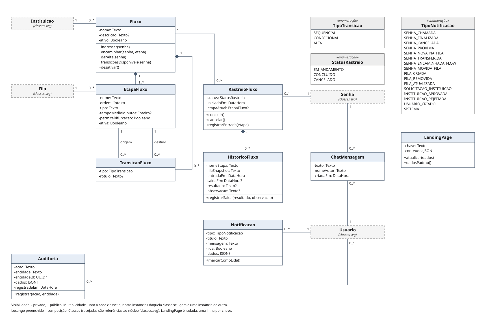

# Diagrama de classes de domínio

Milestone 2 · Modelagem do domínio (Fábrica de Software I)

O diagrama modela o domínio do FilaCidadã: as classes que o negócio reconhece, seus atributos, operações e associações. Não é diagrama de tabelas, controllers ou DAO. O mapeamento para o banco está em [dicionário de dados](../../06-banco-de-dados/dicionario-de-dados.md).

## Arquivos

- [classes.svg](classes.svg): núcleo do domínio (Instituicao, TipoEtapa, Usuario, Fila, Mesa, QrCode, Senha) e enumerações.
- [classes-apoio.svg](classes-apoio.svg): fluxos (Fluxo, EtapaFluxo, TransicaoFluxo, RastreioFluxo, HistoricoFluxo), ChatMensagem, Notificacao, Auditoria e LandingPage. Instituicao, Fila, Senha e Usuario aparecem tracejadas, como referência ao núcleo.

## Lista oficial de classes

Nomes oficiais. OCL, estados e sequência usam estes mesmos nomes. Telas são citadas por perfil (CID, OPE, ADI, ADP, PUB); os IDs finais dos wireframes são da frente de protótipo.

| Classe | Responsabilidade | Telas (perfil) | Tabela |
|---|---|---|---|
| Usuario | Pessoa com acesso ao sistema. Acumula papéis e pode estar vinculada a uma instituição. | PUB (login, cadastro), CID (perfil), ADI e ADP (usuários) | `users` (papéis em `usuario_papeis`) |
| Instituicao | Órgão atendido. Passa pelo ciclo PENDENTE, APROVADA ou REJEITADA. | PUB (solicitação), ADP (avaliação), ADI (dados) | `instituicoes` |
| TipoEtapa | Vocabulário de etapas que a instituição configura. | ADI (tipos de etapa) | `tipos_etapa` |
| Fila | Serviço de atendimento. Define regras de emissão, prioridade e QR Code. | CID (escolher fila), OPE e ADI (filas) | `filas` |
| Mesa | Estação de atendimento de uma fila, identificada por número. | OPE (chamada), ADI (mesas) | `mesas` |
| QrCode | Código que autoriza a emissão presencial. Rotativo ou fixo, com validade e tolerância. | OPE e ADI (QR Codes) | `qr_codes` |
| Senha | Ficha de atendimento e seu ciclo de vida (AGUARDANDO, EM_ATENDIMENTO, FINALIZADA, CANCELADA). | CID (emitir, minha senha), OPE (chamar, finalizar) | `senhas` |
| Fluxo | Sequência de etapas em filas diferentes, pela qual uma senha passa. | ADI (flows), OPE (encaminhar), CID (status) | `flows` |
| EtapaFluxo | Passo de um fluxo, associado a uma fila. | ADI (flows) | `flow_steps` |
| TransicaoFluxo | Caminho permitido entre duas etapas. | ADI (flows) | `flow_transitions` |
| RastreioFluxo | Andamento de uma senha dentro de um fluxo. Uma senha tem no máximo um rastreio ativo. | OPE (encaminhar), CID (acompanhar) | `senha_flow_trackings` |
| HistoricoFluxo | Registro de cada passagem da senha por uma etapa. | OPE e CID (histórico do fluxo) | `senha_flow_historicos` |
| ChatMensagem | Mensagem trocada entre cidadão e operador sobre uma senha. | CID (minha senha), OPE (atendimento) | `chat_mensagens` |
| Notificacao | Aviso entregue a um usuário (chamada, finalização, aprovação etc.). | Cabeçalho de todas as telas autenticadas | `notificacoes` |
| Auditoria | Registro de ação sensível, com ator, entidade e dados. | ADP e ADI (auditoria) | `auditorias` |
| LandingPage | Conteúdo editável da página pública, uma linha por chave. | PUB (página inicial), ADP (edição) | `landing_pages` |

## Associações e multiplicidades

Leitura: o número junto a uma classe indica quantas instâncias dela se ligam a uma instância da outra. Losango preenchido indica composição.

| Associação | Multiplicidade (A e B) | Tipo | Observação |
|---|---|---|---|
| Instituicao e TipoEtapa | 1 e 0..* | Composição | Tipos pertencem à instituição |
| Instituicao e Fila | 1 e 0..* | Composição | Filas pertencem à instituição |
| Instituicao e Usuario | 0..1 e 0..* | Associação | Usuário pode não ter instituição (cidadão, admin da plataforma) |
| Fila e Mesa | 1 e 0..* | Composição | |
| Fila e QrCode | 1 e 0..* | Composição | Modo fixo mantém um QR Code ativo; rotativo gera vários |
| Fila e Senha | 1 e 0..* | Associação | Senha é registro de atendimento, não parte da fila |
| Mesa e Senha | 0..1 e 0..* | Associação | Senha atendida em uma estação. Sem FK no banco (ver divergências) |
| Usuario e Senha (solicitante) | 0..1 e 0..* | Associação | Senha presencial não tem cidadão |
| Usuario e Senha (operador) | 0..1 e 0..* | Associação | Preenchido na chamada |
| Instituicao e Fluxo | 1 e 0..* | Associação | |
| Fluxo e EtapaFluxo | 1 e 1..* | Composição | Fluxo precisa de ao menos uma etapa |
| Fluxo e TransicaoFluxo | 1 e 0..* | Composição | |
| EtapaFluxo e TransicaoFluxo | 1 e 0..* | Associação | Duas vezes: origem e destino |
| Fila e EtapaFluxo | 1 e 0..* | Associação | Etapa executada em uma fila |
| Fluxo e RastreioFluxo | 1 e 0..* | Associação | |
| Senha e RastreioFluxo | 1 e 0..1 | Associação | Um rastreio ativo por senha |
| RastreioFluxo e EtapaFluxo | 0..* e 0..1 | Associação | Etapa atual, atributo `etapaAtual` |
| RastreioFluxo e HistoricoFluxo | 1 e 0..* | Composição | |
| Senha e ChatMensagem | 1 e 0..* | Associação | |
| Usuario e ChatMensagem | 1 e 0..* | Associação | Autor da mensagem |
| Usuario e Notificacao | 1 e 0..* | Associação | Destinatário |
| Instituicao e Notificacao | 0..1 e 0..* | Associação | Não desenhada em classes-apoio.svg para evitar cruzamentos |
| Usuario e Auditoria | 0..1 e 0..* | Associação | Ator da ação (vazio em processos do sistema) |
| Instituicao e Auditoria | 0..1 e 0..* | Associação | Não desenhada em classes-apoio.svg para evitar cruzamentos |

## Enumerações

| Enumeração | Literais | Usada em |
|---|---|---|
| Papel | ADMIN_PLATAFORMA, ADMIN_INSTITUICAO, OPERADOR, USUARIO_FINAL | Usuario.papeis |
| StatusInstituicao | PENDENTE, APROVADA, REJEITADA | Instituicao.status |
| TipoAtendimento | ONLINE, PRESENCIAL, HIBRIDO | Fila.tipoAtendimento |
| ModoQrCode | ROTATIVO, FIXO | Fila.modoQrCode |
| StatusSenha | AGUARDANDO, EM_ATENDIMENTO, CANCELADA, FINALIZADA | Senha.status |
| PrioridadeSenha | LEGAL (peso 1), FIDELIDADE (peso 2), NORMAL (peso 3) | Senha.prioridade |
| TipoTransicao | SEQUENCIAL, CONDICIONAL, ALTA | TransicaoFluxo.tipo |
| StatusRastreio | EM_ANDAMENTO, CONCLUIDO, CANCELADO | RastreioFluxo.status |
| TipoNotificacao | SENHA_CHAMADA, SENHA_FINALIZADA, SENHA_CANCELADA, SENHA_PROXIMA, SENHA_NOVA_NA_FILA, SENHA_TRANSFERIDA, SENHA_ENCAMINHADA_FLOW, SENHA_MOVIDA_FILA, FILA_CRIADA, FILA_REMOVIDA, FILA_ATUALIZADA, SOLICITACAO_INSTITUICAO, INSTITUICAO_APROVADA, INSTITUICAO_REJEITADA, USUARIO_CRIADO, SISTEMA | Notificacao.tipo |

Os enums do banco foram mantidos com os mesmos literais. Os nomes dos papéis vêm de `src/constants/roles.js`.

## Decisões de modelagem

- **Papel como enumeração, não classe.** `Usuario.papeis` é um conjunto de `Papel`. A tabela `usuario_papeis` é só a persistência desse conjunto. Não há herança entre perfis: um mesmo usuário pode acumular papéis (ex.: admin de instituição que também atende como operador), então subclasses como `Operador` ou `Cidadao` estariam erradas.
- **Escopo do domínio.** Ficaram fora as tabelas técnicas do BetterAuth (`sessions`, `accounts`, `verifications`), as chaves primárias e as chaves estrangeiras. Identificadores e FKs são do modelo lógico, não do diagrama de classes.
- **Composição onde a parte não tem sentido sozinha.** Tipos de etapa, filas, mesas, QR Codes, etapas e transições de fluxo, e o histórico de um rastreio. Senha não é composição de Fila: é associação, com ciclo próprio como registro de atendimento. A exclusão em cascata de fila é regra do banco, não do domínio.
- **Operações de domínio, não endpoints.** Os nomes seguem as regras (ex.: `Senha.chamar`, `Fila.emitirOnline`, `Instituicao.reconsiderar`), não as rotas HTTP. Cada operação corresponde a uma transição ou regra do service.
- **Estados ficam em `estados/`.** O enum `StatusSenha` aparece como atributo; as transições e guardas (ex.: cancelar só em AGUARDANDO) são do diagrama de estados.
- **Prioridade congelada na emissão.** `Senha.prioridadePeso` guarda o peso no momento da criação, porque a ordem de atendimento (`prioridadePeso`, `posicao`) depende dele. Mudar a configuração da fila não reordena senhas emitidas.
- **Snapshots.** `HistoricoFluxo.filaSnapshot` e `ChatMensagem.nomeAutor` guardam texto do momento do registro, para que o histórico sobreviva a alterações ou exclusões.
- **Mesa referenciada pelo número.** Em `Senha`, a estação é gravada pelo número. A associação Mesa e Senha existe no modelo, mas é ligação lógica (ver divergências).
- **Associações omitidas do apoio.** Notificacao e Auditoria têm ligação com Instituicao. Ela está na tabela acima e não foi desenhada em `classes-apoio.svg`, porque o desenho cruzaria as demais ligações.

## Divergências

Divergências entre o schema, o código e o catálogo do briefing. Quando divergem, o código é a referência.

1. **PrioridadeSenha.NORMAL.** O enum do schema tem `NORMAL`, e a documentação de regras (`documentacao/03-papeis-e-regras.md`) o define com peso 3. O código não persiste `NORMAL`: grava `prioridade = null` quando a prioridade efetiva não é LEGAL nem FIDELIDADE, e usa peso 3 como padrão. O modelo segue o schema (três literais); o banco e o código guardam a ausência de prioridade.
2. **Senha.mesa sem FK.** O schema guarda a estação como texto (`mesa`, `mesaNome`) e não tem chave estrangeira para `mesas`. A associação Mesa e Senha é lógica. Duas senhas com a mesma estação em atendimento são barradas pelo código, não pelo banco.
3. **TipoEtapa sem vínculo com o fluxo.** `tipos_etapa` não tem chave estrangeira de nenhuma outra tabela. `flow_steps.tipo` é texto livre (o seed usa RECEPCAO, TRIAGEM, ATENDIMENTO), sem relação com `TipoEtapa.codigo`. Não confirmei se essa ligação deveria existir; o modelo mantém as duas classes separadas.
4. **StatusRastreio.CANCELADO sem uso.** O enum tem `CANCELADO`, mas nenhuma rotina do código encontrada por busca grava esse valor. Mantido no modelo por estar no schema.
5. **Papel fora da lista de classes do briefing.** O briefing lista `Papel` entre as classes de domínio. O modelo a trata como enumeração (ver decisões). Não é divergência com o código, que usa `ROLES` como constante.

## Veja também

- [Casos de uso](../casos-de-uso/README.md)
- [Sequência](../sequencia/README.md)
- [Atividades](../atividades/README.md)
- [Estados](../estados/README.md)
- [OCL e divergências](../ocl/README.md)
- [Modelo conceitual](../../06-banco-de-dados/modelo-conceitual.svg) e [modelo lógico](../../06-banco-de-dados/modelo-logico.svg)
- [Dicionário de dados](../../06-banco-de-dados/dicionario-de-dados.md)
- [Modelagem (índice)](../README.md)
