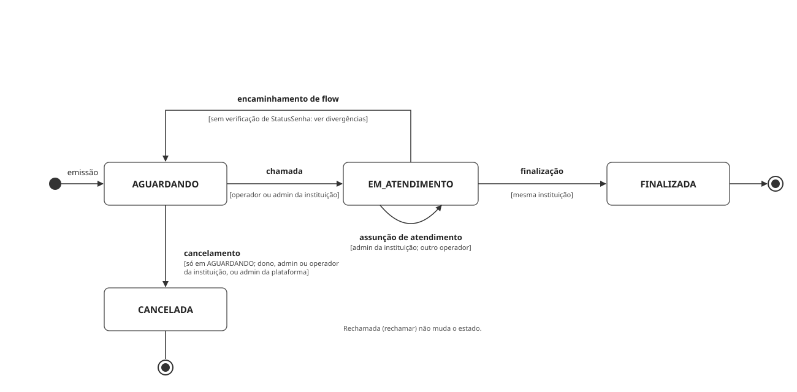
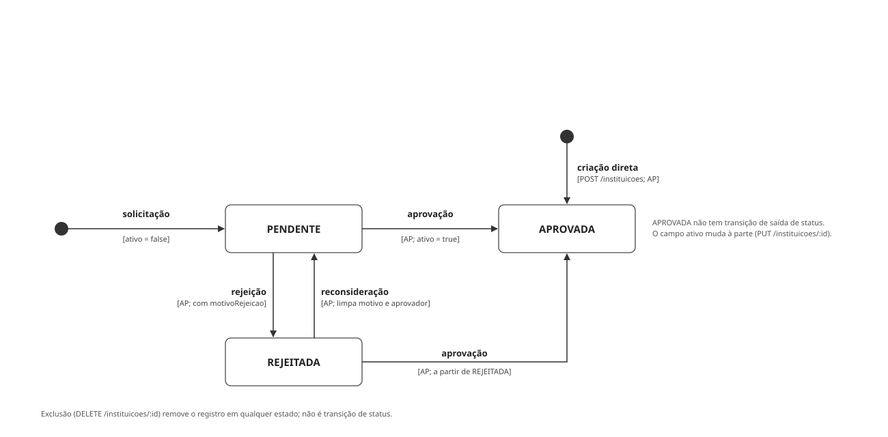
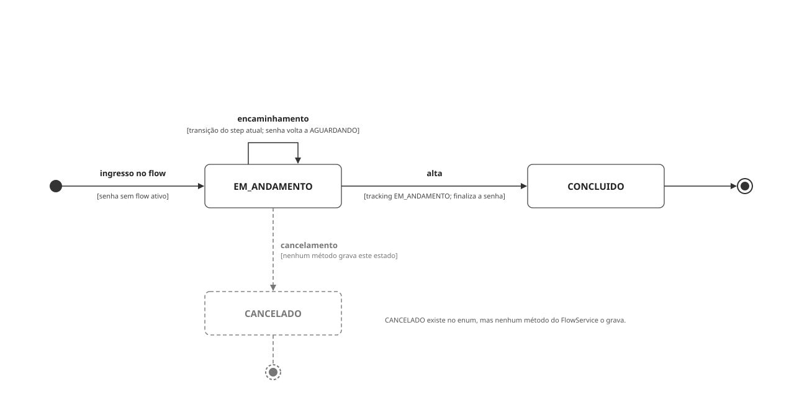

# Máquinas de estados

Milestone 2 · Modelagem comportamental (Fábrica de Software I)

Este diagrama mostra o ciclo de vida dos objetos de domínio que têm um campo `status` com enum fechado no banco. Os nomes dos estados são os valores reais do enum (`StatusSenha`, `StatusInstituicao`, `SenhaFlowStatus`). As transições são nomeadas pelo evento que as dispara; a guarda aparece entre colchetes e foi conferida nos services (`SenhaService`, `InstituicaoService`, `FlowService`). Filas, mesas e flows usam apenas um booleano `ativa`/`ativo`, sem máquina de estados própria, e ficam fora deste documento.

## Senha (StatusSenha)

| Origem | Evento | Guarda | Destino | Quem pode | Método |
|---|---|---|---|---|---|
| (inicial) | emissão online | fila ativa; sem outra senha ativa do cidadão na fila; QR válido se a fila for presencial | AGUARDANDO | USUARIO_FINAL | `SenhaService.criar` (`POST /filas/:filaId/senhas`) |
| (inicial) | emissão presencial | fila ativa da mesma instituição; prioridade habilitada na fila | AGUARDANDO | ADMIN_INSTITUICAO, OPERADOR | `SenhaService.criarPresencial` |
| AGUARDANDO | chamada | status AGUARDANDO; mesma instituição; operador sem outro atendimento; mesa livre, se informada | EM_ATENDIMENTO | ADMIN_INSTITUICAO, OPERADOR | `SenhaService.chamar` |
| AGUARDANDO | cancelamento | status AGUARDANDO; dono, admin ou operador da mesma instituição, ou ADMIN_PLATAFORMA | CANCELADA | Rota aberta a autenticados; permissão no service | `SenhaService.cancelar` |
| EM_ATENDIMENTO | finalização | status EM_ATENDIMENTO; mesma instituição | FINALIZADA | ADMIN_INSTITUICAO, OPERADOR | `SenhaService.finalizar` |
| EM_ATENDIMENTO | alta de flow | tracking EM_ANDAMENTO; senha EM_ATENDIMENTO (exigida por `finalizar`) | FINALIZADA | ADMIN_INSTITUICAO, OPERADOR | `FlowService.darAlta` |
| EM_ATENDIMENTO | encaminhamento de flow | tracking EM_ANDAMENTO; existe transição do step atual para o step pedido | AGUARDANDO | ADMIN_INSTITUICAO, OPERADOR | `FlowService.encaminhar` |
| EM_ATENDIMENTO | assunção de atendimento | status EM_ATENDIMENTO; mesma instituição; quem assume não é o operador atual e não tem outro atendimento | EM_ATENDIMENTO (troca `operadorId`) | ADMIN_INSTITUICAO | `SenhaService.assumirAtendimento` |

Notas:

- A rechamada (`rechamar`) não muda o estado. Só o operador responsável pode rechamar.
- Em `chamar`, se o cidadão já está em atendimento em outra fila da mesma instituição, a senha pedida vai para o fim da fila e o service tenta a próxima senha AGUARDANDO. Por isso a senha devolvida pode não ser a que foi pedida.
- O estado AGUARDANDO volta a valer também após o encaminhamento de flow, que recoloca a senha na fila do próximo step.

## Instituição (StatusInstituicao)

| Origem | Evento | Guarda | Destino | Quem pode | Método |
|---|---|---|---|---|---|
| (inicial) | solicitação | usuário autenticado; grava `ativo = false` e `solicitanteId` | PENDENTE | Qualquer usuário autenticado (rota sem papel) | `InstituicaoService.solicitar` |
| (inicial) | criação direta | dados válidos | APROVADA | ADMIN_PLATAFORMA | `InstituicaoService.criar` |
| PENDENTE | aprovação | status PENDENTE ou REJEITADA; grava `ativo = true`, `aprovadoPorId` e `aprovadoEm`; envia e-mail ao solicitante | APROVADA | ADMIN_PLATAFORMA | `InstituicaoService.aprovar` |
| PENDENTE | rejeição | status PENDENTE; `motivoRejeicao` informado; grava `ativo = false` | REJEITADA | ADMIN_PLATAFORMA | `InstituicaoService.rejeitar` |
| REJEITADA | reconsideração | status REJEITADA; zera `motivoRejeicao`, `aprovadoPorId` e `aprovadoEm` | PENDENTE | ADMIN_PLATAFORMA | `InstituicaoService.reconsiderar` |
| REJEITADA | aprovação | status PENDENTE ou REJEITADA (o código aceita a aprovação direta) | APROVADA | ADMIN_PLATAFORMA | `InstituicaoService.aprovar` |

Notas:

- APROVADA não tem transição de saída de status. O campo `ativo` é independente de `status`: pode ser alterado por `PUT /instituicoes/:id`, cujo schema não aceita `status`.
- Aprovar não concede o papel ADMIN_INSTITUICAO. O administrador da instituição é criado depois, em `POST /instituicoes/:instituicaoId/usuarios` (ADMIN_PLATAFORMA ou ADMIN_INSTITUICAO). Ver [Papéis e regras](../../../documentacao/03-papeis-e-regras.md).
- A exclusão (`DELETE /instituicoes/:id`) remove o registro em qualquer estado. Não é transição de status e não aparece no diagrama.

## Acompanhamento de flow (SenhaFlowStatus)

Este enum fica em `SenhaFlowTracking`, que existe no máximo uma vez por senha (`senhaId` único).

| Origem | Evento | Guarda | Destino | Quem pode | Método |
|---|---|---|---|---|---|
| (inicial) | ingresso no flow | senha sem tracking ativo; flow com ao menos um step | EM_ANDAMENTO | ADMIN_INSTITUICAO, OPERADOR | `FlowService.ingressar` |
| EM_ANDAMENTO | encaminhamento | existe transição do step atual para o step pedido; registra histórico; troca `stepAtualId` | EM_ANDAMENTO (a senha volta a AGUARDANDO) | ADMIN_INSTITUICAO, OPERADOR | `FlowService.encaminhar` |
| EM_ANDAMENTO | alta | tracking EM_ANDAMENTO; a senha é finalizada em seguida pelo `SenhaService` | CONCLUIDO | ADMIN_INSTITUICAO, OPERADOR | `FlowService.darAlta` |
| EM_ANDAMENTO | cancelamento | (sem método no código) | CANCELADO | Nenhum | Não implementado |

## Divergências

Diferenças entre o código e o que o modelo de estados sugere. A fonte da verdade é o código; estas linhas registram o comportamento atual.

1. `FlowService.encaminhar` não verifica `StatusSenha`. Uma senha CANCELADA ou FINALIZADA, com tracking ainda EM_ANDAMENTO, volta a AGUARDANDO. Não há transição de CANCELADA para AGUARDANDO no fluxo de senha.
2. `FlowService.ingressar` também não verifica `StatusSenha`. Uma senha FINALIZADA ou CANCELADA pode entrar em um flow.
3. `FlowService.darAlta` grava `CONCLUIDO` no tracking dentro de uma transação. Depois chama `SenhaService.finalizar`, que exige EM_ATENDIMENTO, fora dessa transação. Se a senha não estiver EM_ATENDIMENTO, o tracking fica CONCLUIDO e a senha não é finalizada. O erro 409 é devolvido, mas o tracking não é desfeito.
4. `SenhaFlowStatus.CANCELADO` existe no enum, e nenhum método do código o grava. O estado é inalcançável.
5. `SenhaService.finalizar` confere a instituição e o status, mas não confere se o operador é o responsável pela senha. Qualquer OPERADOR ou ADMIN_INSTITUICAO da instituição pode finalizar a senha de outro. Em contraste, `rechamar` exige o operador responsável.
6. `InstituicaoService.aprovar` aceita REJEITADA como origem. A aprovação não precisa passar por `reconsiderar`.
7. `POST /instituicoes/solicitar` (`solicitar`) não exige papel: qualquer usuário autenticado pode pedir o cadastro. O catálogo fala em ACT-01 (Cidadão), que é o papel USUARIO_FINAL. Ver a raia do solicitante em [Diagramas de atividades](../atividades/README.md).

## Veja também

- [Diagramas de atividades](../atividades/README.md): o fluxo que dispara estas transições.
- [Diagrama de classes](../classes/README.md): classes `Senha`, `Instituicao` e `SenhaFlowTracking` e seus atributos.
- [Casos de uso](../casos-de-uso/README.md): UC-03 a UC-11 e UC-15, que disparam as transições.
- [Diagramas de sequência](../sequencia/README.md): troca de mensagens em cada transição.
- [Modelagem](../README.md): visão geral da unidade.
