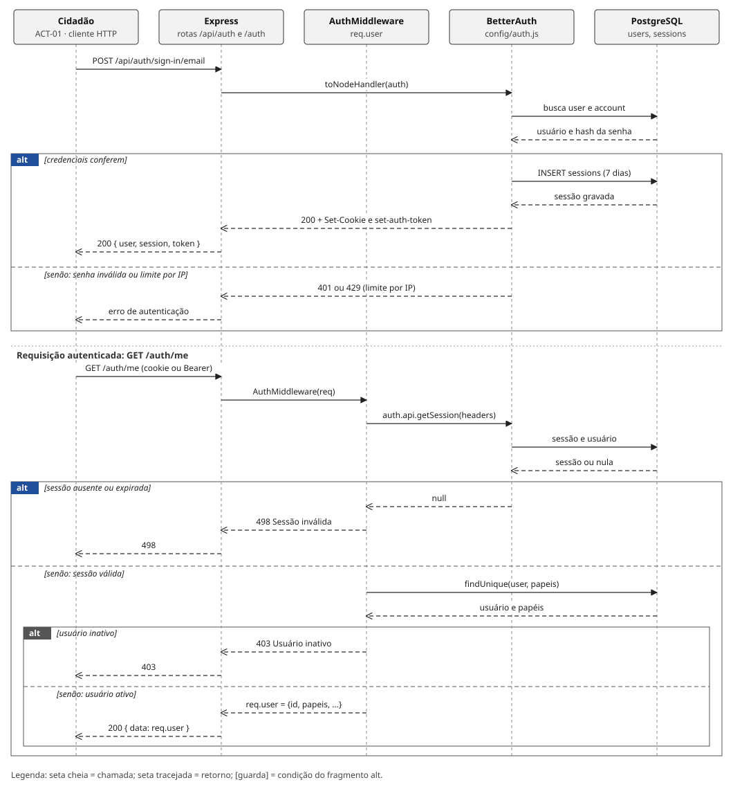
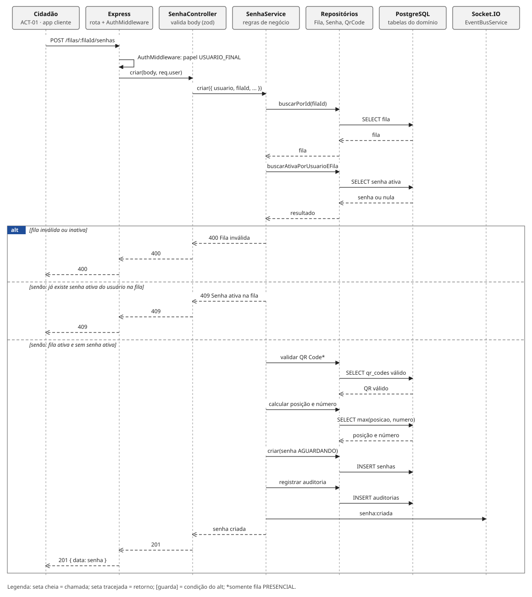
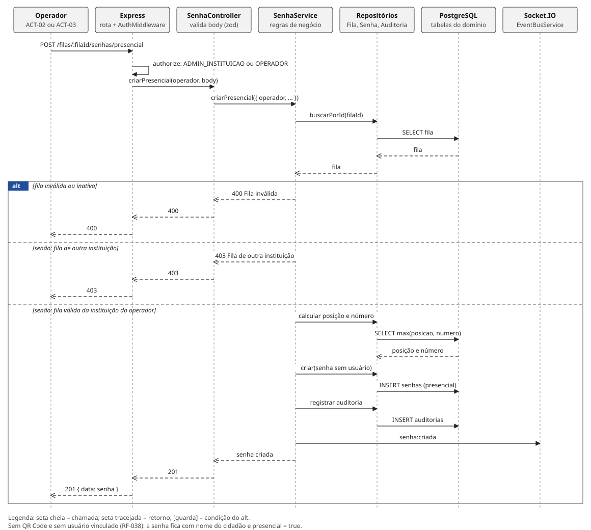
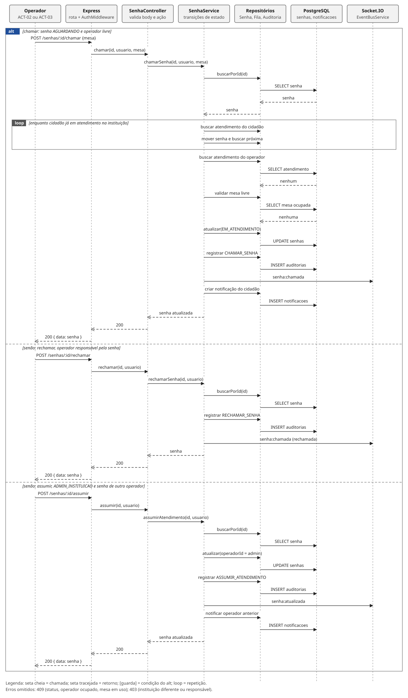
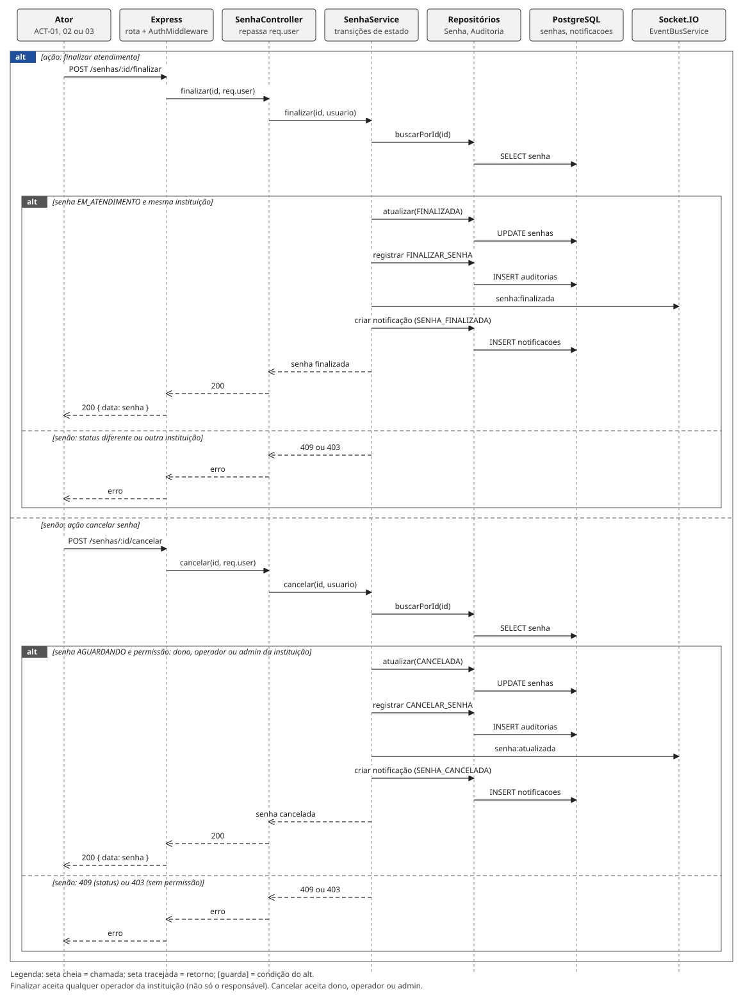
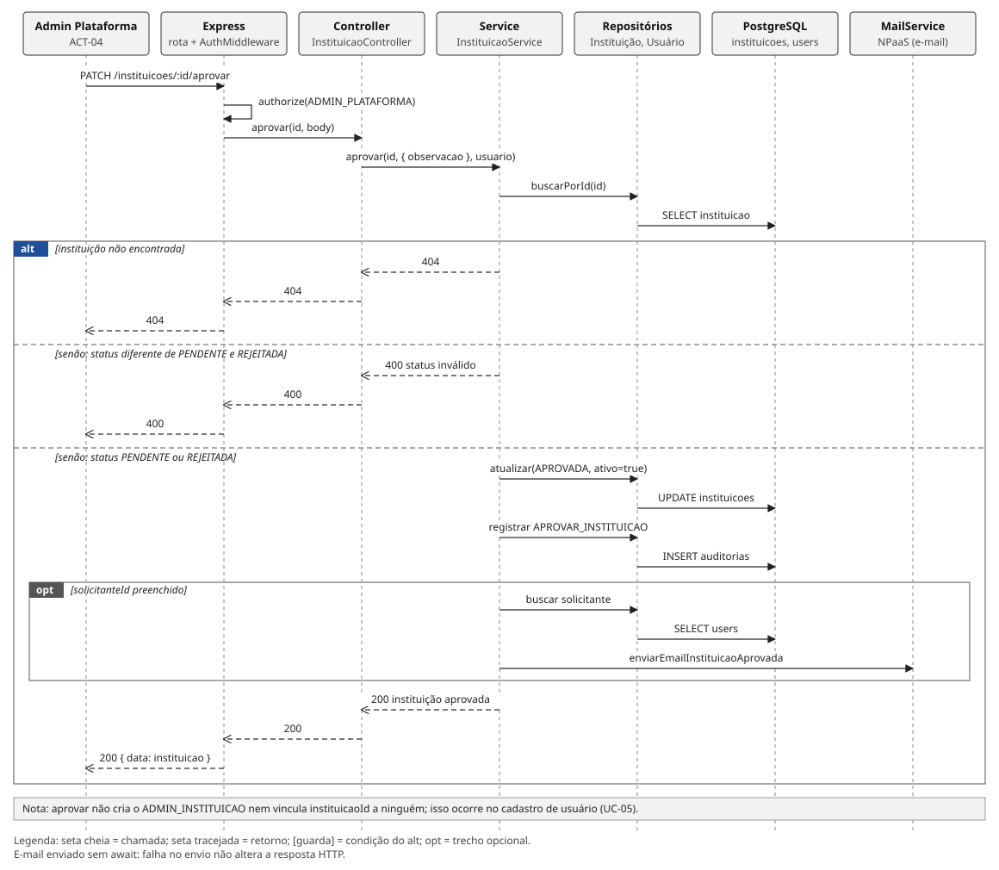

# Diagramas de sequência

Milestone 2 · Modelagem UML (Engenharia de Software, Fábrica de Software I)

Seis diagramas de sequência cobrem os cenários principais do FilaCidadã. Cada um segue o caminho real do código: rota Express, middleware, controller, service, repositório Prisma e PostgreSQL, com os eventos Socket.IO e as notificações quando existem.

## Cenários e diagramas

| Cenário | UC | RF | US | Diagrama |
|---|---|---|---|---|
| Autenticação com BetterAuth (sign-in e verificação de sessão) | UC-01 | RF-002, RF-003 | a definir | [seq-login.svg](seq-login.svg) |
| Emitir senha online | UC-08 | RF-034, RF-037 | a definir | [seq-emitir-senha-online.svg](seq-emitir-senha-online.svg) |
| Emitir senha presencial | UC-09 | RF-038 | a definir | [seq-emitir-senha-presencial.svg](seq-emitir-senha-presencial.svg) |
| Chamar, rechamar e assumir senha | UC-10 | RF-039, RF-040, RF-041 | a definir | [seq-chamar-senha.svg](seq-chamar-senha.svg) |
| Finalizar ou cancelar atendimento | UC-11 | RF-045, RF-046 | a definir | [seq-finalizar-cancelar.svg](seq-finalizar-cancelar.svg) |
| Aprovar solicitação de instituição | UC-04 | RF-012 | a definir | [seq-aprovar-instituicao.svg](seq-aprovar-instituicao.svg) |

A coluna US fica "a definir" porque `docs/03-requisitos/historias-de-usuario.md` ainda não foi publicado. Quando a lista de histórias existir, cada linha recebe os IDs `US-xxx` dos UC correspondentes.

## Convenções de leitura

- **Participantes**: são camadas reais do código, não atores abstratos. O ator aparece à esquerda com o papel do catálogo (ACT-01 a ACT-04).
- **Rotas**: as rotas de domínio são montadas sem prefixo `/api` (`app.use(perfil, usuarios, instituicoes, filas, senhas, ...)` em `src/routes/index.js`). Somente `/api/auth/*` pertence ao BetterAuth.
- **Autorização**: aparece como autochamada no Express (`AuthMiddleware` e `authorize(...)`), porque é uma etapa do mesmo ponto de entrada.
- **Setas**: seta cheia é chamada síncrona; seta tracejada é retorno. A resposta de erro percorre a cadeia de volta até o ator, com o código HTTP do erro.
- **Fragmentos**: `alt` tem uma guarda por ramo, em colchetes, e o ramo final é `senão`. `opt` é trecho opcional. `loop` repete enquanto a guarda vale.
- **Erros**: sessão ausente responde 498 (`AuthenticationError`, RF-003). Credencial inválida responde 401 (BetterAuth).

## Diagramas

### Autenticação com BetterAuth (UC-01)

Login em `POST /api/auth/sign-in/email` cria uma linha em `sessions` (validade de 7 dias) e devolve cookie e `set-auth-token`. A rota protegida `GET /auth/me` valida a sessão no `AuthMiddleware` e carrega papéis e instituição do banco. Usuário inativo recebe 403 mesmo com sessão válida.

### Emitir senha online (UC-08)

`POST /filas/:filaId/senhas` bloqueia fila inválida ou inativa (400) e usuário com senha ativa na fila (409). QR Code é validado só para fila `PRESENCIAL`. Ao criar, o service calcula posição e número, grava a senha e a auditoria, e emite `senha:criada`.

### Emitir senha presencial (UC-09)

`POST /filas/:filaId/senhas/presencial` é usado pelo operador ou administrador da instituição para cidadão sem celular. A senha é gravada sem `usuarioId`, com `nomeCidadao` e `presencial = true`. A fila precisa ser da instituição do operador (403).

### Chamar, rechamar e assumir senha (UC-10)

Três ações partem do operador:

- **Chamar** (`POST /senhas/:id/chamar`): só senha `AGUARDANDO`. O `loop` pula senhas cujo cidadão já está em atendimento na instituição. O operador não pode ter outra senha em atendimento, e a mesa não pode estar em uso (409).
- **Rechamar** (`POST /senhas/:id/rechamar`): só o operador responsável. Reemite `senha:chamada` com `rechamada: true` e não grava nova notificação.
- **Assumir** (`POST /senhas/:id/assumir`): só `ADMIN_INSTITUICAO`, sobre senha `EM_ATENDIMENTO` de outro operador. Notifica o operador anterior com `SENHA_TRANSFERIDA`.

### Finalizar ou cancelar atendimento (UC-11)

- **Finalizar** (`POST /senhas/:id/finalizar`): senha `EM_ATENDIMENTO` da mesma instituição vira `FINALIZADA`, com auditoria `FINALIZAR_SENHA`, evento `senha:finalizada` e notificação ao cidadão.
- **Cancelar** (`POST /senhas/:id/cancelar`): senha `AGUARDANDO` vira `CANCELADA`. A permissão é checada no service: dono, operador ou administrador da instituição, ou administrador da plataforma.

### Aprovar solicitação de instituição (UC-04)

`PATCH /instituicoes/:id/aprovar` é restrito a `ADMIN_PLATAFORMA`. Aceita instituição `PENDENTE` ou `REJEITADA` (outros status: 400) e grava `aprovadoPorId`, `aprovadoEm` e `ativo = true`. O e-mail ao solicitante é enviado sem `await`: falha de envio não altera a resposta.

## Eventos e notificações

Eventos Socket.IO emitidos pelo `EventBusService`, para as salas `fila:<id>`, `instituicao:<id>` e `user:<id>`:

| Evento | Origem | Salas |
|---|---|---|
| `senha:criada` | emissão online e presencial | fila, instituição, usuário (quando houver) |
| `senha:chamada` | chamar e rechamar (`rechamada: true`) | fila, instituição, usuário |
| `senha:atualizada` | cancelar e assumir | fila, instituição, usuário |
| `senha:finalizada` | finalizar | fila, instituição, usuário |

Notificações persistidas em `notificacoes`, com push via NPaaS: `SENHA_CHAMADA`, `SENHA_FINALIZADA`, `SENHA_CANCELADA` e `SENHA_TRANSFERIDA`.

## Divergências

Diferenças entre o código e os requisitos em `docs/03-requisitos/requisitos-funcionais.md`. Os diagramas seguem o código.

1. **Notificações de emissão e fila (RF-034, RF-039).** O RF promete `SENHA_NOVA_NA_FILA` aos operadores na criação e `SENHA_PROXIMA` ao próximo da fila na chamada. O código não envia nenhum dos dois: os tipos existem em `src/constants/notificacao.js`, mas `SENHA_PROXIMA` só aparece no seed.
2. **Quem cancela (RF-046).** O RF diz "administrador cancela". O código também aceita o dono da senha (`isDono`) e qualquer `OPERADOR` da instituição, porque `PAPEIS_ADMIN_INSTITUICAO` inclui `OPERADOR`.
3. **Notificação de aprovação (RF-012).** O RF diz que notifica o solicitante com `INSTITUICAO_APROVADA`. O código só envia e-mail pelo `MailService` (template `instituicao-aprovada`) e não grava linha em `notificacoes`.
4. **Último login (`ultimoLoginEm`).** O campo existe em `src/config/auth.js` e `UsuarioRepository.registrarLogin()` o grava, mas nenhum código chama esse método. O login pelo BetterAuth não atualiza `ultimoLoginEm`.
5. **Finalizar sem responsável.** O código deixa qualquer operador ou administrador da instituição finalizar qualquer senha `EM_ATENDIMENTO`, sem checar o `operadorId`. O RF-045 não fala disso. Rechamar, ao contrário, exige o operador responsável (RF-040), e o código cumpre.
6. **Código morto na sessão.** `src/services/SessionService.js` ainda é instanciado no boot, mas seus métodos quebram se chamados (usam `removeToken` e campo `refreshtoken` inexistentes). A sessão é do BetterAuth. O diagrama de login não o usa.

## Veja também

- [Casos de uso](../casos-de-uso/README.md)
- [Classes](../classes/README.md)
- [Atividades](../atividades/README.md)
- [Estados](../estados/README.md)
- [Requisitos funcionais](../../03-requisitos/requisitos-funcionais.md)
- [Modelagem](../README.md)
