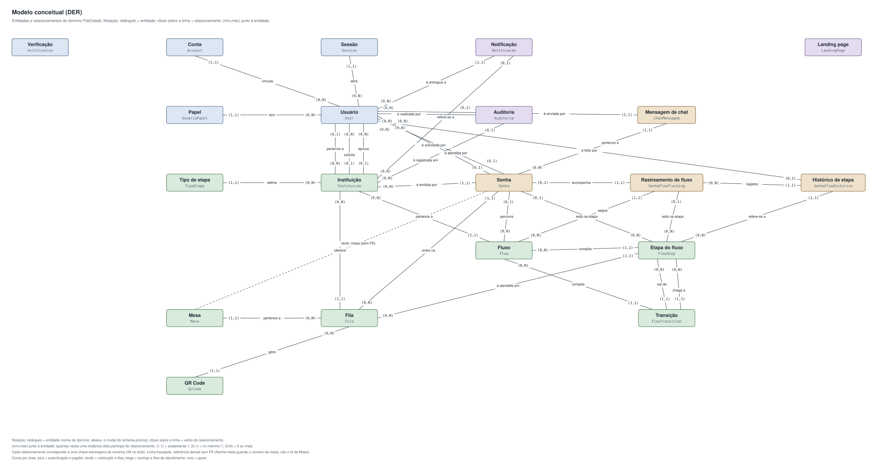
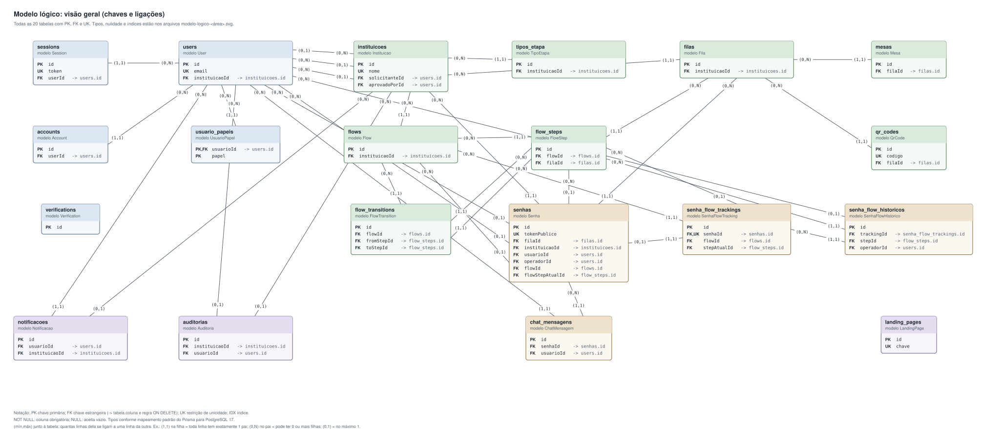

# Banco de dados

Contexto: Fábrica de Software I · projeto FilaCidadã · modelagem relacional (SGBD PostgreSQL 17 com Prisma 6).

O banco é descrito em três artefatos. O `prisma/schema.prisma` é a fonte de verdade; estes documentos o descrevem e são conferidos contra ele e contra a migração `prisma/migrations/20260805220051_init_uuid`.

| Artefato | Conteúdo |
|---|---|
| [modelo-conceitual.svg](modelo-conceitual.svg) | Entidades do domínio e seus relacionamentos, sem tipos de coluna. |
| [modelo-logico.svg](modelo-logico.svg) | Tabelas, chaves primárias, chaves estrangeiras e regras de exclusão. |
| [dicionario-de-dados.md](dicionario-de-dados.md) | Todas as tabelas e colunas, com tipo, nulidade, default, chaves e origem no modelo de classes. |
| [schema.sql](schema.sql) | DDL PostgreSQL equivalente à migração mais recente, com comentários. |

## SGBD e ferramentas

| Item | Escolha | Observação |
|---|---|---|
| SGBD | PostgreSQL 17 | Enums nativos, JSONB, chaves estrangeiras com regras de exclusão e índices compostos. A aplicação original usava MongoDB. |
| ORM e migrações | Prisma 6 (`@prisma/client`) | Gera o cliente tipado a partir de `schema.prisma`. As migrações ficam versionadas em `prisma/migrations/`. |
| Migração atual | `20260805220051_init_uuid` | Migração única, que cria as 20 tabelas, os 9 tipos enumerados, os índices e as 34 chaves estrangeiras. |
| Provedor | `provider = "postgresql"` | Declarado em `prisma/schema.prisma` e em `prisma/migrations/migration_lock.toml`. |

## Decisões de mapeamento (domínio para relacional)

| Decisão | Escolha | Motivo |
|---|---|---|
| Chave primária | `UUID` (`String @id @default(uuid()) @db.Uuid`) | Identificador opaco, como o `ObjectId` do Mongo, sem expor contagem. Os contratos de API continuam recebendo `id` como string. O valor é gerado pelo Prisma no cliente, por isso o banco não tem `DEFAULT` para o UUID. |
| Nomes | Tabelas em `snake_case` plural (`@@map`); colunas em `camelCase` | Padroniza o SQL e mantém os nomes do modelo Prisma. |
| Papéis do usuário | Tabela `usuario_papeis` (chave composta `usuarioId, papel`) | Antes era um array de texto no usuário. A tabela permite índice por papel e integridade. |
| Mesas da fila | Tabela `mesas` | Têm identidade própria (número, nome, ativa). A senha guarda a identificação da mesa em texto (`senhas.mesa`), sem FK. |
| Tipos de etapa | Tabela `tipos_etapa` | Cadastro por instituição, com código único por instituição. |
| Configuração de QR Code | Cinco colunas em `filas` | Era um subdocumento 1:1 sem identidade. Uma tabela só acrescentaria um join. |
| Histórico do acompanhamento de flow | Tabela `senha_flow_historicos` | Postgres não tem array de subdocumento. O registro é append-only. |
| Credenciais e sessões | Tabelas `accounts`, `sessions` e `verifications` | Responsabilidade do BetterAuth. Os nomes e campos seguem o contrato do BetterAuth e não devem ser renomeados sem ajustar o adaptador em `src/config/auth.js`. |
| Campos do domínio no usuário | Colunas em `users` (`pais`, `ativo`, `fusoHorario`, `ultimoLoginEm`, `instituicaoId`) | São `additionalFields` do BetterAuth. |
| Configurações livres | JSON (`instituicoes.configuracoes`, `landing_pages.conteudo`, `notificacoes.dados`, `auditorias.dados`) | Regra: normaliza-se o que se consulta; fica em JSON o que é lido inteiro. A landing page tem mais de 40 campos aninhados lidos por um único `GET`. |
| Enums | Tipos do banco (`CREATE TYPE ... AS ENUM`) | O SGBD recusa valor fora da lista, em vez de depender só da validação na aplicação. |
| Vocabulário de etapas de flow | `flow_steps.tipo` como texto livre (`VARCHAR(64)`) | O vocabulário cresce por instituição; não cabe em enum fechado. |
| Referências sem FK | Snapshots e registros históricos: `senha_flow_historicos.stepNome` e `filaId`, `chat_mensagens.nome`, `senhas.mesaNome`, `auditorias.entidadeId` | Preservam o registro quando o original é renomeado ou excluído. |
| Precisão de tempo | `TIMESTAMP(3)` | Milissegundos, como o `Date` do JavaScript. |

## Enums

| Enum | Valores |
|---|---|
| `Papel` | `ADMIN_PLATAFORMA`, `ADMIN_INSTITUICAO`, `OPERADOR`, `USUARIO_FINAL` |
| `StatusInstituicao` | `PENDENTE`, `APROVADA`, `REJEITADA` |
| `TipoAtendimento` | `ONLINE`, `PRESENCIAL`, `HIBRIDO` |
| `ModoQrCode` | `ROTATIVO`, `FIXO` |
| `StatusSenha` | `AGUARDANDO`, `EM_ATENDIMENTO`, `CANCELADA`, `FINALIZADA` |
| `PrioridadeSenha` | `LEGAL`, `FIDELIDADE`, `NORMAL` |
| `NotificacaoTipo` | 16 valores, listados no [dicionário](dicionario-de-dados.md#enums) |
| `FlowTransicaoTipo` | `SEQUENCIAL`, `CONDICIONAL`, `ALTA` |
| `SenhaFlowStatus` | `EM_ANDAMENTO`, `CONCLUIDO`, `CANCELADO` |

Os enums de `Papel` espelham `src/constants/roles.js`. Os enums do schema GraphQL devem acompanhar os do banco.

## Modelos (tabelas)

Vinte tabelas, agrupadas por função. A coluna "Classe" indica a classe de domínio correspondente.

| Grupo | Tabela | Classe | O que guarda |
|---|---|---|---|
| Autenticação (BetterAuth) | [users](dicionario-de-dados.md#users) | Usuario | Usuário, com campos do domínio. |
| | [sessions](dicionario-de-dados.md#sessions) | Sessão (BetterAuth) | Sessões de login. |
| | [accounts](dicionario-de-dados.md#accounts) | Conta (BetterAuth) | Contas de login por provedor (`credential`, OAuth). |
| | [verifications](dicionario-de-dados.md#verifications) | Verificação (BetterAuth) | Tokens temporários. |
| Autorização | [usuario_papeis](dicionario-de-dados.md#usuario_papeis) | Papel | Associação entre usuário e papel. |
| Domínio | [instituicoes](dicionario-de-dados.md#instituicoes) | Instituicao | Instituição, com o fluxo de solicitação e aprovação. |
| | [tipos_etapa](dicionario-de-dados.md#tipos_etapa) | TipoEtapa | Tipos de etapa cadastrados pela instituição. |
| | [filas](dicionario-de-dados.md#filas) | Fila | Fila de atendimento e configuração do QR Code. |
| | [mesas](dicionario-de-dados.md#mesas) | Mesa | Mesas de atendimento de uma fila. |
| | [senhas](dicionario-de-dados.md#senhas) | Senha | Senhas emitidas, com status, prioridade e posição. |
| | [qr_codes](dicionario-de-dados.md#qr_codes) | QrCode | QR Codes de uma fila, com validade e tolerância. |
| Flow de atendimento | [flows](dicionario-de-dados.md#flows) | Flow | Fluxo de atendimento da instituição. |
| | [flow_steps](dicionario-de-dados.md#flow_steps) | FlowStep | Etapas do flow, ligadas a uma fila. |
| | [flow_transitions](dicionario-de-dados.md#flow_transitions) | FlowTransition | Transições entre etapas. |
| | [senha_flow_trackings](dicionario-de-dados.md#senha_flow_trackings) | SenhaFlowTracking | Acompanhamento de uma senha no flow. |
| | [senha_flow_historicos](dicionario-de-dados.md#senha_flow_historicos) | SenhaFlowHistorico | Histórico de etapas percorridas pela senha. |
| Comunicação | [notificacoes](dicionario-de-dados.md#notificacoes) | Notificacao | Notificações persistidas do usuário. |
| | [chat_mensagens](dicionario-de-dados.md#chat_mensagens) | ChatMensagem | Mensagens do chat durante o atendimento. |
| Apoio | [auditorias](dicionario-de-dados.md#auditorias) | Auditoria | Trilha de auditoria, append-only. |
| | [landing_pages](dicionario-de-dados.md#landing_pages) | LandingPage | Conteúdo da landing page, em JSON. |

## Política de exclusão

| Regra (`ON DELETE`) | Onde se aplica | Efeito |
|---|---|---|
| `CASCADE` | Sessões, contas e papéis do usuário; tipos de etapa, filas, senhas, flows e notificações da instituição; mesas, senhas e QR Codes da fila; steps, transições e acompanhamentos do flow; histórico do acompanhamento; mensagens do chat da senha | O filho não existe sem o pai. |
| `SET NULL` | `users.instituicaoId`; `senhas.usuarioId`, `senhas.operadorId`, `senhas.flowId`, `senhas.flowStepAtualId`; `instituicoes.solicitanteId` e `aprovadoPorId`; `auditorias.instituicaoId` e `usuarioId`; `notificacoes.instituicaoId`; `senha_flow_trackings.stepAtualId`; `senha_flow_historicos.operadorId` | O registro fica e perde a referência. |
| `RESTRICT` | `flow_steps.filaId`; `senha_flow_historicos.stepId` | Não se apaga fila usada por um step, nem step por onde uma senha já passou. O caminho é desativar. |

> [!WARNING]
> Apagar uma fila apaga as senhas dela, inclusive as finalizadas. Apagar uma instituição com flow configurado tende a falhar pela restrição `RESTRICT` (step ligado a uma fila, ou step com histórico de senha): desfaça o flow antes.

## Exclusão lógica e registros que não são apagados

- Não há coluna `deletedAt` nem soft delete genérico. A desativação usa a coluna `ativo` (ou `ativa`, em `filas` e `mesas`) em `users`, `instituicoes`, `tipos_etapa`, `filas`, `mesas`, `qr_codes`, `flows` e `flow_steps`.
- O cancelamento de senha é o status `CANCELADA`, não uma exclusão.
- Um step de flow já usado é desativado (`ativo = false`), não apagado, por causa da restrição `RESTRICT` em `senha_flow_historicos.stepId`.
- As notificações "nunca são excluídas", e a trilha de `auditorias` é append-only. Essas duas regras são de aplicação: o banco não impede um `DELETE` nessas tabelas.

## Auditoria

A tabela `auditorias` registra ação (`acao`), entidade (`entidade`, `entidadeId`), detalhes (`dados`, JSON), instituição e usuário. Tem só `createdAt`. A coluna `entidadeId` não tem FK, porque o registro auditado pode deixar de existir. As FKs para instituição e usuário são `SET NULL`, para que a trilha sobreviva à exclusão de quem a originou.

## Índices que sustentam as consultas

| Tabela | Índice | Consulta que atende |
|---|---|---|
| `senhas` | `(filaId, status, prioridadePeso, posicao)` | Próxima senha da fila, já na ordem de chamada. |
| `senhas` | `(usuarioId, filaId, status)` | O cidadão já tem senha ativa nesta fila? |
| `senhas` | `(instituicaoId, numero)`, `(operadorId)`, `(flowId)` | Busca por número; senhas de um operador; senhas de um flow. |
| `senhas` | `UK (tokenPublico)` | Acompanhamento público da senha. |
| `filas` | `(instituicaoId)`, `(instituicaoId, ativa)` | Filas ativas da instituição. |
| `qr_codes` | `(filaId, ativo)`, `(validoAte)` | QR Code válido da fila. |
| `notificacoes` | `(usuarioId, lida)`, `(usuarioId, createdAt DESC)` | Não lidas e linha do tempo. |
| `auditorias` | `(instituicaoId, createdAt)`, `(entidade, entidadeId)` | Linha do tempo da instituição; histórico de um registro. |
| `sessions` | `(userId)`, `(expiresAt)` | Sessões de um usuário; limpeza de sessões expiradas. |
| `chat_mensagens` | `(senhaId, createdAt)` | Mensagens de um atendimento, em ordem. |

A ordem das colunas importa: o PostgreSQL usa o índice a partir do prefixo mais à esquerda. Todos os índices e chaves únicos estão no [dicionário](dicionario-de-dados.md) e no [schema.sql](schema.sql).

## Divergências

Divergências encontradas entre a documentação existente e o código. Quando houve conflito, este documento segue o código.

1. `README.md` da raiz diz "13 tabelas, 6 enums e 16 chaves estrangeiras", e o texto "schema.prisma 13 models, 6 enums". O schema tem 20 modelos (20 tabelas), 9 enums e 34 chaves estrangeiras. A tabela de grupos do README também omite o flow, o chat e as notificações.
2. `README.md` da raiz diz que os identificadores são `cuid()`. O schema usa `uuid()` com `@db.Uuid`.
3. `documentacao/05-dados.md` diz que "toda tabela de domínio tem `createdAt` e `updatedAt`". Não têm os dois campos: `mesas`, `tipos_etapa`, `flow_steps`, `flow_transitions` e `senha_flow_historicos` (que tem `entradaEm`). `auditorias` e `chat_mensagens` têm só `createdAt`, como já dito no próprio documento.
4. `documentacao/05-dados.md` lista as notificações da instituição entre os `CASCADE`. No schema, `Notificacao.instituicao` é `onDelete: SetNull` (migração: `notificacoes_instituicaoId_fkey`).

## Veja também

- [Dicionário de dados](dicionario-de-dados.md) e [schema.sql](schema.sql)
- [Modelo de classes](../05-modelagem/classes/README.md), que usa os nomes de classe desta lista
- [Casos de uso](../05-modelagem/casos-de-uso/README.md) e [requisitos funcionais](../03-requisitos/requisitos-funcionais.md)
- [Decisões de arquitetura (ADR)](../adr/README.md)
- [Rastreabilidade](../07-rastreabilidade/matriz.md)
